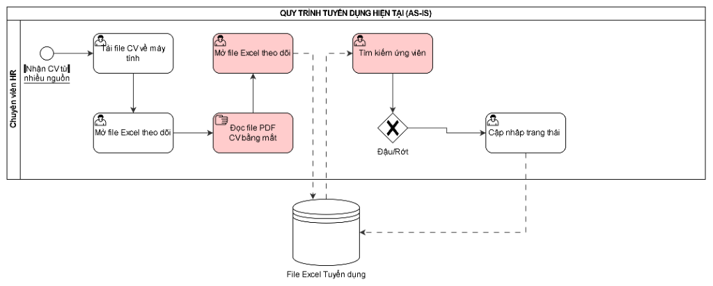
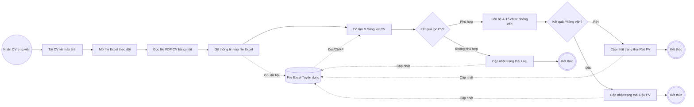
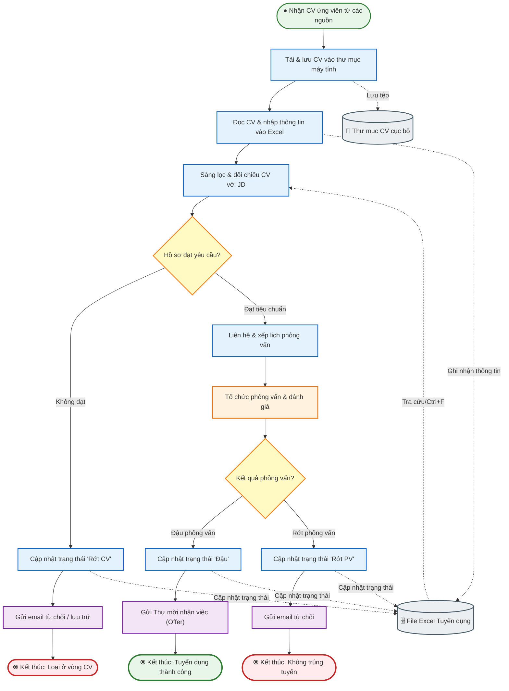
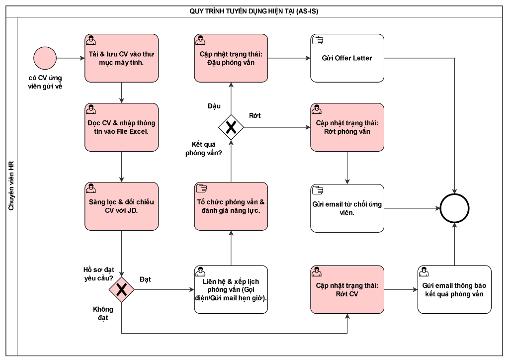
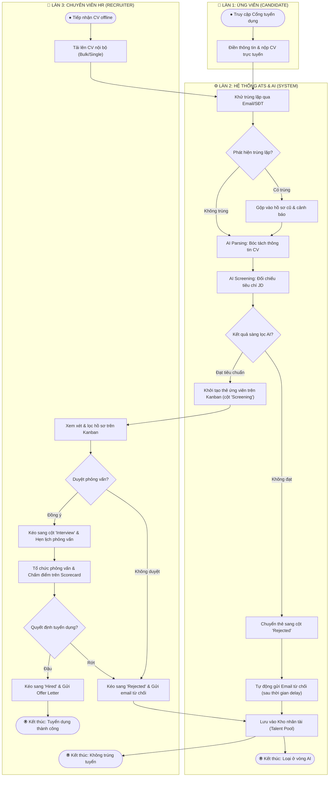
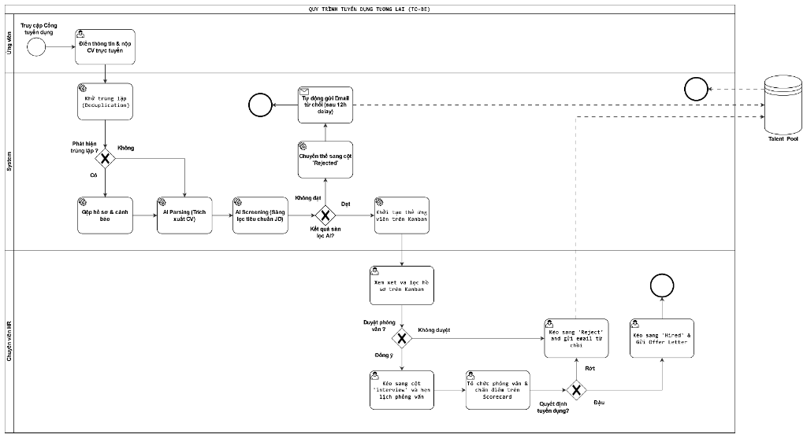

# QUY TR?NH NGHI?P V? AS-IS & TO-BE (BPMN 2.0)

> **D? ?n:** ReCoverX Career - ATS
> **T?i li?u t?ng h?p c?c phi?n b?n s? ?? BPMN 2.0, ??nh gi? chu?n ho? v? di?n gi?i nghi?p v?.**

---

## 1. QUY TR?NH AS-IS (HI?N TR?NG CH?A C? ATS)

### S? ?? ban ??u v? nh?n x?t BPMN 2.0



#### ??nh gi? chu?n BPMN 2.0:

Chào bạn, qua đối chiếu hình ảnh sơ đồ bạn vẽ với **chuẩn BPMN 2.0** và **nghiệp vụ thực tế của quy trình tuyển dụng (cũng như nội dung tài liệu BRD bạn đính kèm)**, mình đưa ra nhận xét chi tiết như sau:

---

### TỔNG QUAN ĐÁNH GIÁ
* **Điểm tốt:** 
  * Bạn đã làm nổi bật được các điểm nghẽn (Pain-points) thủ công bằng màu đỏ cam (đọc PDF bằng mắt, dò Excel, mở file thủ công).
  * Đã biết dùng Pool/Lane ("Chuyên viên HR"), phân biệt User Task (icon người), Manual Task (icon bàn tay), và biểu tượng Data Store (hình trụ "File Excel Tuyển dụng").
* **Điểm chưa đạt:**
  1. **Chưa đúng chuẩn cú pháp BPMN 2.0** (vướng nhiều lỗi cơ bản: thiếu End Event, lỗi đứt gãy luồng, lỗi Gateway).
  2. **Chưa đúng logic nghiệp vụ thực tế** (bị "đốt cháy giai đoạn": từ tìm kiếm nhảy thẳng sang Đậu/Rớt mà không có bước Sàng lọc hay Phỏng vấn).

---

### PHẦN 1: CÁC LỖI SAI CHUẨN CÚ PHÁP BPMN 2.0

#### 1. Lỗi đứt gãy luồng điều khiển (Sequence Flow) *(Lỗi nghiêm trọng)*
* **Hiện trạng trên hình:** Giữa task `Mở file Excel theo dõi` (phía trên) và `Tìm kiếm ứng viên`, bạn **không có mũi tên nét liền (Sequence Flow)** nào nối chúng với nhau, mà lại dùng 2 mũi tên nét đứt qua Data Store `File Excel Tuyển dụng`.
* **Quy tắc BPMN 2.0:** Mũi tên nét đứt là **Data Association** (luồng liên kết dữ liệu), **hoàn toàn không có khả năng kích hoạt task tiếp theo**. Nếu chạy mô phỏng (token simulation), quy trình của bạn sẽ bị "chết đứng" ở task thứ 4 và task `Tìm kiếm ứng viên` sẽ không bao giờ được kích hoạt.
* **Cách sửa:** Bắt buộc phải có **Sequence Flow (mũi tên nét liền)** đi từ task trước sang task sau.

#### 2. Lỗi cấu trúc Exclusive Gateway (Cổng rẽ nhánh "X") *(Lỗi nghiêm trọng)*
* **Hiện trạng trên hình:** Cổng rẽ nhánh `Đậu/Rớt` của bạn chỉ có **1 luồng vào** và **đúng 1 luồng ra** đi tới `Cập nhập trạng thái`.
* **Quy tắc BPMN 2.0:** 
  * Gateway sinh ra là để **rẽ nhánh** (phân nhánh điều kiện: nếu A thì đi hướng này, nếu B thì đi hướng kia) hoặc gộp nhánh. Một Gateway không thể chỉ có 1 đường ra duy nhất.
  * Bản thân Gateway không phải là hành động kiểm tra, mà việc đánh giá phải diễn ra ở **Task trước đó**. Gateway chỉ đọc kết quả để rẽ nhánh.
* **Cách sửa:** Nếu có nhánh `Đậu` và `Rớt`, bạn phải vẽ 2 mũi tên đi ra:
  * Nhánh `[Đậu]`: Tiếp tục quy trình (Mời phỏng vấn / Gửi Offer / Cập nhật trạng thái Trúng tuyển).
  * Nhánh `[Rớt]`: Gửi thư từ chối / Cập nhật trạng thái Loại.

#### 3. Thiếu End Event (Sự kiện kết thúc)
* **Hiện trạng trên hình:** Sau task `Cập nhập trạng thái`, luồng kết thúc lơ lửng, không có điểm dừng.
* **Quy tắc BPMN 2.0:** Mọi luồng quy trình hợp lệ đều phải kết thúc bằng **End Event** (vòng tròn nét viền đậm).

#### 4. Lỗi trùng lặp tên Task và lỗi chính tả
* Bạn có 2 task tên giống hệt nhau: **`Mở file Excel theo dõi`** (ở hàng dưới và hàng trên).
  * Theo BRD của bạn, task ở hàng trên thực chất là: **`Nhập liệu thông tin ứng viên vào Excel`** (Copy/Paste Họ tên, SĐT, Kỹ năng). Bạn copy-paste shape nhưng quên đổi tên.
* Lỗi chính tả tiếng Việt: `Cập nhập trạng thái` ➔ Chuẩn là **`Cập nhật trạng thái`**.

---

### PHẦN 2: TÍNH THỰC TẾ CỦA QUY TRÌNH TUYỂN DỤNG

So với thực tế cách một công ty tuyển dụng và ngay trong mục **IV.1 của BRD** bạn viết:

```text
1. Ứng viên nộp CV qua Email/TopCV.
2. HR tải CV về máy tính.
3. HR mở file Excel theo dõi tuyển dụng.
4. HR mở PDF CV -> Đọc bằng mắt -> Copy/Gõ lại Họ tên, kỹ năng vào Excel.
5. HR cần tìm người có kinh nghiệm -> Dùng Ctrl+F dò trên Excel hoặc đọc lại từng file PDF.
6. Ứng viên qua vòng phỏng vấn -> HR tìm đến dòng của ứng viên trên Excel và gõ cập nhật trạng thái "Đậu/Rớt".
```

Sơ đồ hiện tại của bạn đang bị các lỗi logic nghiệp vụ sau:

1. **"Đốt cháy giai đoạn" – Chưa phỏng vấn đã có kết quả Đậu/Rớt:**
   * Trên sơ đồ: Đang ở bước `Tìm kiếm ứng viên` ➔ Rẽ nhánh `Đậu/Rớt` ➔ `Cập nhật trạng thái`.
   * **Thực tế:** Sau khi tìm kiếm/sàng lọc hồ sơ, HR phải:
     * *Vòng 1 (Sàng lọc hồ sơ):* Đạt CV thì mới liên hệ hẹn phỏng vấn; không đạt thì loại ngay vòng hồ sơ.
     * *Vòng 2 (Phỏng vấn):* Phải diễn ra buổi phỏng vấn (HR/Hiring Manager phỏng vấn) thì mới có kết quả `Đậu` hay `Rớt`. Sơ đồ của bạn bỏ qua hoàn toàn bước tương tác/phỏng vấn này.
2. **Thiếu tương tác với Ứng viên (Gửi thông báo/Mail):**
   * Dù là quy trình thủ công As-Is, HR vẫn phải gửi Email mời phỏng vấn hoặc gửi thông báo trúng tuyển/từ chối cho ứng viên, chứ không chỉ âm thầm gõ vào file Excel rồi xong.
3. **Nhầm lẫn giữa 2 thời điểm (Use Cases):**
   * *Thời điểm 1:* Tiếp nhận hồ sơ mới & nhập liệu vào file theo dõi.
   * *Thời điểm 2:* Khi cần lọc ứng viên để phỏng vấn & chấm điểm.
   * Nếu gom chung vào một luồng tuần tự từ đầu đến cuối cho 1 ứng viên, nó phải diễn ra liền mạch: *Tiếp nhận ➔ Nhập thông tin ➔ Đánh giá hồ sơ ➔ Phỏng vấn ➔ Cập nhật kết quả.*

---

### PHẦN 3: ĐỀ XUẤT CÁCH SỬA & SƠ ĐỒ AS-IS CHUẨN

Dưới đây là sơ đồ As-Is hoàn chỉnh, vừa đúng chuẩn BPMN 2.0, vừa thể hiện chính xác quy trình thủ công theo đúng mô tả BRD của bạn:



### Hướng dẫn bạn sửa lại trên công cụ vẽ (draw.io / Camunda):
1. **Đổi tên Task thứ 4:** Đổi từ `Mở file Excel theo dõi` thành `Nhập thông tin ứng viên vào Excel`.
2. **Kéo Sequence Flow:** Vẽ mũi tên nét liền từ task `Nhập thông tin...` sang task `Tìm kiếm / Sàng lọc ứng viên`.
3. **Bổ sung bước Đánh giá/Phỏng vấn:** Thêm task `Tổ chức phỏng vấn ứng viên` trước khi đến Gateway `Đậu/Rớt`.
4. **Tách 2 nhánh ở Gateway `Đậu/Rớt`:**
   * Nhánh `Đậu` ➔ Task `Cập nhật trạng thái Đậu vào Excel` ➔ Thêm **End Event** (vòng tròn viền đậm).
   * Nhánh `Rớt` ➔ Task `Cập nhật trạng thái Rớt vào Excel` ➔ Thêm **End Event**.
5. **Nối Data Association:** Từ các task cập nhật trạng thái, giữ mũi tên nét đứt trỏ xuống biểu tượng hình trụ `File Excel Tuyển dụng`.

---

### Quy tr?nh As-Is chu?n h?a (V?n b?n SOP nghi?p v?):

Rất đồng ý với bạn! Trong tài liệu phân tích nghiệp vụ (BRD), **Quy trình As-Is là tài liệu mô tả quy trình vận hành tiêu chuẩn (SOP) hiện hành**, cần được viết với góc nhìn khách quan, chuẩn mực về mặt luồng nghiệp vụ (ai làm gì, bằng công cụ gì, đầu vào - đầu ra là gì), chứ không phải là nơi để liệt kê lỗi hay phàn nàn. 

Khi viết chuẩn chỉnh như một quy trình tác nghiệp thực thụ, phần **To-Be (hệ thống có AI)** sẽ đóng vai trò là bước cải tiến, nâng cấp và số hóa quy trình chuẩn đó lên mức hiệu quả hơn.

Dưới đây là bản viết lại cho **Mục IV.1** theo đúng văn phong chuẩn quy trình vận hành:

---

### **IV. AS-IS & TO-BE PROCESSES (Quy trình Hiện tại và Tương lai)**

#### **1. Quy trình hiện tại (As-Is Process)**

Quy trình tuyển dụng và quản lý hồ sơ ứng viên hiện tại được vận hành theo các bước tiêu chuẩn sau:

* **Bước 1: Tiếp nhận & Phân loại hồ sơ (CV Intake & Organization):**
  * Ứng viên nộp hồ sơ (CV) thông qua các kênh tuyển dụng chính thức (Email tuyển dụng của công ty, cổng thông tin việc làm TopCV, tin tuyển dụng trên mạng xã hội).
  * Chuyên viên Tuyển dụng (HR) tiếp nhận, tải các tệp hồ sơ (.pdf, .doc, .docx) về máy tính và lưu trữ vào thư mục quản lý tuyển dụng theo từng vị trí đang mở.

* **Bước 2: Ghi nhận dữ liệu ứng viên (Candidate Data Logging):**
  * HR mở tệp hồ sơ của từng ứng viên và mở bảng tính quản lý tuyển dụng (*File Excel Tuyển dụng*).
  * HR đọc thông tin trên CV và ghi nhận các trường dữ liệu định danh và năng lực cơ bản vào bảng tính, bao gồm: Họ và tên, Số điện thoại, Email, Vị trí ứng tuyển, Trình độ/Kỹ năng chính, Nguồn ứng tuyển.

* **Bước 3: Sàng lọc hồ sơ (CV Screening):**
  * HR đối chiếu thông tin trên CV và bảng tính với tiêu chuẩn của Bản mô tả công việc (JD).
  * Đối với các vị trí yêu cầu chuyên sâu, HR sử dụng tính năng tìm kiếm (`Ctrl + F`) trên bảng tính hoặc tra cứu trực tiếp trong tệp CV để lọc ra các ứng viên có số năm kinh nghiệm hoặc kỹ năng phù hợp.
  * Với các hồ sơ đạt yêu cầu bước đầu, HR chuyển tiếp tệp CV đến Quản lý chuyên môn (Hiring Manager) để đánh giá và duyệt danh sách phỏng vấn.

* **Bước 4: Tổ chức phỏng vấn & Đánh giá (Interview & Evaluation):**
  * Dựa trên danh sách ứng viên đã được phê duyệt, HR liên hệ với ứng viên qua Email hoặc Điện thoại để thông báo và sắp xếp lịch phỏng vấn.
  * Buổi phỏng vấn được thực hiện bởi Hội đồng phỏng vấn (HR và Quản lý chuyên môn). Kết quả đánh giá năng lực của ứng viên được ghi nhận lại sau buổi phỏng vấn.

* **Bước 5: Cập nhật kết quả & Đóng hồ sơ (Result Update & Closure):**
  * Căn cứ vào quyết định tuyển dụng cuối cùng, HR tìm dòng dữ liệu tương ứng của ứng viên trên *File Excel Tuyển dụng* và cập nhật cột trạng thái thành **"Đậu"** hoặc **"Rớt"**.
  * HR thực hiện gửi thông báo kết quả đến ứng viên (gửi Thư mời nhận việc - Offer Letter đối với ứng viên trúng tuyển, hoặc gửi Thư cảm ơn/từ chối đối với ứng viên không phù hợp).
  * Tệp CV và dòng dữ liệu trên bảng tính được lưu giữ để phục vụ công tác đối soát và tra cứu khi có đợt tuyển dụng tương tự trong tương lai.

---

### Điểm chuẩn hóa của bản này:
1. **Khách quan & Đúng chuẩn SOP:** Viết rõ từng hành động tác nghiệp cụ thể mà một HR chuyên nghiệp vẫn làm bằng các công cụ văn phòng truyền thống (Email, Excel, File Server).
2. **Liền mạch logic thực tế:** Đi trọn vẹn từ *Tiếp nhận ➔ Ghi nhận ➔ Sàng lọc ➔ Phỏng vấn ➔ Cập nhật Đậu/Rớt ➔ Thông báo ứng viên & Lưu trữ*.
3. **Làm cơ sở vững chắc cho To-Be:** Bạn sẽ thấy To-Be (IV.2) trong BRD của bạn chính là sự kế thừa từng bước này:
   * *Bước 1 & 2 As-Is* ➔ Được tối ưu hóa bằng **Upload & AI Parsing** ở To-Be.
   * *Bước 3 As-Is (Dò tay/Ctrl+F)* ➔ Được tối ưu hóa bằng **Bộ lọc nâng cao & Kanban Pipeline** ở To-Be.
   * *Bước 4 As-Is (Đánh giá)* ➔ Được số hóa bằng **Scorecard** ở To-Be.
   * *Bước 5 As-Is (Lưu Excel)* ➔ Được chuẩn hóa thành **Talent Pool & Quản trị dữ liệu** ở To-Be.

---

### Thi?t k? l?i s? ?? As-Is BPMN 2.0:

Dưới đây là thiết kế lại toàn diện của **BPMN 2.0 Diagram cho Quy trình Tuyển dụng Hiện tại (As-Is)** bám sát đúng chuẩn quy trình vận hành (SOP) mà chúng ta vừa chuẩn hóa.

---

### 1. SƠ ĐỒ TRỰC QUAN (BPMN 2.0 AS-IS DIAGRAM)



---

### 2. BẢNG CHI TIẾT CÁC PHẦN TỬ ĐỂ BẠN VẼ TRÊN DRAW.IO / CAMUNDA

Khi mở công cụ vẽ (như **draw.io** hay **Camunda Modeler**), bạn kéo các hình theo bảng đối chiếu sau:

| STT | Tên phần tử | Loại biểu tượng trong BPMN 2.0 | Icon / Hình vẽ | Mô tả hành động trong quy trình |
| :--- | :--- | :--- | :--- | :--- |
| **1** | **Pool & Lane** | `Pool: Quy trình Tuyển dụng (As-Is)`<br>`Lane: Chuyên viên Tuyển dụng (HR)` | Khung chữ nhật bao quanh | Đại diện cho người thực thi chính của quy trình. |
| **2** | **Start Event** | `Message Start Event` hoặc `None Start Event` | Vòng tròn nét đơn mảnh (có icon phong bì thư hoặc vòng tròn rỗng) | Kích hoạt khi có CV ứng viên gửi về (Email, TopCV, MXH). |
| **3** | **Task 1** | `User Task` | Chữ nhật bo góc + Icon người góc trái | **Tải & lưu CV vào thư mục máy tính**. |
| **4** | **Task 2** | `User Task` | Chữ nhật bo góc + Icon người góc trái | **Đọc CV & nhập thông tin vào File Excel**. |
| **5** | **Task 3** | `User Task` / `Manual Task` | Chữ nhật bo góc | **Sàng lọc & đối chiếu CV với JD**. |
| **6** | **Gateway 1** | `Exclusive Gateway (XOR)` | Hình thoi có dấu **X** bên trong | Điều kiện rẽ nhánh: `Hồ sơ đạt yêu cầu?`<br>- Nhánh `Đạt tiêu chuẩn`<br>- Nhánh `Không đạt` |
| **7** | **Task 4** | `User Task` | Chữ nhật bo góc + Icon người | **Liên hệ & xếp lịch phỏng vấn** (Gọi điện/Gửi mail hẹn giờ). |
| **8** | **Task 5** | `Manual Task` | Chữ nhật bo góc + Icon bàn tay | **Tổ chức phỏng vấn & đánh giá năng lực**. |
| **9** | **Gateway 2** | `Exclusive Gateway (XOR)` | Hình thoi có dấu **X** bên trong | Điều kiện rẽ nhánh: `Kết quả phỏng vấn?`<br>- Nhánh `Đậu phỏng vấn`<br>- Nhánh `Rớt phỏng vấn` |
| **10**| **Các Task Cập nhật** | `User Task` | Chữ nhật bo góc + Icon người | Cập nhật tương ứng trạng thái: *Rớt CV*, *Rớt PV*, hoặc *Đậu*. |
| **11**| **Các Task Gửi mail** | `Send Task` | Chữ nhật bo góc + Icon phong bì đen | Gửi Offer Letter hoặc Gửi email từ chối ứng viên. |
| **12**| **End Events** | `None End Event` | Vòng tròn viền **đậm** | Đóng luồng quy trình (Tuyển dụng thành công / Loại hồ sơ). |
| **13**| **Data Stores** | `Data Store` | Hình trụ có 3 vạch ngang trên đỉnh | 1. `Thư mục CV cục bộ`<br>2. `File Excel Tuyển dụng` |

---

### 3. CÁC NGUYÊN TẮC KẾT NỐI (ĐẢM BẢO CHUẨN BPMN 2.0 100%)

1. **Luồng tuần tự (Sequence Flow - Mũi tên nét liền có mũi tên nhọn):**
   * Phải nối liên tục từ `Start Event` ➔ qua từng `Task` ➔ qua `Gateway` ➔ đến `End Event`.
   * Tuyệt đối không để mũi tên bị đứt quãng giữa chừng.
2. **Luồng dữ liệu (Data Association - Mũi tên nét đứt):**
   * Chỉ dùng để nối giữa **Task** và **Data Store** (File Excel / Thư mục):
     * Task ghi dữ liệu vào Excel: Mũi tên nét đứt từ Task trỏ xuống hình trụ Data Store.
     * Task tra cứu/đọc dữ liệu từ Excel: Mũi tên nét đứt từ hình trụ Data Store trỏ lên Task.
   * **Không dùng nét đứt để nối Task với Task.**
3. **Cổng rẽ nhánh (Gateway):**
   * Cổng luôn có **1 luồng vào** và **2 luồng ra**.
   * Trên mỗi nhánh rẽ phải ghi rõ nhãn điều kiện (Condition Label): `Đậu` / `Rớt`, hoặc `Đạt` / `Không đạt`.

---

### S? ?? As-Is ho?n thi?n:



#### Gi?i th?ch chi ti?t c?c b??c trong s? ?? As-Is:

### 1. MÔ TẢ TỔNG QUAN (HÌNH NÀY LÀ GÌ?)

Đây là **Sơ đồ Quy trình nghiệp vụ chuẩn BPMN 2.0** mô tả **Quy trình Tuyển dụng Hiện tại (As-Is)** của công ty. Sơ đồ thể hiện chuỗi hoạt động do **Chuyên viên Tuyển dụng (HR)** thực hiện tuần tự từ lúc tiếp nhận hồ sơ ứng viên gửi về cho đến khi hoàn tất quy trình với kết quả cuối cùng (Trúng tuyển hoặc Từ chối).

---

### 2. GIẢI THÍCH CHI TIẾT TỪNG BƯỚC TRONG QUY TRÌNH

Quy trình vận hành theo trình tự các bước như sau:

#### **Giai đoạn 1: Tiếp nhận và Ghi nhận hồ sơ**
* **Điểm bắt đầu (Start Event - "Có CV ứng viên gửi về"):** Quy trình được kích hoạt khi có hồ sơ của ứng viên gửi về qua các kênh tuyển dụng.
* **Bước 1 ("Tải & lưu CV vào thư mục máy tính"):** HR mở tệp đính kèm, tải file CV về máy tính cá nhân và lưu vào thư mục tuyển dụng.
* **Bước 2 ("Đọc CV & nhập thông tin vào File Excel"):** HR mở từng file CV, đọc nội dung và nhập các thông tin cá nhân (Họ tên, SĐT, Email, Kỹ năng) vào bảng theo dõi trên Excel.

---

#### **Giai đoạn 2: Sàng lọc hồ sơ**
* **Bước 3 ("Sàng lọc & đối chiếu CV với JD"):** HR xem xét nội dung CV và so sánh với các yêu cầu của Bản mô tả công việc (JD).
* **Cổng điều kiện 1 (Gateway - "Hồ sơ đạt yêu cầu?"):** Đánh giá CV để rẽ nhánh:
  * **Nhánh "Không đạt":**
    * **Bước 4A ("Cập nhật trạng thái: Rớt CV"):** HR đánh dấu trạng thái không đạt vòng hồ sơ trên bảng theo dõi.
    * **Bước 5A ("Gửi email thông báo..."):** HR gửi email thông báo kết quả hồ sơ đến ứng viên.
    * Luồng này đi thẳng đến **Điểm kết thúc (End Event)**.
  * **Nhánh "Đạt":** Đi tiếp sang Giai đoạn 3 (Phỏng vấn).

---

#### **Giai đoạn 3: Phỏng vấn và Đánh giá**
* **Bước 4B ("Liên hệ & xếp lịch phỏng vấn"):** HR gọi điện hoặc gửi email cho ứng viên đạt vòng hồ sơ để thống nhất thời gian và địa điểm phỏng vấn.
* **Bước 5B ("Tổ chức phỏng vấn & đánh giá năng lực"):** Tiến hành buổi phỏng vấn và ghi nhận đánh giá về năng lực chuyên môn của ứng viên.

---

#### **Giai đoạn 4: Xác định kết quả và Kết thúc**
* **Cổng điều kiện 2 (Gateway - "Kết quả phỏng vấn?"):** Đưa ra quyết định tuyển dụng cuối cùng:
  * **Nhánh "Đậu" (Trúng tuyển):**
    * **Bước 6A ("Cập nhật trạng thái: Đậu phỏng vấn"):** HR cập nhật kết quả trúng tuyển của ứng viên lên bảng theo dõi.
    * **Bước 7A ("Gửi Offer Letter"):** HR soạn và gửi Thư mời nhận việc (Offer Letter) cho ứng viên.
    * Chuyển đến **Điểm kết thúc (End Event)** - Tuyển dụng thành công.
  * **Nhánh "Rớt" (Không trúng tuyển):**
    * **Bước 6B ("Cập nhật trạng thái: Rớt phỏng vấn"):** HR ghi nhận trạng thái không đạt phỏng vấn lên bảng theo dõi.
    * **Bước 7B ("Gửi email từ chối ứng viên"):** HR gửi thư cảm ơn và thông báo từ chối tới ứng viên.
    * Chuyển đến **Điểm kết thúc (End Event)** - Khép lại hồ sơ ứng viên.

---
*Toàn bộ 3 luồng rẽ nhánh (Rớt CV, Đậu phỏng vấn, Rớt phỏng vấn) sau khi hoàn tất đều hội tụ về **Sự kiện kết thúc (vòng tròn viền đậm)** để đóng quy trình.*

---

## 2. QUY TR?NH TO-BE (T??NG LAI C? H? TH?NG ATS)

### H??ng d?n thi?t k? quy tr?nh To-Be chu?n BPMN 2.0:

Để vẽ quy trình **To-Be (Tương lai)** chuẩn BPMN 2.0 và thể hiện rõ sức mạnh của phần mềm ATS có AI, bạn nên vẽ theo dạng **Phân làn (Swimlanes)**. 

Khi chia làn, người xem (Sếp, Giảng viên, Đội ngũ Lập trình) sẽ thấy ngay: **Hệ thống AI đã gánh toàn bộ những việc thủ công nặng nhọc nhất**, giúp HR chỉ tập trung vào việc ra quyết định.

---

### PHẦN 1: CẤU TRÚC PHÂN LÀN (POOL & LANES)
Bạn tạo **1 Pool lớn**: `QUY TRÌNH TUYỂN DỤNG TƯƠNG LAI (TO-BE)` và chia thành **3 Lanes (Làn)**:
1. **Làn 1: Ứng viên (Candidate):** Tự nộp hồ sơ trực tuyến.
2. **Làn 2: Hệ thống ATS & AI (System):** Xử lý tự động (Khử trùng lặp, bóc tách AI Parsing, sàng lọc AI Screening, tự gửi email từ chối).
3. **Làn 3: Chuyên viên Tuyển dụng (HR):** Duyệt danh sách trên Kanban, phỏng vấn, chấm Scorecard và chốt tuyển dụng.

---

### PHẦN 2: SƠ ĐỒ TRỰC QUAN MẪU (TO-BE BPMN 2.0 DIAGRAM)

Dưới đây là sơ đồ chi tiết để bạn quan sát toàn bộ luồng chạy:



---

### PHẦN 3: BẢNG HƯỚNG DẪN KÉO THẢ TỪNG SHAPE TRÊN DRAW.IO / CAMUNDA

Khi mở công cụ vẽ, bạn chia 3 dải ngang (Horizontal Lanes) và đặt các icon theo bảng sau:

| Vị trí Làn | Tên Task / Sự kiện | Loại ký hiệu BPMN 2.0 | Ý nghĩa & Hành vi |
| :--- | :--- | :--- | :--- |
| **Ứng viên** | `Truy cập Cổng tuyển dụng` | **Start Event** (Vòng tròn nét đơn) | Điểm bắt đầu chính. |
| **Ứng viên** | `Điền thông tin & nộp CV trực tuyến` | **User Task** (Icon người 👤) | Ứng viên tự upload file CV và nhập thông tin. |
| **Hệ thống** | `Khử trùng lặp (Deduplication)` | **Service Task** (Icon bánh răng ⚙️) | Hệ thống tự kiểm tra Email/SĐT trong CSDL. |
| **Hệ thống** | `Gộp hồ sơ & cảnh báo` | **Service Task** (⚙️) | Chạy tự động nếu phát hiện trùng lặp. |
| **Hệ thống** | `AI Parsing (Trích xuất CV)` | **Service Task** (⚙️) | Tự động đọc và bóc tách thông tin từ PDF/Word. |
| **Hệ thống** | `AI Screening (Sàng lọc tiêu chuẩn JD)` | **Service Task** (⚙️) | AI đối chiếu kỹ năng/kinh nghiệm với JD. |
| **Hệ thống** | Cổng `Kết quả sàng lọc AI?` | **Exclusive Gateway** (Hình thoi có **X**) | Rẽ 2 nhánh: Đạt hoặc Không đạt. |
| **Hệ thống** | `Tự động gửi Email từ chối (sau delay)` | **Send Task** (Icon phong bì ✉️) | Tự gửi email từ chối lịch sự đến ứng viên bị loại. |
| **Hệ thống** | `Khởi tạo thẻ ứng viên trên Kanban` | **Service Task** (⚙️) | Tự động tạo thẻ ở cột "Screening" nếu vượt qua AI. |
| **Chuyên viên HR** | `Xem xét & lọc hồ sơ trên Kanban` | **User Task** (👤) | HR dùng bộ lọc nâng cao để chọn ứng viên phỏng vấn. |
| **Chuyên viên HR** | `Kéo sang Interview & hẹn lịch phỏng vấn` | **User Task** (👤) | HR thao tác kéo thả và liên hệ ứng viên. |
| **Chuyên viên HR** | `Tổ chức phỏng vấn & chấm Scorecard` | **User Task** (👤) | Nhập điểm trực tiếp trên hệ thống ATS. |
| **Chuyên viên HR** | Cổng `Quyết định tuyển dụng?` | **Exclusive Gateway** (Hình thoi có **X**) | Rẽ 2 nhánh: Đậu hoặc Rớt. |
| **Chuyên viên HR** | `Gửi Offer Letter` / `Gửi email từ chối` | **User Task** hoặc **Send Task** | Hoàn tất phản hồi kết quả phỏng vấn. |
| **Hệ thống** | `Lưu vào Kho nhân tài (Talent Pool)` | **Service Task** (⚙️) | Lưu trữ tập trung và quản lý vòng đời hồ sơ. |

---

### PHẦN 4: 4 ĐIỂM "ĂN TIỀN" ĐỂ BẠN THUYẾT MINH TO-BE SO VỚI AS-IS

Khi so sánh 2 sơ đồ, bạn chỉ cần nhấn mạnh 4 điểm đột phá này:
1. **Chuyển từ "HR bị động tải file" sang "Ứng viên tự phục vụ (Self-service)":** Có cổng nộp CV công khai giúp tiết kiệm 100% thời gian tải và gom file thủ công.
2. **Loại bỏ hoàn toàn bước gõ tay Excel:** Bước này được thay thế bằng **Service Task: AI Parsing** chạy ngầm trong chưa đầy 3 giây.
3. **Cơ chế Sàng lọc & Từ chối 2 lớp:**
   * *Lớp 1 (Tự động):* AI Screening loại ngay hồ sơ không đạt chuẩn tối thiểu và tự gửi thư từ chối (có độ trễ), HR không phải tốn một giây nào.
   * *Lớp 2 (Chuyên sâu):* HR chỉ tập trung phỏng vấn và đánh giá những ứng viên thực sự tiềm năng.
4. **Thay thế file Excel rời rạc bằng Bảng Kanban & Scorecard:** Quản lý trực quan bằng thao tác kéo-thả và chấm điểm phỏng vấn tập trung, lưu vết lịch sử (Audit Log) đầy đủ.

---

### S? ?? To-Be ho?n ch?nh ?? duy?t:



### Di?n gi?i chi ti?t t?ng b??c quy tr?nh To-Be (SOP):

Dưới đây là phần diễn giải toàn bộ quy trình **To-Be** được viết chuẩn xác theo đúng cấu trúc mô tả mà chúng ta đã làm cho quy trình As-Is:

---

### 1. MÔ TẢ TỔNG QUAN (HÌNH NÀY LÀ GÌ?)

Đây là **Sơ đồ Quy trình nghiệp vụ chuẩn BPMN 2.0** mô tả **Quy trình Tuyển dụng Tương lai (To-Be)** của hệ thống ATS. Sơ đồ được thiết kế dạng phân làn (Swimlanes) gồm 3 chủ thể: **Ứng viên (Candidate)**, **Hệ thống tự động (System)** và **Chuyên viên Tuyển dụng (HR)**; thể hiện chuỗi hoạt động từ khi tiếp nhận hồ sơ trực tuyến, xử lý bóc tách và sàng lọc tự động bằng AI, cho đến khi đánh giá phỏng vấn và đóng quy trình tuyển dụng.

---

### 2. GIẢI THÍCH CHI TIẾT TỪNG BƯỚC TRONG QUY TRÌNH

Quy trình vận hành tuần tự qua 4 giai đoạn cụ thể như sau:

#### **Giai đoạn 1: Tiếp nhận hồ sơ và Khử trùng lặp (Ứng viên & Hệ thống)**
* **Điểm bắt đầu (Start Event - "Truy cập Cổng tuyển dụng"):** Quy trình được kích hoạt khi ứng viên truy cập vào Cổng thông tin tuyển dụng trực tuyến của công ty.
* **Bước 1 ("Điền thông tin & nộp CV trực tuyến"):** Ứng viên điền thông tin liên hệ và tải tệp CV (.pdf, .doc, .docx) lên biểu mẫu ứng tuyển công khai.
* **Bước 2 ("Khử trùng lặp (Deduplication)"):** Hệ thống tự động quét kiểm tra Email và Số điện thoại của ứng viên vừa nộp với cơ sở dữ liệu hiện có.
* **Cổng điều kiện 1 (Gateway - "Phát hiện trùng lặp?"):**
  * **Nhánh "Có":** Hệ thống thực hiện bước **"Gộp hồ sơ & cảnh báo"** để lưu vết lịch sử ứng tuyển cũ, sau đó chuyển tiếp sang bước bóc tách dữ liệu.
  * **Nhánh "Không":** Chuyển thẳng sang bước bóc tách dữ liệu.

---

#### **Giai đoạn 2: Trích xuất và Sàng lọc tự động bằng AI (Hệ thống)**
* **Bước 3 ("AI Parsing (Trích xuất CV)"):** Hệ thống tự động đọc tệp CV và bóc tách các trường dữ liệu có cấu trúc (Họ tên, SĐT, Email, Kỹ năng, Số năm kinh nghiệm).
* **Bước 4 ("AI Screening (Sàng lọc tiêu chuẩn JD)"):** Hệ thống đối chiếu tự động các dữ liệu vừa bóc tách với tiêu chuẩn yêu cầu trong Bản mô tả công việc (JD).
* **Cổng điều kiện 2 (Gateway - "Kết quả sàng lọc AI?"):**
  * **Nhánh "Không đạt":**
    * **Bước 5A ("Chuyển thẻ sang cột 'Rejected'"):** Hệ thống tự động phân loại thẻ ứng viên vào cột Rejected trên bảng Kanban kèm lý do không đạt.
    * **Bước 6A ("Tự động gửi Email từ chối (sau 12h delay)"):** Hệ thống kích hoạt gửi email thông báo từ chối lịch sự đến ứng viên (sau thời gian trễ cấu hình trước), đồng thời lưu trữ dữ liệu vào **Kho nhân tài (Talent Pool)** và đi đến **Điểm kết thúc (End Event)**.
  * **Nhánh "Đạt":**
    * **Bước 5B ("Khởi tạo thẻ ứng viên trên Kanban"):** Hệ thống tự động tạo mới thẻ ứng viên tại trạng thái sẵn sàng sàng lọc trên bảng Kanban và chuyển quyền xử lý sang cho Chuyên viên HR.

---

#### **Giai đoạn 3: Đánh giá hồ sơ và Phỏng vấn (Chuyên viên HR)**
* **Bước 7 ("Xem xét và lọc hồ sơ trên Kanban"):** HR truy cập bảng Kanban, sử dụng bộ lọc nâng cao để xem chi tiết hồ sơ và CV gốc của ứng viên.
* **Cổng điều kiện 3 (Gateway - "Duyệt phỏng vấn?"):**
  * **Nhánh "Không duyệt":** HR thực hiện **"Kéo sang 'Reject' & gửi email từ chối"**, dữ liệu được đồng bộ vào **Talent Pool** và kết thúc luồng xử lý.
  * **Nhánh "Đồng ý":** 
    * **Bước 8 ("Kéo sang cột 'interview' và hẹn lịch phỏng vấn"):** HR thao tác kéo thẻ ứng viên sang cột Interview và liên hệ ứng viên để thống nhất thời gian phỏng vấn.
    * **Bước 9 ("Tổ chức phỏng vấn & chấm điểm trên Scorecard"):** Buổi phỏng vấn diễn ra; HR và Quản lý chuyên môn nhập điểm đánh giá (1–5 sao) và nhận xét trực tiếp vào Biểu mẫu đánh giá (Scorecard) trên thẻ ứng viên.

---

#### **Giai đoạn 4: Xác định kết quả tuyển dụng và Đóng hồ sơ (HR & Hệ thống)**
* **Cổng điều kiện 4 (Gateway - "Quyết định tuyển dụng?"):** Căn cứ vào điểm số trên Scorecard để đưa ra quyết định cuối cùng:
  * **Nhánh "Đậu" (Trúng tuyển):**
    * **Bước 10A ("Kéo sang 'Hired' & Gửi Offer Letter"):** HR chuyển thẻ ứng viên sang cột Hired và gửi Thư mời nhận việc cho ứng viên.
    * Chuyển đến **Điểm kết thúc (End Event)** - Tuyển dụng thành công.
  * **Nhánh "Rớt" (Không trúng tuyển):**
    * **Bước 10B ("Kéo sang 'Reject' & gửi email từ chối"):** HR chuyển thẻ ứng viên sang cột Rejected và gửi email phản hồi kết quả phỏng vấn.
    * Hồ sơ ứng viên được lưu trữ tập trung vào **Kho nhân tài (Talent Pool)** để quản lý vòng đời dữ liệu và phục vụ luân chuyển vị trí (Repooling) trong tương lai; sau đó chuyển đến **Điểm kết thúc (End Event)**.

