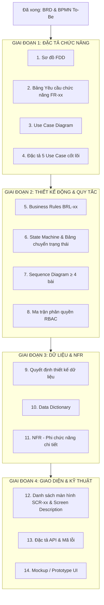
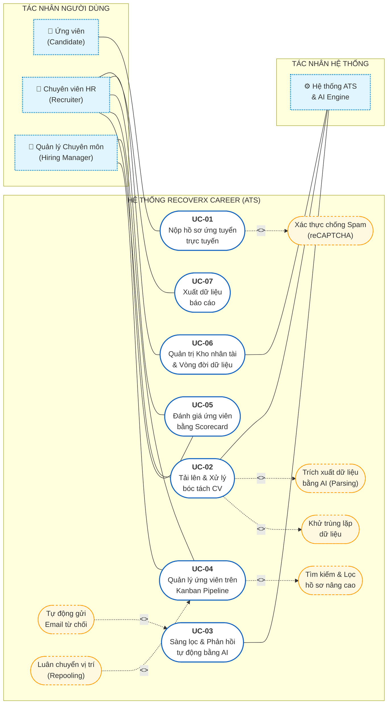
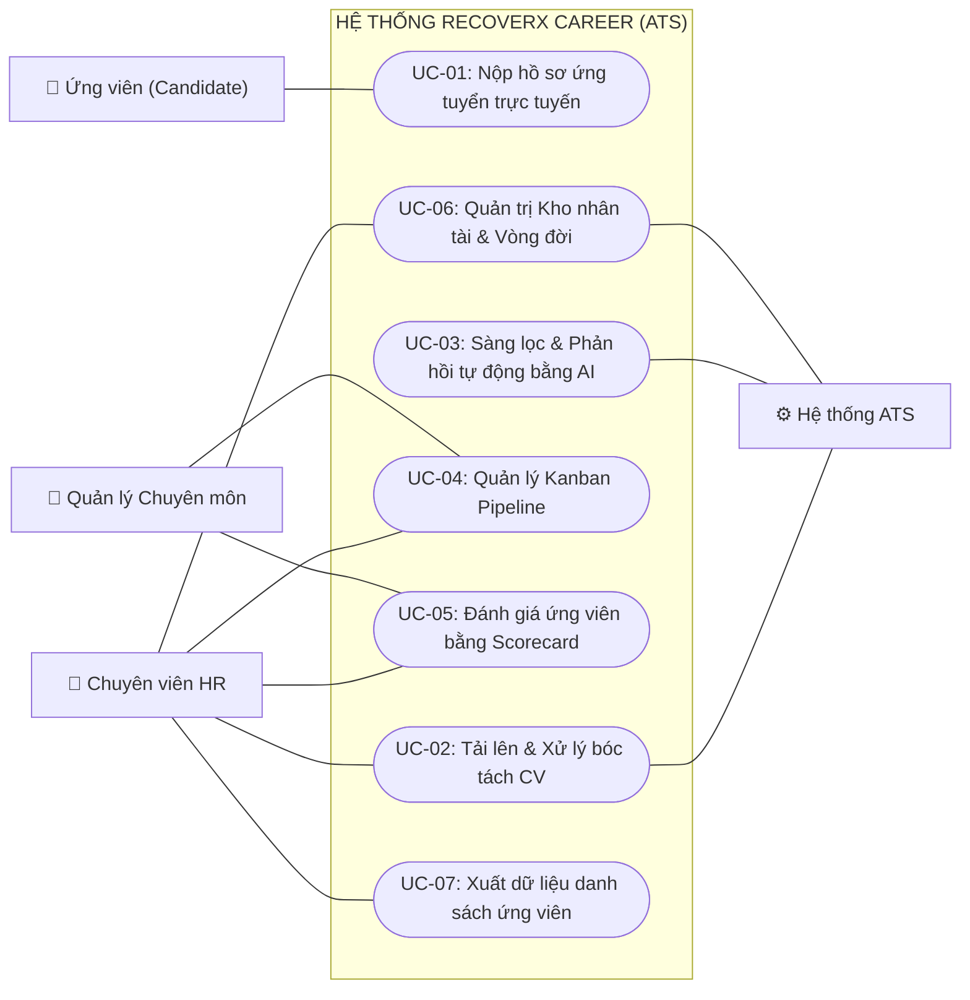
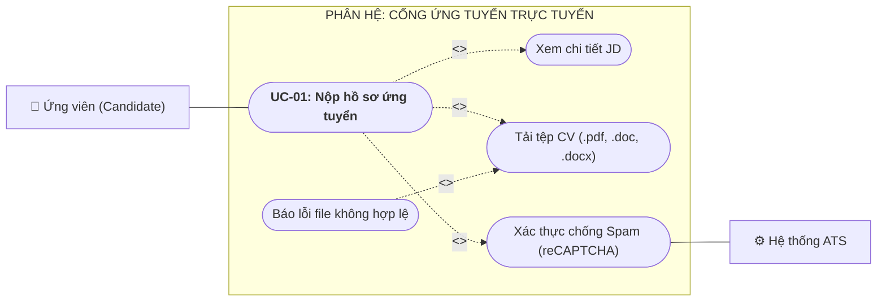
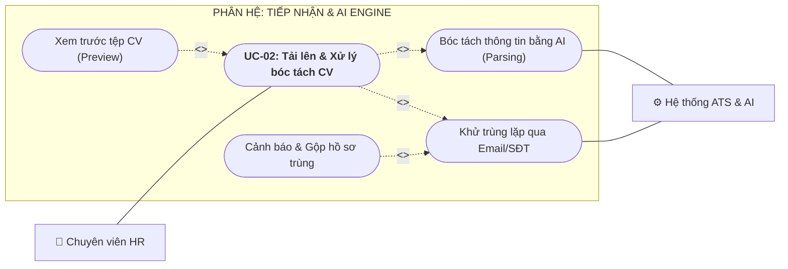
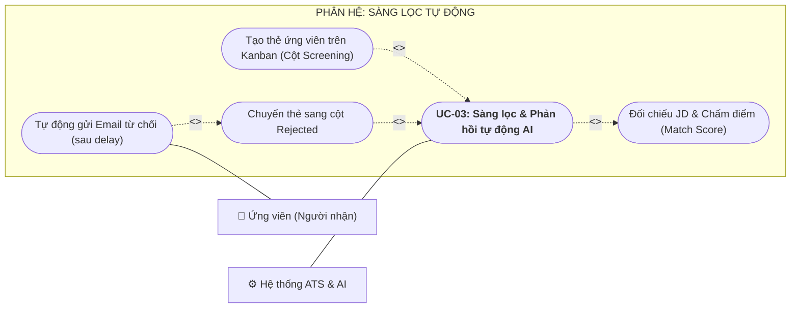
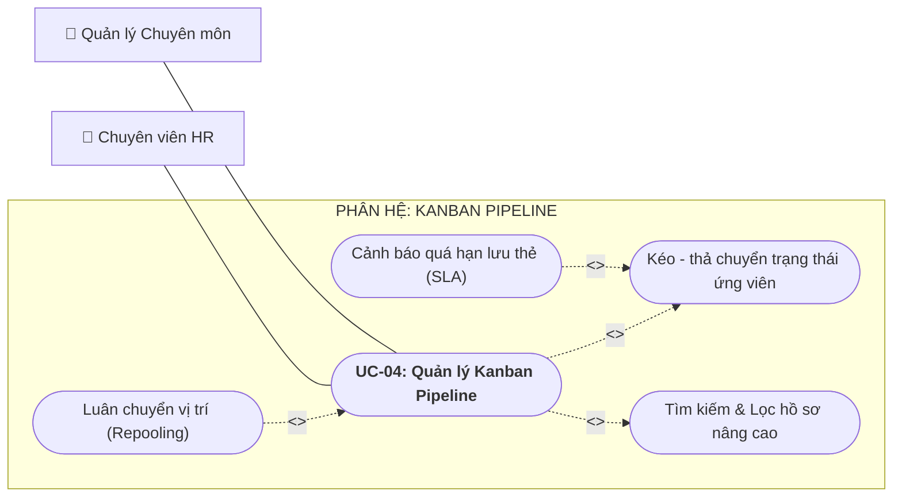
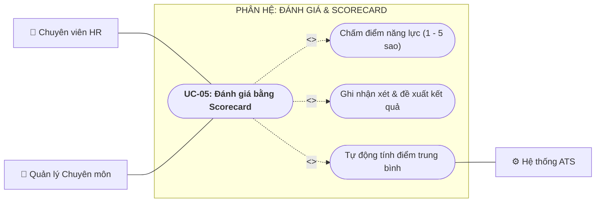
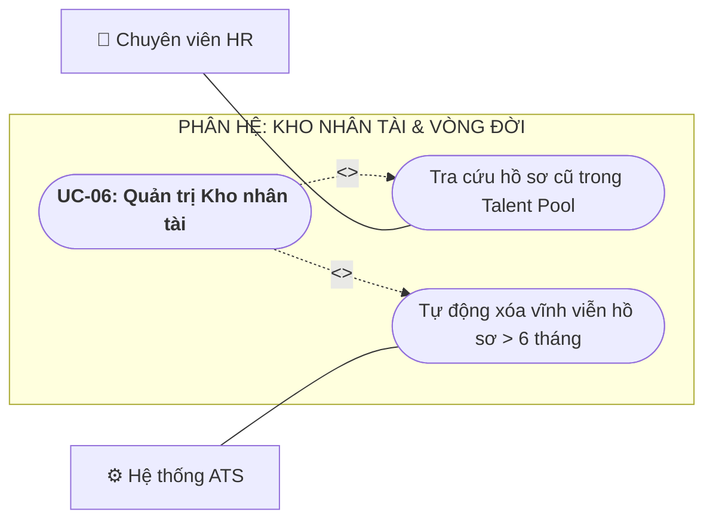
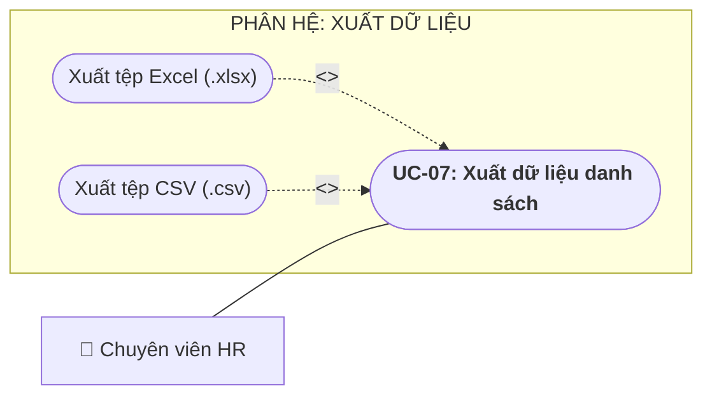

# S? ?? PH?N R? CH?C N?NG (FDD) & DANH S?CH USE CASE

> **D? ?n:** ReCoverX Career - ATS

---

## 1. S? ?? ph?n r? ch?c n?ng (FDD) & Chuy?n giao sang Use Case

Sau khi đã hoàn thiện xong **BRD** và **Quy trình To-Be**, theo đúng phương pháp luận Phân tích & Thiết kế phần mềm (Software Analysis & Design), **bước tiếp theo chuẩn nhất bạn NÊN LÀM NGAY** là:

---

### 👉 BƯỚC TIẾP THEO: Sơ đồ phân rã chức năng (FDD) & Bảng yêu cầu chức năng (FR-xx)

#### Vì sao phải làm bước này trước mà không nhảy cóc?
1. **FDD (Functional Decomposition Diagram)** giúp bạn "bổ nhỏ" toàn bộ hệ thống ATS thành một **Cây tính năng (Feature Tree)**: từ các Phân hệ lớn (Module) ➔ Nhóm chức năng ➔ Các tính năng chi tiết.
2. **Bảng FR-xx (Functional Requirements)** là "xương sống" của tài liệu kỹ thuật:
   * Giúp bạn ánh xạ 1-1: Mỗi `BR-xx` ở BRD sẽ được hiện thực hóa bằng những `FR-xx` nào.
   * Là tiền đề bắt buộc để gom nhóm thành **Use Case Diagram (`UC-xx`)** và làm **Ma trận truy vết (Traceability Matrix)**.

---

### LỘ TRÌNH TRIỂN KHAI TOÀN BỘ CHECKLIST CÒN LẠI (THEO 4 GIAI ĐOẠN LOGIC)

Để không bị rối giữa 16 đầu việc, bạn nên đi theo thứ tự sau:

---

### GỢI Ý CẤU TRÚC FDD CHO HỆ THỐNG ATS CỦA BẠN (CÓ THỂ DÙNG NGAY)

Hệ thống **ReCoverX Career - ATS** của bạn có thể phân rã thành **5 Module cốt lõi**:

1. **Module 1: Cổng ứng tuyển trực tuyến (Candidate Portal)**
   * 1.1 Xem danh sách và chi tiết vị trí tuyển dụng (JD).
   * 1.2 Nộp hồ sơ trực tuyến (Nhập thông tin + Upload file CV).
   * 1.3 Xác thực bảo vệ chống spam (reCAPTCHA / Rate limit).
2. **Module 2: Tiếp nhận & Xử lý hồ sơ tự động (Intake & AI Engine)**
   * 2.1 Upload CV nội bộ (Đơn lẻ & Hàng loạt).
   * 2.2 Khử trùng lặp hồ sơ (Email & Số điện thoại).
   * 2.3 Bóc tách dữ liệu CV tự động (AI Parsing).
   * 2.4 Sàng lọc và chấm điểm phù hợp (AI Screening & Matching).
3. **Module 3: Quản lý Quy trình Tuyển dụng (Kanban Pipeline Management)**
   * 3.1 Bảng điều khiển Kanban (5 cột: New, Screening, Interview, Hired, Rejected).
   * 3.2 Kéo - thả chuyển trạng thái ứng viên.
   * 3.3 Tìm kiếm & Lọc hồ sơ nâng cao (từ khóa, kỹ năng, kinh nghiệm).
   * 3.4 Cảnh báo vi phạm thời gian lưu thẻ (SLA Alert).
   * 3.5 Luân chuyển hồ sơ sang vị trí khác (Repooling/Transfer).
4. **Module 4: Đánh giá phỏng vấn (Evaluation & Scorecard)**
   * 4.1 Tạo & cấu hình tiêu chí đánh giá (Scorecard Template).
   * 4.2 Nhập điểm số (1–5) và nhận xét của hội đồng phỏng vấn.
   * 4.3 Tổng hợp kết quả đánh giá ứng viên.
5. **Module 5: Tự động hóa Truyền thông & Dữ liệu (Automation & Talent Pool)**
   * 5.1 Quản lý mẫu email (Email Template).
   * 5.2 Tự động gửi email từ chối có cài đặt độ trễ (Auto Rejection Delay).
   * 5.3 Quản lý Kho nhân tài (Talent Pool) & Tự động xóa theo vòng đời (6 tháng).
   * 5.4 Xuất dữ liệu danh sách ứng viên (Export Excel/CSV).

---

### BẠN MUỐN LÀM GÌ TIẾP THEO?
Chúng ta có thể triển khai ngay một trong các việc sau:
1. **Lập cây Sơ đồ FDD hoàn chỉnh (bằng Mermaid flowchart để bạn copy vào bài)** và **Bảng danh sách FR-xx ánh xạ với BR-xx**.
2. **Vẽ luôn Use Case Diagram** và chọn ra **5 Use Case cốt lõi** để chuẩn bị viết đặc tả chi tiết.

---

## 2. B?ng ??i chi?u Y?u c?u ch?c n?ng (FR) v? Danh s?ch Use Case

Đã có FDD rồi, bước tiếp theo bắt buộc trong checklist là:  
👉 **Lập Bảng danh sách yêu cầu chức năng (FR-xx)** gắn với **BR-xx**, **UC-xx** và **Độ ưu tiên (MoSCoW)**.

Bảng này là chiếc cầu nối kỹ thuật quan trọng nhất: nó chuyển hóa các nhánh của FDD thành các yêu cầu chức năng cụ thể và chia thành các **Use Case (UC-xx)** để bạn vẽ **Use Case Diagram** ngay sau đó.

Dưới đây là **Bảng FR-xx hoàn chỉnh** được thiết kế chuẩn xác theo đúng FDD và BRD của bạn để bạn đưa vào tài liệu:

---

### BẢNG DANH SÁCH YÊU CẦU CHỨC NĂNG (FUNCTIONAL REQUIREMENTS - FR)

| Mã FR | Tên chức năng | Mô tả chức năng chi tiết | Tác nhân chính | Tham chiếu BR | Ánh xạ Use Case | Độ ưu tiên (MoSCoW) |
| :---: | :--- | :--- | :---: | :---: | :---: | :---: |
| **Phân hệ 0: Quản trị Xác thực & Người dùng Nội bộ (Internal Auth & User Management)** | | | | | | |
| **FR-00a** | Đăng nhập hệ thống nội bộ | Xác thực người dùng bằng Email & Mật khẩu; hỗ trợ tiện ích chuyển vai trò demo (Admin, HR, Hiring Manager) phục vụ thuyết trình. | Admin, HR, Manager | BRL-Auth | **UC-00** | Must Have |
| **FR-00b** | Quản lý người dùng & Phân quyền | Cho phép Admin tạo tài khoản nhân viên mới, gán vai trò (`HR`, `HIRING_MANAGER`) và khóa/mở khóa tài khoản. | Admin | BRL-Auth | **UC-00** | Must Have |
| **Phân hệ 1: Cổng ứng tuyển trực tuyến (Candidate Portal)** | | | | | | |
| **FR-01** | Xem tin tuyển dụng & JD | Cho phép ứng viên xem danh sách các vị trí đang tuyển và chi tiết yêu cầu công việc (JD) công khai. | Ứng viên | BR-01 | **UC-01** | Must Have |
| **FR-02** | Nộp hồ sơ trực tuyến | Cho phép ứng viên nhập Họ tên, SĐT, Email và tải lên tệp CV (.pdf, .doc, .docx ≤ 10MB) không cần đăng nhập tài khoản. | Ứng viên | BR-01 | **UC-01** | Must Have |
| **FR-03** | Chống nộp spam/bot | Tích hợp reCAPTCHA / giới hạn tần suất gửi (Rate Limiting) để chặn gửi hồ sơ rác. | Hệ thống | NFR | **UC-01** | Must Have |
| **Phân hệ 2: Tiếp nhận & Xử lý hồ sơ bằng AI (Intake & AI Engine)** | | | | | | |
| **FR-04** | Upload CV nội bộ | Cho phép HR tải lên từng tệp hoặc nhiều tệp CV (Bulk Upload) kèm trình xem trước (Preview) nội dung CV trực tiếp trên web. | HR | BR-02 | **UC-02** | Must Have |
| **FR-05** | Khử trùng lặp tự động (Deduplication) | Tự động quét đối chiếu Email và SĐT; nếu phát hiện trùng lặp, hệ thống cảnh báo và hỗ trợ gộp hồ sơ vào lịch sử cũ. | Hệ thống | BR-03 | **UC-02** | Must Have |
| **FR-06** | Bóc tách dữ liệu CV (AI Parsing) | Tự động trích xuất các trường: Họ tên, Email, SĐT, Kỹ năng, Số năm kinh nghiệm từ tệp CV với độ chính xác ≥ 85%. | Hệ thống | BR-04 | **UC-02** | Must Have |
| **FR-07** | Sàng lọc tự động (AI Screening) | Tự động so sánh dữ liệu CV với yêu cầu JD, chấm điểm phù hợp (Match Score); nếu không đạt tiêu chuẩn tối thiểu, tự chuyển sang cột *Rejected*. | Hệ thống | BR-05 | **UC-03** | Must Have |
| **FR-08** | Tự động gửi Email từ chối | Tự động gửi email từ chối lịch sự theo mẫu định sẵn cho ứng viên bị loại ở bước AI Screening (kèm thiết lập delay 12–24h). | Hệ thống | BR-06 | **UC-03** | Must Have |
| **Phân hệ 3: Quản lý Quy trình Tuyển dụng (Kanban Pipeline)** | | | | | | |
| **FR-09** | Quản lý Pipeline Kanban 5 cột | Hiển thị bảng Kanban gồm 5 cột chuẩn: *New, Screening, Interview, Hired, Rejected*. | HR | BR-08 | **UC-04** | Must Have |
| **FR-10** | Kéo - thả chuyển trạng thái | Cho phép HR kéo-thả thẻ ứng viên giữa các cột để thay đổi trạng thái tuyển dụng. | HR | BR-08 | **UC-04** | Must Have |
| **FR-11** | Tìm kiếm & Lọc nâng cao | Cung cấp thanh tìm kiếm theo từ khóa chuyên môn (Boolean AND/OR), lọc theo kỹ năng và số năm kinh nghiệm (phản hồi ≤ 3s). | HR | BR-07 | **UC-04** | Must Have |
| **FR-12** | Cảnh báo thời gian lưu thẻ (SLA) | Tự động đổi màu thẻ ứng viên khi thời gian lưu lại tại một cột vượt quá giới hạn SLA cấu hình trước. | Hệ thống | BR-08 | **UC-04** | Should Have |
| **FR-13** | Luân chuyển vị trí (Repooling) | Cho phép HR chuyển một thẻ ứng viên từ vị trí này sang vị trí khác đang mở mà không cần ứng viên nộp lại CV. | HR | BR-10 | **UC-04** | Should Have |
| **Phân hệ 4: Đánh giá & Phỏng vấn (Evaluation & Scorecard)** | | | | | | |
| **FR-14** | Nhập điểm và nhận xét Scorecard | Tích hợp biểu mẫu đánh giá trên thẻ ứng viên, cho phép HR và Hiring Manager chấm điểm (1–5) và ghi nhận xét. | HR, Manager | BR-09 | **UC-05** | Should Have |
| **FR-15** | Tổng hợp kết quả đánh giá | Tự động tính điểm trung bình và hiển thị tổng hợp phản hồi của hội đồng phỏng vấn trên thẻ ứng viên. | Hệ thống | BR-09 | **UC-05** | Should Have |
| **Phân hệ 5: Quản trị Hệ thống & Dữ liệu (System & Data Management)** | | | | | | |
| **FR-16** | Quản trị vòng đời Kho nhân tài (Talent Pool) | Lưu trữ tập trung hồ sơ và tự động chạy tiến trình xóa vĩnh viễn (Hard Delete) đối với hồ sơ bị loại sau 06 tháng. | Hệ thống | BR-10 | **UC-06** | Must Have |
| **FR-17** | Ghi nhận lịch sử thao tác (Audit Log) | Tự động ghi lại lịch sử thao tác (người thực hiện, hành động, thời gian) khi có thay đổi trên thẻ ứng viên. | Hệ thống | BR-11 | System | Must Have |
| **FR-18** | Xuất danh sách ứng viên (Data Export) | Cho phép HR trích xuất danh sách ứng viên theo bộ lọc ra file .xlsx hoặc .csv. | HR | BR-12 | **UC-07** | Could Have |

---

### KẾ HOẠCH BƯỚC TIẾP THEO SAU BẢNG FR-xx NÀY:

Nhìn vào cột **Ánh xạ Use Case** ở trên, bạn đã có ngay danh sách **8 Use Case (UC-xx)** c?a h? th?ng:
* **UC-00:** ??ng nh?p & Qu?n tr? Ng??i d?ng N?i b? *(Admin, HR, Hiring Manager)*
* **UC-01:** Nộp hồ sơ ứng tuyển trực tuyến *(Ứng viên)*
* **UC-02:** Tải lên & Xử lý bóc tách CV *(HR & Hệ thống)*
* **UC-03:** Sàng lọc hồ sơ & Phản hồi tự động bằng AI *(Hệ thống)*
* **UC-04:** Quản lý ứng viên trên Kanban Pipeline *(HR)*
* **UC-05:** Đánh giá ứng viên bằng Scorecard *(HR & Hiring Manager)*
* **UC-06:** Quản lý Kho nhân tài & Vòng đời dữ liệu *(Admin / Hệ thống)*
* **UC-07:** Xuất dữ liệu báo cáo *(HR)*

👉 **Bước kế tiếp ngay bây giờ:** 
1. **Vẽ sơ đồ Use Case Diagram tổng thể** (kết nối 4 Tác nhân: *Ứng viên, HR, Hiring Manager, Hệ thống* với 7 Use Case trên).
2. Sau đó chọn ra **5 Use Case cốt lõi (UC-01 đến UC-05)** để viết **Đặc tả Use Case chi tiết** (theo đúng yêu cầu `≥ 5 UC` trong checklist của bạn).

Bạn có muốn mình **vẽ Sơ đồ Use Case Diagram** và **bắt đầu viết Đặc tả cho 5 Use Case đầu tiên** luôn không?

---

## 3. S? ?? Use Case t?ng th? (Use Case Diagram)

Dưới đây là thiết kế hoàn chỉnh của **Sơ đồ Use Case Diagram Tổng thể** cho hệ thống **ReCoverX Career - ATS**, kết nối đầy đủ **4 Tác nhân (Actors)** với **7 Use Case cốt lõi** và các mối quan hệ nghiệp vụ chuẩn UML (`<<include>>`, `<<extend>>`).

---

### 1. SƠ ĐỒ USE CASE DIAGRAM TỔNG THỂ (MERMAID)

---

### 2. MA TRẬN PHÂN QUYỀN TÁC NHÂN - USE CASE (TRACEABILITY MATRIX)

Bảng này giúp chứng minh tính logic của sơ đồ khi đưa vào báo cáo:

| Mã UC | Tên Use Case | 👤 Ứng viên | 👔 Chuyên viên HR | 💼 Hiring Manager | ⚙️ Hệ thống ATS | Mô tả vai trò tham gia |
| :---: | :--- | :---: | :---: | :---: | :---: | :--- |
| **UC-01** | Nộp hồ sơ ứng tuyển trực tuyến | **Primary** | - | - | **Supporting** | Ứng viên chủ động nộp; Hệ thống hỗ trợ kiểm tra spam (reCAPTCHA). |
| **UC-02** | Tải lên & Xử lý bóc tách CV | - | **Primary** | - | **Supporting** | HR upload file; Hệ thống tự động khử trùng lặp và AI Parsing. |
| **UC-03** | Sàng lọc & Phản hồi tự động AI | - | - | - | **Primary** | Hệ thống tự động đối chiếu JD và gửi email từ chối nếu không đạt. |
| **UC-04** | Quản lý Kanban Pipeline | - | **Primary** | **Secondary** | - | HR kéo-thả, tìm kiếm, repooling; Manager xem hồ sơ được phân công. |
| **UC-05** | Đánh giá bằng Scorecard | - | **Primary** | **Primary** | - | Cả HR và Manager đều truy cập biểu mẫu để chấm điểm (1–5) & ghi nhận xét. |
| **UC-06** | Quản trị Kho nhân tài & Vòng đời | - | **Secondary** | - | **Primary** | HR tra cứu ứng viên cũ; Hệ thống tự động quét dọn xóa sau 06 tháng. |
| **UC-07** | Xuất dữ liệu báo cáo | - | **Primary** | - | - | HR xuất danh sách ứng viên ra tệp Excel (.xlsx, .csv). |

---

### 3. CÁC QUAN HỆ ĐẶC BIỆT TRONG SƠ ĐỒ (`<<include>>` & `<<extend>>`)

1. **Quan hệ `<<include>>` (Bắt buộc phải chạy kèm):**
   * `UC-01` ➔ `Xác thực chống Spam`: Khi ứng viên gửi hồ sơ, hệ thống bắt buộc phải kiểm tra bot/reCAPTCHA trước khi nhận file.
   * `UC-02` ➔ `Khử trùng lặp` & `Bóc tách AI (Parsing)`: Khi tải CV lên, hệ thống bắt buộc phải chạy thuật toán quét trùng SĐT/Email và bóc tách dữ liệu vào form.
   * `UC-04` ➔ `Tìm kiếm & Lọc nâng cao`: Chức năng tra cứu nằm sẵn bên trong giao diện Kanban Pipeline.

2. **Quan hệ `<<extend>>` (Mở rộng - Chỉ xảy ra khi thỏa điều kiện):**
   * `Tự động gửi Email từ chối` ➔ `UC-03`: **Điều kiện:** Chỉ kích hoạt khi điểm phù hợp của CV < ngưỡng điểm yêu cầu (bị loại ở vòng AI Screening).
   * `Luân chuyển vị trí (Repooling)` ➔ `UC-04`: **Điều kiện:** Chỉ thực hiện khi HR thấy ứng viên không hợp vị trí này nhưng phù hợp với vị trí tuyển dụng khác đang mở.

---

### 4. HƯỚNG DẪN KHI VẼ TRÊN DRAW.IO / STARUML

* **Khung viền lớn bao quanh (System Boundary):** Dùng hình chữ nhật lớn, đặt tên trên đỉnh là `Hệ thống ReCoverX Career (ATS)`.
* **Ký hiệu Tác nhân (Actor):** Dùng hình người (Stick Man). Đặt 3 người bên trái (Ứng viên, HR, Manager) và 1 người/hộp dịch vụ bên phải đại diện cho `Hệ thống ATS`.
* **Ký hiệu Use Case:** Dùng hình Ovan (Eclipse). Use case chính viền liền, Use case con (`include`/`extend`) có thể để nét đứt mảnh để làm nổi bật.

---

👉 **BƯỚC TIẾP THEO:**  
Theo checklist của bạn, bước kế tiếp là **Đặc tả Use Case chi tiết (cho ≥ 5 Use Case cốt lõi)**:
1. `UC-01`: Nộp hồ sơ ứng tuyển trực tuyến *(Ứng viên)*
2. `UC-02`: Tải lên & Xử lý bóc tách CV *(HR & Hệ thống)*
3. `UC-03`: Sàng lọc & Phản hồi tự động bằng AI *(Hệ thống)*
4. `UC-04`: Quản lý ứng viên trên Kanban Pipeline *(HR)*
5. `UC-05`: Đánh giá ứng viên bằng Scorecard *(HR & Hiring Manager)*

Bạn có muốn bắt đầu viết **Đặc tả chi tiết cho 5 Use Case này** ngay bây giờ không?

---

## 4. T?m t?t 7 Use Case c?t l?i & Lu?n c? ph?m vi

Dưới đây là danh sách tổng hợp toàn bộ các **Use Case** của hệ thống **ReCoverX Career (ATS)**, được phân loại theo phân hệ và tác nhân thực hiện:

---

### I. DANH SÁCH 7 USE CASE CHÍNH (CỐT LÕI)

#### 1. **UC-01: Nộp hồ sơ ứng tuyển trực tuyến**
* **Tác nhân chính:** Ứng viên (Candidate).
* **Mục đích:** Cho phép ứng viên xem JD, điền thông tin liên hệ và tải file CV (.pdf, .doc, .docx) lên Cổng tuyển dụng công khai không cần đăng nhập.
* **Use case con đi kèm:**
  * `<<include>>` Xác thực chống spam (reCAPTCHA / Rate limit).

#### 2. **UC-02: Tải lên & Xử lý bóc tách CV nội bộ**
* **Tác nhân chính:** Chuyên viên HR, Hệ thống ATS.
* **Mục đích:** HR tải lên các tệp CV thu thập từ nguồn ngoại tuyến (tải lẻ hoặc tải hàng loạt); Hệ thống tự động xử lý dữ liệu đầu vào.
* **Use case con đi kèm:**
  * `<<include>>` Khử trùng lặp dữ liệu (Deduplication qua Email/SĐT).
  * `<<include>>` Bóc tách dữ liệu tự động bằng AI (AI Parsing).
  * Xem trước tệp CV (Preview trực tiếp trên trình duyệt).

#### 3. **UC-03: Sàng lọc hồ sơ & Phản hồi tự động bằng AI**
* **Tác nhân chính:** Hệ thống ATS & AI Engine (xử lý ngầm tự động).
* **Mục đích:** Tự động đối chiếu thông tin bóc tách từ CV với yêu cầu trong JD để chấm điểm phù hợp (Match Score) và phân nhánh tự động:
  * *Đạt tiêu chuẩn:* Tự tạo thẻ ứng viên trên Kanban (cột Screening).
  * *Không đạt tiêu chuẩn:* Tự chuyển thẻ sang cột Rejected.
* **Use case con đi kèm:**
  * `<<extend>>` Tự động gửi Email từ chối (kèm thiết lập delay 12–24h) khi ứng viên không đạt tiêu chuẩn sàng lọc AI.

#### 4. **UC-04: Quản lý quy trình ứng viên trên Kanban Pipeline**
* **Tác nhân chính:** Chuyên viên HR *(Hiring Manager có quyền xem)*.
* **Mục đích:** Quản lý tiến độ tuyển dụng qua 5 cột trạng thái: *New, Screening, Interview, Hired, Rejected*.
* **Use case con đi kèm:**
  * `<<include>>` Tìm kiếm & Lọc hồ sơ nâng cao (theo từ khóa, kỹ năng, kinh nghiệm).
  * Kéo - thả chuyển trạng thái thẻ ứng viên.
  * Cảnh báo vi phạm thời gian lưu thẻ (SLA Alert).
  * `<<extend>>` Luân chuyển vị trí tuyển dụng (Repooling/Transfer) khi ứng viên phù hợp với công việc khác.

#### 5. **UC-05: Đánh giá ứng viên bằng Scorecard**
* **Tác nhân chính:** Chuyên viên HR, Quản lý chuyên môn (Hiring Manager).
* **Mục đích:** Hội đồng phỏng vấn truy cập trực tiếp vào thẻ ứng viên để chấm điểm năng lực (thang điểm 1–5) và ghi nhận xét phỏng vấn.
* **Use case con đi kèm:**
  * Tính điểm trung bình và tổng hợp kết quả đánh giá.

#### 6. **UC-06: Quản trị Kho nhân tài & Vòng đời dữ liệu**
* **Tác nhân chính:** Hệ thống ATS *(Chuyên viên HR tra cứu)*.
* **Mục đích:** Lưu trữ tập trung toàn bộ dữ liệu ứng viên cũ (Talent Pool) phục vụ tái sử dụng; tự động quét và xóa vĩnh viễn (Hard Delete) hồ sơ bị loại quá 06 tháng.

#### 7. **UC-07: Xuất dữ liệu danh sách ứng viên**
* **Tác nhân chính:** Chuyên viên HR.
* **Mục đích:** Trích xuất dữ liệu danh sách ứng viên theo kết quả lọc ra file Excel (.xlsx, .csv).

---

### II. 5 USE CASE CỐT LÕI NÊN CHỌN ĐỂ VIẾT ĐẶC TẢ (THEO CHECKLIST ≥ 5 UC)

Khi viết phần **Đặc tả Use Case chi tiết** (gồm Tiền/Hậu điều kiện, Luồng chính, Luồng thay thế, Luồng ngoại lệ), bạn nên chọn đúng **5 UC đầu tiên** này vì chúng thể hiện trọn vẹn toàn bộ "linh hồn" và giá trị của hệ sinh thái phần mềm:

1. **UC-01:** Nộp hồ sơ ứng tuyển trực tuyến *(Đại diện cho phía Ứng viên)*
2. **UC-02:** Tải lên & Xử lý bóc tách CV nội bộ *(Đại diện cho phần tiếp nhận dữ liệu)*
3. **UC-03:** Sàng lọc hồ sơ & Phản hồi tự động bằng AI *(Đại diện cho tính năng AI & Automation)*
4. **UC-04:** Quản lý quy trình ứng viên trên Kanban Pipeline *(Đại diện cho giao diện làm việc chính của HR)*
5. **UC-05:** Đánh giá ứng viên bằng Scorecard *(Đại diện cho khâu phối hợp phỏng vấn giữa HR và Manager)*

### V? sao 7 Use Case l? ?? v? chu?n m?c:

**HOÀN TOÀN ĐƯỢC VÀ 7 LÀ RẤT ĐỦ!** 

Trong phân tích phần mềm chuyên nghiệp (và cả chấm đồ án), **7 Use Case là "con số vàng"** (nguyên tắc 7 ± 2 của Miller: một sơ đồ mức hệ thống đẹp nhất là từ 5 đến 9 Use Case).

Việc **chỉ vẽ đúng 7 Use Case chính (không cần vẽ nhánh phụ `<<include>>` hay `<<extend>>`)** thậm chí còn có nhiều ưu điểm lớn:

---

### 3 LÝ DO VÌ SAO CHỈ VẼ 7 USE CASE LẠI TỐT:

1. **Đúng bản chất của Use Case (Goal-driven):** 
   * Use Case đại diện cho một **Mục tiêu hoàn chỉnh** của người dùng (ví dụ: *Ứng viên muốn Nộp hồ sơ*, *HR muốn Quản lý pipeline*). 
   * Những thứ như *bóc tách AI, khử trùng lặp, captcha, tìm kiếm...* thực chất chỉ là **các bước thực hiện bên trong** (Steps in Flow of Events). Bạn để dành chúng để viết trong phần **Đặc tả Use Case chi tiết (Luồng chính / Luồng phụ)** thì bài viết sẽ sâu hơn rất nhiều.

2. **Tránh bẫy sai cú pháp UML:**
   * Trong thực tế, có đến 80% người vẽ bị trừ điểm vì **vẽ ngược chiều mũi tên** của `<<include>>` và `<<extend>>`. 
   * Chỉ vẽ Use Case chính nối với Actor bằng nét liền (Association) là **an toàn tuyệt đối 100%**, không ai có thể bắt bẻ lỗi cú pháp của bạn.

3. **Sơ đồ sạch sẽ, chuyên nghiệp, không bị "rối như mạng nhện":**
   * Người xem (Sếp, Giảng viên) nhìn vào sơ đồ 7 ô là nắm trọn vẹn 100% hệ thống ATS trong vòng 10 giây.

---

### SƠ ĐỒ 7 USE CASE GỌN GÀNG (BẠN CHỈ CẦN VẼ THẾ NÀY):

---

### KẾT LUẬN:
Bạn **cứ tự tin chốt đúng 7 Use Case này** lên hình vẽ, không cần vẽ thêm bất kỳ nhánh phụ nào cả! 

Các chi tiết nghiệp vụ sâu hơn (như *bóc tách AI thế nào, gửi mail từ chối ra sao*) sẽ được thể hiện trọn vẹn ở bước tiếp theo: **Đặc tả chi tiết cho 5 Use Case cốt lõi (UC-01 đến UC-05)**.

---

## 5. Ph?n r? s? ?? cho t?ng Use Case (Sub-Use Case Diagrams)

Dưới đây là **sơ đồ chi tiết phân rã riêng cho từng Use Case (Sub-Use Case Diagrams)**. Khi đưa vào báo cáo, mỗi Use Case sẽ có 1 hình vẽ riêng để làm rõ các chức năng con, quan hệ `<<include>>` (bắt buộc) và `<<extend>>` (mở rộng/điều kiện):

---

### 1. UC-01: NỘP HỒ SƠ ỨNG TUYỂN TRỰC TUYẾN (CANDIDATE PORTAL)

> **Mục tiêu:** Ứng viên nộp CV công khai và hệ thống bảo vệ biểu mẫu chống spam.

* **`<<include>>`:** Khi nộp hồ sơ, bắt buộc phải *Tải tệp CV* và *Xác thực reCAPTCHA*.
* **`<<extend>>`:** *Báo lỗi file* chỉ xuất hiện khi file quá 10MB hoặc sai định dạng.

---

### 2. UC-02: TẢI LÊN & XỬ LÝ BÓC TÁCH CV NỘI BỘ (HR INTAKE & AI PARSING)

> **Mục tiêu:** HR tải hồ sơ ngoại tuyến lên; Hệ thống tự động khử trùng lặp và bóc tách dữ liệu AI.

* **`<<include>>`:** Cứ tải CV lên là hệ thống bắt buộc chạy *Khử trùng lặp* và *Bóc tách dữ liệu AI*.
* **`<<extend>>`:** *Gộp hồ sơ trùng* chỉ xảy ra khi phát hiện trùng Email/SĐT; *Xem trước CV* là thao tác tùy chọn của HR.

---

### 3. UC-03: SÀNG LỌC HỒ SƠ & PHẢN HỒI TỰ ĐỘNG BẰNG AI

> **Mục tiêu:** AI tự động chấm điểm hồ sơ với JD và rẽ nhánh (Tạo thẻ phỏng vấn hoặc Gửi mail từ chối).

* **`<<include>>`:** Phải luôn *Đối chiếu JD & Chấm điểm phù hợp*.
* **`<<extend>>`:** 
  * Nếu điểm Đạt ➔ Mở rộng sang nhánh *Tạo thẻ trên Kanban*.
  * Nếu điểm Không đạt ➔ Mở rộng sang nhánh *Chuyển thẻ sang Rejected* và tự động *Gửi Email từ chối*.

---

### 4. UC-04: QUẢN LÝ QUY TRÌNH TUYỂN DỤNG TRÊN KANBAN PIPELINE

> **Mục tiêu:** HR làm việc chính trên bảng Kanban: kéo thả trạng thái, lọc tìm kiếm và luân chuyển vị trí.

* **`<<include>>`:** Giao diện Kanban bắt buộc có tính năng *Kéo-thả* và *Tìm kiếm/Lọc nâng cao*.
* **`<<extend>>`:** 
  * *Cảnh báo SLA:* Tự kích hoạt đổi màu khi thẻ quá hạn lưu tại 1 cột.
  * *Luân chuyển vị trí (Repooling):* Chỉ dùng khi HR muốn chuyển ứng viên sang vị trí khác.

---

### 5. UC-05: ĐÁNH GIÁ ỨNG VIÊN BẰNG SCORECARD

> **Mục tiêu:** Hội đồng phỏng vấn (HR & Hiring Manager) chấm điểm năng lực và ghi nhận xét phỏng vấn.

* **`<<include>>`:** Khi hoàn thành đánh giá, bắt buộc phải có *Chấm điểm*, *Ghi nhận xét* và Hệ thống tự động *Tính điểm trung bình*.

---

### 6. UC-06: QUẢN TRỊ KHO NHÂN TÀI & VÒNG ĐỜI DỮ LIỆU (TALENT POOL)

> **Mục tiêu:** Lưu trữ tập trung hồ sơ cũ và tự động dọn dẹp sau 6 tháng.

---

### 7. UC-07: XUẤT DỮ LIỆU DANH SÁCH ỨNG VIÊN (DATA EXPORT)

> **Mục tiêu:** HR xuất danh sách ứng viên phục vụ báo cáo.

---

💡 **Bước tiếp theo trong checklist:** Bạn có thể chọn ngay **5 Use Case đầu tiên (UC-01 đến UC-05)** để chúng ta bắt tay vào viết **Đặc tả Use Case chi tiết** (gồm: Tiền điều kiện, Hậu điều kiện, Luồng chính Main Flow, Luồng thay thế Alternative Flow và Luồng ngoại lệ Exception Flow).

