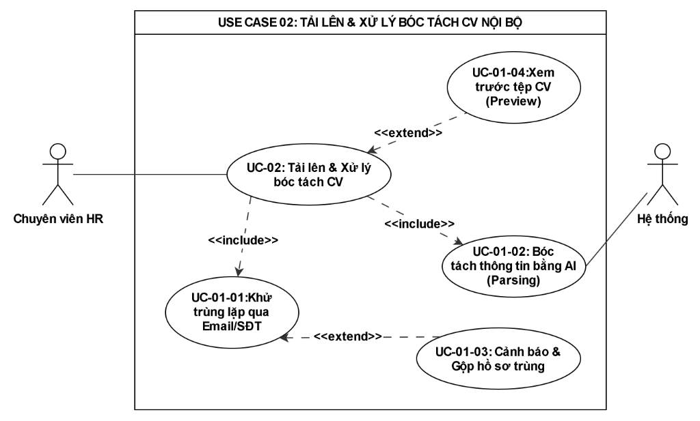
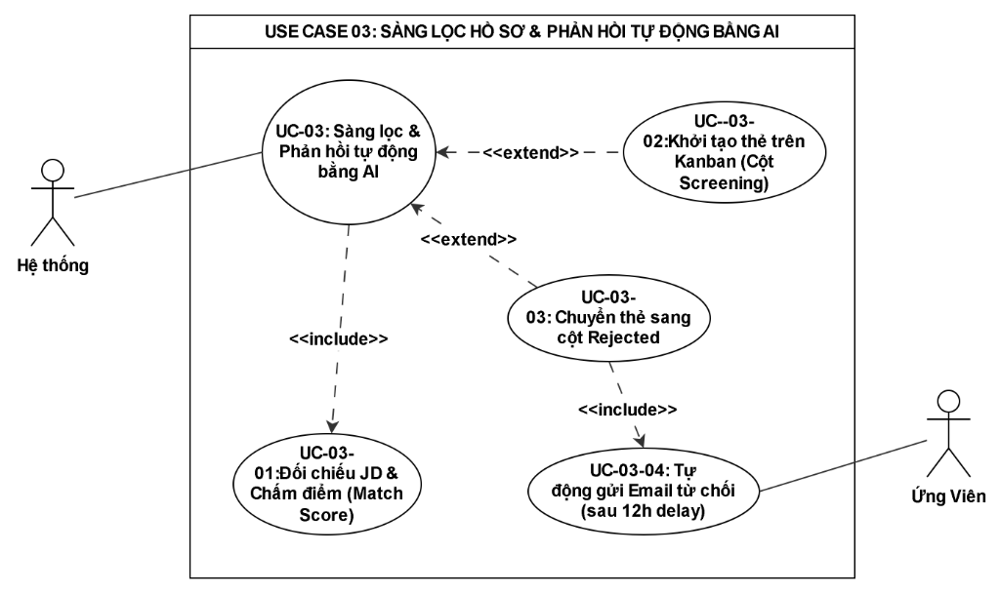
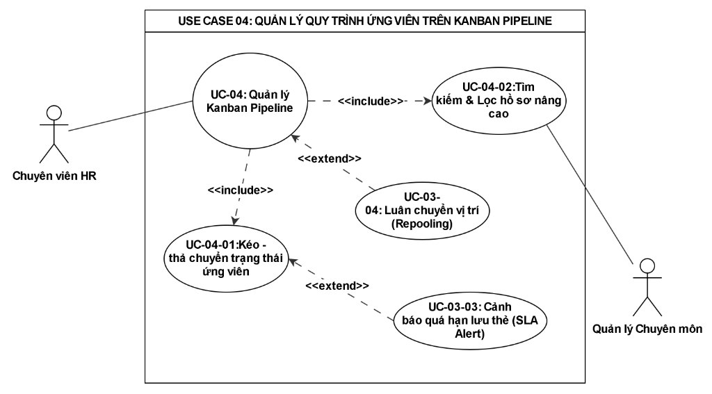
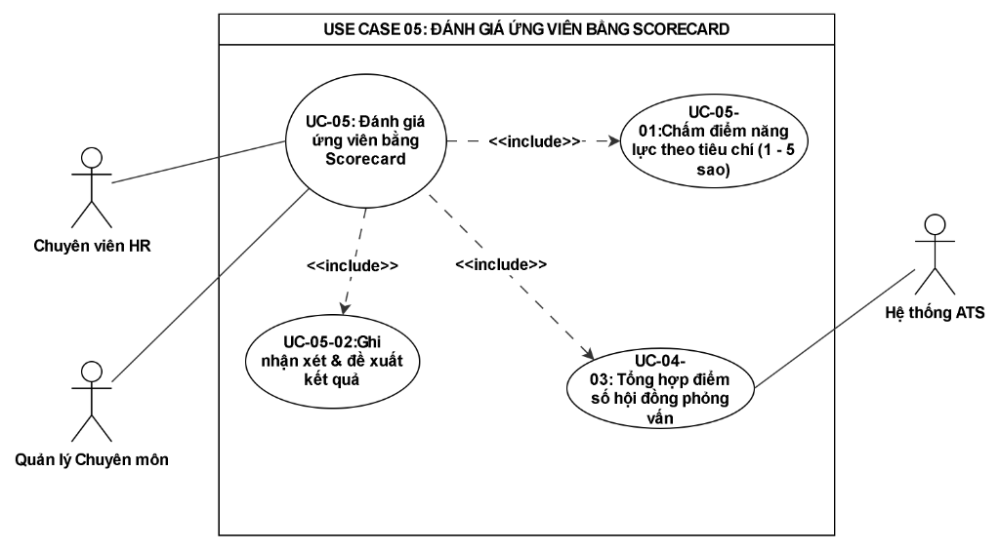

# B?N ??C T? CHI TI?T USE CASE (USE CASE SPECIFICATIONS)

> **D? ?n:** ReCoverX Career - ATS
> **Quy chu?n c?u tr?c b?ng ??c t? chi ti?t theo chu?n BA chuy?n nghi?p.**

---

## 1. Ki?m tra r? so?t v? Template ??c t? chu?n

Dưới đây là phần **Kiểm tra rà soát tính hợp lý** toàn diện, kèm theo **Hướng dẫn chi tiết (có sẵn text để bạn copy vào draw.io tự vẽ)** và **Bản Đặc tả Use Case chi tiết chuẩn mực** cho **5 Use Case cốt lõi (UC-01 đến UC-05)** theo đúng checklist.

---

### PHẦN 1: KẾT QUẢ RÀ SOÁT TÍNH HỢP LÝ (SANITY CHECK)

Sau khi đối chiếu chéo giữa **BRD**, **Quy trình BPMN To-Be** và **Các Use Case**, mình phát hiện **3 điểm bất hợp lý tiềm ẩn** và đã chuẩn hóa lại như sau:

1. **Phân quyền của Quản lý chuyên môn (Hiring Manager) ở UC-04:**
   * *Điểm bất hợp lý:* Nếu để Manager cũng có quyền kéo-thả trên Kanban thì sẽ vi phạm Ma trận phân quyền ở Mục VI của BRD (*"Hiring Manager chỉ có quyền Read-only đối với các hồ sơ được phân công"*).
   * *Đã chuẩn hóa:* Trong UC-04, **chỉ có Chuyên viên HR mới được kéo-thả chuyển trạng thái**; Hiring Manager chỉ có quyền **Xem hồ sơ & Đọc thẻ ứng viên**.
2. **Quy tắc chiều mũi tên trong UML (Rất dễ bị trừ điểm):**
   * Chuẩn UML quy định:
     * **`<<include>>`**: Mũi tên nét đứt đi từ **Use Case Gốc ➔ Use Case Con** (Bắt buộc phải có).
     * **`<<extend>>`**: Mũi tên nét đứt đi từ **Use Case Mở rộng ➔ Use Case Gốc** (Chỉ kích hoạt khi thỏa mãn điều kiện).
   * *Đã chuẩn hóa:* Dưới mỗi Use Case bên dưới đều ghi rõ chữ `Từ [A] ➔ trỏ sang [B]` để bạn kéo mũi tên không bao giờ bị ngược.
3. **Mối nối dữ liệu giữa UC-01, UC-02 và UC-03:**
   * Sau khi Ứng viên nộp (UC-01) hoặc HR upload (UC-02), tệp CV phải ở trạng thái sẵn sàng để kích hoạt tiến trình bóc tách và sàng lọc tự động (UC-03).

---

### PHẦN 2: CHI TIẾT 5 ĐẶC TẢ USE CASE CỐT LÕI (KÈM TEXT ĐỂ COPY TỰ VẼ)

---

### 🟢 USE CASE 01: NỘP HỒ SƠ ỨNG TUYỂN TRỰC TUYẾN (CANDIDATE PORTAL)

#### A. TEXT ĐỂ BẠN COPY VẼ TRÊN DRAW.IO:
* **Tác nhân (Actor):**
  * `Ứng viên (Candidate)` (Bên trái)
  * `Hệ thống ATS` (Bên phải)
* **Khung ranh giới (Boundary):** `Phân hệ Cổng ứng tuyển trực tuyến`
* **Hình Ovan chính (Base Use Case):** `Nộp hồ sơ ứng tuyển trực tuyến`
* **Các hình Ovan con & Mũi tên kết nối:**
  1. Nối nét liền giữa `Ứng viên` và `Nộp hồ sơ ứng tuyển trực tuyến`.
  2. Vẽ Ovan: `Xem chi tiết JD` ➔ Mũi tên nét đứt `<<include>>` từ `Nộp hồ sơ...` trỏ sang `Xem chi tiết JD`.
  3. Vẽ Ovan: `Tải lên tệp CV` ➔ Mũi tên nét đứt `<<include>>` từ `Nộp hồ sơ...` trỏ sang `Tải lên tệp CV`.
  4. Vẽ Ovan: `Xác thực reCAPTCHA` ➔ Mũi tên nét đứt `<<include>>` từ `Nộp hồ sơ...` trỏ sang `Xác thực reCAPTCHA`. Nối nét liền từ `Xác thực reCAPTCHA` sang `Hệ thống ATS`.
  5. Vẽ Ovan: `Báo lỗi tệp không hợp lệ` ➔ Mũi tên nét đứt `<<extend>>` từ `Báo lỗi tệp không hợp lệ` trỏ ngược về `Tải lên tệp CV`.

#### B. BẢN ĐẶC TẢ CHI TIẾT (USE CASE SPECIFICATION):
* **Mã Use Case:** UC-01
* **Tên Use Case:** Nộp hồ sơ ứng tuyển trực tuyến
* **Tác nhân:** Ứng viên (Chính), Hệ thống ATS (Hỗ trợ)
* **Mô tả:** Cho phép ứng viên truy cập vào cổng nghề nghiệp của công ty, xem thông tin JD, điền thông tin liên hệ và tải file CV để ứng tuyển mà không cần tạo tài khoản.
* **Tiền điều kiện:** Vị trí tuyển dụng đang ở trạng thái mở (Active) trên Cổng thông tin.
* **Hậu điều kiện:** Hồ sơ được ghi nhận vào hệ thống; hiển thị thông báo ứng tuyển thành công; kích hoạt tiến trình xử lý ngầm (UC-02 / UC-03).
* **Luồng sự kiện chính (Basic Flow):**
  1. Ứng viên truy cập liên kết tuyển dụng của công ty và chọn vị trí tuyển dụng mong muốn.
  2. Hệ thống hiển thị Bản mô tả công việc (JD) chi tiết kèm biểu mẫu nộp hồ sơ.
  3. Ứng viên nhấn nút "Ứng tuyển ngay".
  4. Ứng viên điền thông tin bắt buộc: Họ và tên, Email, Số điện thoại.
  5. Ứng viên đính kèm tệp CV từ máy tính cá nhân.
  6. Ứng viên tích chọn xác thực reCAPTCHA.
  7. Ứng viên nhấn nút "Gửi hồ sơ".
  8. Hệ thống kiểm tra tính hợp lệ của dữ liệu và tệp đính kèm.
  9. Hệ thống lưu tệp CV, ghi nhận dữ liệu ứng tuyển vào cơ sở dữ liệu.
  10. Hệ thống hiển thị thông báo "Nộp hồ sơ thành công! Chúng tôi sẽ phản hồi qua email của bạn." và kết thúc Use Case.
* **Luồng thay thế (Alternative Flows):**
  * *4a. Ứng viên bỏ trống trường bắt buộc:* Hệ thống hiển thị thông báo lỗi màu đỏ ngay dưới trường tương ứng (ví dụ: "Vui lòng nhập Email hợp lệ") và giữ nguyên dữ liệu đã nhập.
* **Luồng ngoại lệ (Exception Flows):**
  * *5a. Tệp đính kèm sai định dạng hoặc quá dung lượng:* Hệ thống chặn gửi, hiển thị thông báo: "Chỉ hỗ trợ file .pdf, .doc, .docx và dung lượng tối đa 10MB".
  * *6a. Xác thực reCAPTCHA thất bại:* Hệ thống yêu cầu ứng viên xác thực lại mã captcha trước khi cho phép bấm nút gửi.

---

### 🟢 USE CASE 02: TẢI LÊN & XỬ LÝ BÓC TÁCH CV NỘI BỘ (INTAKE & AI PARSING)

#### A. TEXT ĐỂ BẠN COPY VẼ TRÊN DRAW.IO:
* **Tác nhân (Actor):**
  * `Chuyên viên HR` (Bên trái)
  * `Hệ thống ATS & AI` (Bên phải)
* **Khung ranh giới (Boundary):** `Phân hệ Tiếp nhận & AI Engine`
* **Hình Ovan chính (Base Use Case):** `Tải lên & Xử lý bóc tách CV`
* **Các hình Ovan con & Mũi tên kết nối:**
  1. Nối nét liền giữa `Chuyên viên HR` và `Tải lên & Xử lý bóc tách CV`.
  2. Vẽ Ovan: `Khử trùng lặp qua Email/SĐT` ➔ Mũi tên `<<include>>` từ Ovan chính trỏ sang Ovan này. Nối nét liền sang `Hệ thống ATS & AI`.
  3. Vẽ Ovan: `Bóc tách thông tin bằng AI (Parsing)` ➔ Mũi tên `<<include>>` từ Ovan chính trỏ sang Ovan này. Nối nét liền sang `Hệ thống ATS & AI`.
  4. Vẽ Ovan: `Cảnh báo & Gộp hồ sơ trùng` ➔ Mũi tên `<<extend>>` từ Ovan này trỏ ngược về `Khử trùng lặp qua Email/SĐT`.
  5. Vẽ Ovan: `Xem trước tệp CV (Preview)` ➔ Mũi tên `<<extend>>` từ Ovan này trỏ về Ovan chính.

#### B. BẢN ĐẶC TẢ CHI TIẾT (USE CASE SPECIFICATION):
* **Mã Use Case:** UC-02
* **Tên Use Case:** Tải lên & Xử lý bóc tách CV nội bộ
* **Tác nhân:** Chuyên viên HR (Chính), Hệ thống ATS & AI (Thực thi ngầm)
* **Mô tả:** HR tải lên các CV thu thập từ nguồn ngoại tuyến (tải lẻ hoặc tải cả thư mục từ 50–100 CV). Hệ thống tự động khử trùng lặp và dùng AI bóc tách thông tin điền vào hồ sơ.
* **Tiền điều kiện:** HR đã đăng nhập hệ thống và có quyền quản lý vị trí tuyển dụng tương ứng.
* **Hậu điều kiện:** Dữ liệu ứng viên được trích xuất thành công; tạo thẻ hồ sơ mới hoặc cập nhật hồ sơ cũ.
* **Luồng sự kiện chính (Basic Flow):**
  1. HR truy cập màn hình vị trí tuyển dụng, chọn nút "Tải lên CV".
  2. HR chọn tải 1 tệp hoặc kéo-thả nhiều tệp (.pdf, .doc, .docx) vào vùng tải lên.
  3. Hệ thống đưa các tệp vào Hàng đợi xử lý (Task Queue) và hiển thị thanh tiến trình.
  4. Với mỗi tệp, Hệ thống trích xuất sơ bộ Email và Số điện thoại để đối chiếu CSDL.
  5. Hệ thống xác nhận không trùng lặp.
  6. Hệ thống gửi nội dung văn bản sang dịch vụ AI Parsing để bóc tách: Họ tên, SĐT, Email, Kỹ năng, Số năm kinh nghiệm.
  7. Hệ thống tự động điền các thông tin bóc tách được vào Form hồ sơ ứng viên.
  8. Hệ thống lưu tệp CV vào kho lưu trữ tập trung và hiển thị danh sách CV xử lý thành công kèm nút "Xem trước (Preview)".
* **Luồng thay thế (Alternative Flows):**
  * *5a. Phát hiện trùng lặp hồ sơ:* Hệ thống hiển thị biểu tượng cảnh báo "Trùng lặp với ứng viên [Tên] nộp ngày [DD/MM/YYYY]". Cung cấp 2 lựa chọn: "Gộp thông tin mới vào hồ sơ cũ" hoặc "Bỏ qua tệp tải lên".
* **Luồng ngoại lệ (Exception Flows):**
  * *6a. Tệp CV là dạng ảnh scan (Image-only PDF) không bóc tách được văn bản:* Hệ thống gắn cờ "Parsing lỗi / Cần nhập tay", tạo thẻ với thông tin rỗng để HR tự điền thủ công.

---

### 🟢 USE CASE 03: SÀNG LỌC HỒ SƠ & PHẢN HỒI TỰ ĐỘNG BẰNG AI

#### A. TEXT ĐỂ BẠN COPY VẼ TRÊN DRAW.IO:
* **Tác nhân (Actor):**
  * `Hệ thống ATS & AI` (Tác nhân chính - Bên trái)
  * `Ứng viên` (Tác nhân nhận thông báo - Bên phải)
* **Khung ranh giới (Boundary):** `Phân hệ Sàng lọc tự động`
* **Hình Ovan chính (Base Use Case):** `Sàng lọc & Phản hồi tự động bằng AI`
* **Các hình Ovan con & Mũi tên kết nối:**
  1. Nối nét liền giữa `Hệ thống ATS & AI` và Ovan chính.
  2. Vẽ Ovan: `Đối chiếu JD & Chấm điểm (Match Score)` ➔ Mũi tên `<<include>>` từ Ovan chính trỏ sang Ovan này.
  3. Vẽ Ovan: `Khởi tạo thẻ trên Kanban (Cột Screening)` ➔ Mũi tên `<<extend>>` từ Ovan này trỏ về Ovan chính (Điều kiện: Điểm ≥ Ngưỡng).
  4. Vẽ Ovan: `Chuyển thẻ sang cột Rejected` ➔ Mũi tên `<<extend>>` từ Ovan này trỏ về Ovan chính (Điều kiện: Điểm < Ngưỡng).
  5. Vẽ Ovan: `Tự động gửi Email từ chối (sau delay)` ➔ Mũi tên `<<include>>` từ `Chuyển thẻ sang cột Rejected` trỏ sang Ovan này. Nối nét liền sang `Ứng viên`.

#### B. BẢN ĐẶC TẢ CHI TIẾT (USE CASE SPECIFICATION):
* **Mã Use Case:** UC-03
* **Tên Use Case:** Sàng lọc hồ sơ & Phản hồi tự động bằng AI
* **Tác nhân:** Hệ thống ATS & AI Engine (Tác nhân tự động), Ứng viên (Người nhận thông báo)
* **Mô tả:** Sau khi CV được bóc tách dữ liệu, hệ thống tự động so khớp năng lực ứng viên với tiêu chuẩn JD để phân loại và gửi email từ chối tự động nếu không đạt.
* **Tiền điều kiện:** CV đã hoàn tất bước AI Parsing (UC-02) và vị trí tuyển dụng đã có tiêu chí JD thiết lập sẵn.
* **Hậu điều kiện:** Thẻ ứng viên được xếp vào đúng cột trên Kanban (*Screening* hoặc *Rejected*); lên lịch gửi email từ chối nếu bị loại.
* **Luồng sự kiện chính (Basic Flow):**
  1. Hệ thống lấy dữ liệu ứng viên (kỹ năng, số năm kinh nghiệm) đối chiếu với tiêu chí JD của vị trí ứng tuyển.
  2. Hệ thống tính toán điểm tương đồng (Match Score, thang điểm 0–100%) và kiểm tra các tiêu chí tiên quyết (Hard Criteria).
  3. Điểm đánh giá đạt từ ngưỡng quy định trở lên (ví dụ: Match Score ≥ 50% và đủ kinh nghiệm bắt buộc).
  4. Hệ thống tự động tạo/chuyển thẻ ứng viên vào cột **"Screening"** trên bảng Kanban.
  5. Hệ thống hiển thị điểm Match Score và tóm tắt lý do phù hợp trên thẻ để HR tiện theo dõi. Kết thúc Use Case.
* **Luồng thay thế (Alternative Flows):**
  * *3a. Điểm đánh giá dưới ngưỡng hoặc không đạt tiêu chí tiên quyết:*
    * 3a.1. Hệ thống tự động chuyển thẻ ứng viên vào cột **"Rejected"** trên Kanban.
    * 3a.2. Hệ thống ghi chú lý do loại (ví dụ: "Kinh nghiệm < 1 năm", "Thiếu kỹ năng chuyên môn bắt buộc").
    * 3a.3. Hệ thống tạo một tác vụ hẹn giờ gửi thư (Delayed Job: 12h hoặc 24h sau).
    * 3a.4. Khi đến thời hạn hẹn giờ, hệ thống tự động gửi Email từ chối lịch sự theo mẫu (Rejection Email Template) đến hòm thư của ứng viên.
    * 3a.5. Hồ sơ được lưu vào Kho nhân tài (Talent Pool) và kích hoạt đếm ngược thời gian lưu trữ 06 tháng.
* **Luồng ngoại lệ (Exception Flows):**
  * *3b. HR can thiệp hủy gửi email:* Trong thời gian chờ (Delay), nếu HR phát hiện ứng viên bị AI đánh giá nhầm, HR có thể kéo thẻ quay lại cột Screening. Hệ thống sẽ tự động hủy lệnh gửi email từ chối.

---

### 🟢 USE CASE 04: QUẢN LÝ QUY TRÌNH ỨNG VIÊN TRÊN KANBAN PIPELINE

#### A. TEXT ĐỂ BẠN COPY VẼ TRÊN DRAW.IO:
* **Tác nhân (Actor):**
  * `Chuyên viên HR` (Chính - Toàn quyền)
  * `Quản lý Chuyên môn` (Phụ - Chỉ đọc)
* **Khung ranh giới (Boundary):** `Phân hệ Quản lý Kanban Pipeline`
* **Hình Ovan chính (Base Use Case):** `Quản lý Kanban Pipeline`
* **Các hình Ovan con & Mũi tên kết nối:**
  1. Nối nét liền từ `Chuyên viên HR` và `Quản lý Chuyên môn` vào Ovan chính.
  2. Vẽ Ovan: `Kéo - thả chuyển trạng thái ứng viên` ➔ Mũi tên `<<include>>` từ Ovan chính trỏ sang. *(Ghi chú: Chỉ HR được nối quyền này)*.
  3. Vẽ Ovan: `Tìm kiếm & Lọc hồ sơ nâng cao` ➔ Mũi tên `<<include>>` từ Ovan chính trỏ sang.
  4. Vẽ Ovan: `Cảnh báo quá hạn lưu thẻ (SLA Alert)` ➔ Mũi tên `<<extend>>` từ Ovan này trỏ về `Kéo - thả chuyển trạng thái ứng viên`.
  5. Vẽ Ovan: `Luân chuyển vị trí (Repooling)` ➔ Mũi tên `<<extend>>` từ Ovan này trỏ về Ovan chính.

#### B. BẢN ĐẶC TẢ CHI TIẾT (USE CASE SPECIFICATION):
* **Mã Use Case:** UC-04
* **Tên Use Case:** Quản lý quy trình ứng viên trên Kanban Pipeline
* **Tác nhân:** Chuyên viên HR (Thực thi chính), Quản lý chuyên môn (Xem hồ sơ)
* **Mô tả:** Cung cấp giao diện trực quan dạng bảng với 5 cột chuẩn (*New, Screening, Interview, Hired, Rejected*) để theo dõi tiến độ, tìm kiếm ứng viên và luân chuyển vị trí.
* **Tiền điều kiện:** Người dùng đã đăng nhập hệ thống với vai trò HR hoặc Hiring Manager được cấp quyền.
* **Hậu điều kiện:** Trạng thái ứng viên được cập nhật theo thời gian thực; hệ thống lưu vết Audit Log.
* **Luồng sự kiện chính (Basic Flow):**
  1. HR truy cập vào mục "Pipeline Tuyển dụng" của vị trí cần quản lý.
  2. Hệ thống hiển thị bảng Kanban 5 cột cùng danh sách các thẻ ứng viên tương ứng.
  3. HR sử dụng thanh tìm kiếm hoặc bộ lọc nâng cao (lọc theo kỹ năng, số năm kinh nghiệm, điểm AI Match Score).
  4. Hệ thống lọc và hiển thị danh sách thẻ thỏa mãn điều kiện lọc trong thời gian ≤ 3 giây.
  5. HR nhấn giữ và kéo thẻ ứng viên từ cột này thả sang cột khác (ví dụ: kéo từ *Screening* sang *Interview*).
  6. Hệ thống cập nhật trạng thái mới của ứng viên, ghi nhận thời gian luân chuyển (Timestamp) và lưu vết người thực hiện vào Audit Log.
* **Luồng thay thế (Alternative Flows):**
  * *5a. Thẻ bị quá hạn SLA:* Hệ thống kiểm tra thời gian lưu của thẻ ở cột hiện tại; nếu vượt quá cấu hình SLA (ví dụ: nằm ở cột Screening quá 3 ngày), hệ thống tự động đổi viền thẻ sang màu đỏ cảnh báo.
  * *5b. Luân chuyển vị trí (Repooling):* Tại thẻ ứng viên ở cột Rejected, HR nhấn biểu tượng "Chuyển vị trí" ➔ Chọn vị trí tuyển dụng mới ➔ Hệ thống tự nhân bản thẻ ứng viên sang cột *New* của vị trí đích, giữ nguyên lịch sử đánh giá cũ.
* **Luồng ngoại lệ (Exception Flows):**
  * *2a. Quản lý chuyên môn (Hiring Manager) đăng nhập:* Hệ thống chỉ cho phép xem thông tin thẻ, tìm kiếm và xem điểm; hệ thống khóa tính năng kéo-thả và ẩn các thông tin nhạy cảm (như mức lương hiện tại/kỳ vọng).

---

### 🟢 USE CASE 05: ĐÁNH GIÁ ỨNG VIÊN BẰNG SCORECARD

#### A. TEXT ĐỂ BẠN COPY VẼ TRÊN DRAW.IO:
* **Tác nhân (Actor):**
  * `Chuyên viên HR` (Bên trái)
  * `Quản lý Chuyên môn (Hiring Manager)` (Bên trái)
  * `Hệ thống ATS` (Bên phải)
* **Khung ranh giới (Boundary):** `Phân hệ Đánh giá & Phỏng vấn`
* **Hình Ovan chính (Base Use Case):** `Đánh giá ứng viên bằng Scorecard`
* **Các hình Ovan con & Mũi tên kết nối:**
  1. Nối nét liền từ `Chuyên viên HR` và `Quản lý Chuyên môn` vào Ovan chính.
  2. Vẽ Ovan: `Chấm điểm năng lực theo tiêu chí (1 - 5 sao)` ➔ Mũi tên `<<include>>` từ Ovan chính trỏ sang.
  3. Vẽ Ovan: `Ghi nhận xét & đề xuất kết quả` ➔ Mũi tên `<<include>>` từ Ovan chính trỏ sang.
  4. Vẽ Ovan: `Tổng hợp điểm số hội đồng phỏng vấn` ➔ Mũi tên `<<include>>` từ Ovan chính trỏ sang. Nối nét liền sang `Hệ thống ATS`.

#### B. BẢN ĐẶC TẢ CHI TIẾT (USE CASE SPECIFICATION):
* **Mã Use Case:** UC-05
* **Tên Use Case:** Đánh giá ứng viên bằng Scorecard
* **Tác nhân:** Chuyên viên HR, Quản lý chuyên môn (Hội đồng phỏng vấn), Hệ thống ATS
* **Mô tả:** Cho phép hội đồng phỏng vấn cùng chấm điểm các tiêu chí năng lực chuyên môn và ghi nhận xét trực tiếp trên hồ sơ ứng viên tại vòng phỏng vấn.
* **Tiền điều kiện:** Ứng viên đang ở trạng thái/cột "Interview" trên bảng Kanban.
* **Hậu điều kiện:** Điểm số và nhận xét được lưu trữ; hệ thống tính điểm trung bình tổng hợp.
* **Luồng sự kiện chính (Basic Flow):**
  1. Người phỏng vấn (HR hoặc Hiring Manager) nhấp chuột vào thẻ ứng viên trên bảng Kanban và chọn tab "Đánh giá (Scorecard)".
  2. Hệ thống hiển thị biểu mẫu đánh giá gồm danh sách các tiêu chí chuyên môn định sẵn (ví dụ: Kỹ năng kỹ thuật, Kỹ năng giao tiếp, Độ phù hợp văn hóa).
  3. Người phỏng vấn chọn số sao chấm điểm cho từng tiêu chí (thang điểm 1 đến 5 sao).
  4. Người phỏng vấn nhập nội dung nhận xét chi tiết vào ô phản hồi.
  5. Người phỏng vấn chọn Đề xuất kết quả: "Nên tuyển" hoặc "Không tuyển".
  6. Người phỏng vấn nhấn "Lưu đánh giá".
  7. Hệ thống xác thực dữ liệu, lưu phiếu đánh giá gắn với tài khoản của người chấm.
  8. Hệ thống tự động tính toán lại Điểm số trung bình cộng của toàn bộ hội đồng phỏng vấn và hiển thị trên giao diện chi tiết hồ sơ. Kết thúc Use Case.
* **Luồng thay thế (Alternative Flows):**
  * *3a. Đã có người khác chấm điểm trước:* Hệ thống hiển thị riêng biệt phần chấm điểm của người dùng hiện tại và phần điểm tổng hợp, không cho phép sửa điểm của người khác.
* **Luồng ngoại lệ (Exception Flows):**
  * *6a. Bỏ trống tiêu chí bắt buộc:* Hệ thống thông báo: "Vui lòng chấm điểm đầy đủ các tiêu chí trước khi lưu".

---

## 2. S? ?? v? ??c t? chi ti?t UC-01 & UC-02

### Nh?n x?t & ??nh gi? s? ??:

### PHẦN 1: NHẬN XÉT HÌNH BẠN VẼ (ĐÃ ĐÚNG CHƯA?)

**Đánh giá:** Sơ đồ này của bạn vẽ **rất xuất sắc về mặt tư duy logic UML (đạt 98%)**! 
* ✅ **Tư duy `<<extend>>` của bạn cực kỳ thông minh:** Việc bạn cho `UC-01-03: Cảnh báo & Gộp hồ sơ trùng` trỏ mũi tên `<<extend>>` vào `UC-01-01: Khử trùng lặp qua Email/SĐT` là hoàn toàn chính xác (vì hành động gộp hồ sơ chỉ xuất hiện khi bước kiểm tra trùng lặp phát hiện ra lỗi trùng).
* ✅ Chiều mũi tên của tất cả các nhánh `<<include>>` và `<<extend>>` đều chuẩn 100%.

👉 **CHỈ CÓ 1 LỖI COPY-PASTE CẦN SỬA DUY NHẤT:**
* **Lỗi mã số Use Case con:** Sơ đồ này là của **`USE CASE 02`**, nhưng cả 4 hình ovan con bên trong bạn đều đang ghi nhầm là `UC-01-...`:
  * `UC-01-01` ➔ Sửa thành **`UC-02-01: Khử trùng lặp qua Email/SĐT`**
  * `UC-01-02` ➔ Sửa thành **`UC-02-02: Bóc tách thông tin bằng AI (Parsing)`**
  * `UC-01-03` ➔ Sửa thành **`UC-02-03: Cảnh báo & Gộp hồ sơ trùng`**
  * `UC-01-04` ➔ Sửa thành **`UC-02-04: Xem trước tệp CV (Preview)`**

*(Góp ý thêm: Đường nối từ Actor `Hệ thống` bạn có thể nối thẳng vào Use Case chính `UC-02` thay vì chỉ nối vào `UC-02-02`, vì Hệ thống thực hiện cả 2 việc ngầm: Khử trùng lặp và AI Parsing).*

---

### PHẦN 2: BẢN ĐẶC TẢ CHI TIẾT UC-02 (CHUẨN DẠNG BẢNG 100%)

#### 1. BẢNG THÔNG TIN TỔNG QUAN (METADATA)

| Thuộc tính | Chi tiết đặc tả |
| :--- | :--- |
| **Mã Use Case** | **UC-02** |
| **Tên Use Case** | **Tải lên & Xử lý bóc tách CV nội bộ (Internal CV Upload & Parsing)** |
| **Phân hệ (Module)** | Tiếp nhận & Xử lý AI Engine (Intake & AI Processing) |
| **Tác nhân chính (Primary Actor)** | Chuyên viên Tuyển dụng (HR) |
| **Tác nhân hỗ trợ (Secondary Actor)**| Hệ thống ATS, Dịch vụ AI Parsing (LLM API) |
| **Mô tả ngắn gọn** | Cho phép HR tải các tệp CV thu thập ngoại tuyến lên hệ thống (tải lẻ hoặc tải hàng loạt tối đa 50 CV/lần). Hệ thống tự động kiểm tra trùng lặp qua Email/SĐT và dùng AI bóc tách thông tin ứng viên vào Form. |
| **Sự kiện kích hoạt (Trigger)** | HR nhấn nút "Tải lên CV" tại màn hình quản lý vị trí tuyển dụng. |
| **Tiền điều kiện (Pre-conditions)** | HR đã đăng nhập hệ thống thành công và có quyền thao tác trên vị trí tuyển dụng đang mở. |
| **Hậu điều kiện (Post-conditions)** | • Thông tin ứng viên (Họ tên, SĐT, Email, Kỹ năng, Kinh nghiệm) được trích xuất và điền vào Form. • Tệp CV gốc được lưu trữ tập trung vào hệ thống. • Kích hoạt sẵn sàng cho bước Sàng lọc AI (UC-03). |

---

#### 2. BẢNG LUỒNG SỰ KIỆN CHÍNH (MAIN FLOW / BASIC FLOW)

| Bước | Hành động của HR (Actor Action) | Phản hồi của Hệ thống (System Response) | Use Case con tương ứng |
| :---: | :--- | :--- | :---: |
| **1** | Truy cập màn hình quản lý vị trí tuyển dụng, nhấn nút **"Tải lên CV"**. | Hiển thị cửa sổ (Modal) tải tệp với vùng kéo-thả hỗ trợ định dạng .pdf, .doc, .docx. | - |
| **2** | Chọn 1 hoặc nhiều tệp CV từ máy tính cá nhân (tối đa 50 tệp) và nhấn **"Bắt đầu tải lên"**. | Tiếp nhận tệp, đưa vào Hàng đợi xử lý ngầm (Task Queue) và hiển thị thanh tiến trình (Progress Bar). | - |
| **3** | *(Chờ hệ thống xử lý)* | Với mỗi tệp tải lên, hệ thống tự động quét trích xuất nhanh Email và Số điện thoại để đối chiếu CSDL. | **UC-02-01** (Khử trùng lặp qua Email/SĐT) |
| **4** | *(Chờ hệ thống xử lý)* | Xác nhận không có trùng lặp; gửi nội dung văn bản CV sang module AI Engine để phân tích cú pháp. | - |
| **5** | *(Chờ hệ thống xử lý)* | AI bóc tách dữ liệu cấu trúc: Họ tên, Email, SĐT, Danh sách kỹ năng, Số năm kinh nghiệm làm việc. | **UC-02-02** (Bóc tách thông tin bằng AI) |
| **6** | *(Chờ hệ thống xử lý)* | • Tự động điền dữ liệu bóc tách vào Form hồ sơ ứng viên. • Lưu tệp CV gốc vào kho lưu trữ tập trung. | - |
| **7** | Xem danh sách kết quả bóc tách hiển thị trên màn hình. | Hiển thị bảng danh sách các CV đã xử lý thành công, bao gồm: Họ tên, SĐT, Email, Kỹ năng chính kèm biểu tượng trạng thái *"Đã bóc tách 100%"*. | - |
| **8** | Nhấn nút **"Hoàn tất"** để đóng cửa sổ tải lên. | Cập nhật danh sách ứng viên mới lên giao diện quản lý tuyển dụng. Kết thúc Use Case. | - |

---

#### 3. BẢNG LUỒNG THAY THẾ VÀ LUỒNG NGOẠI LỆ (ALTERNATIVE & EXCEPTION FLOWS)

| Mã luồng | Bước phát sinh | Điều kiện kích hoạt | Xử lý của Hệ thống |
| :---: | :---: | :--- | :--- |
| **AF-01** | Bước 4 | Phát hiện Email hoặc Số điện thoại của CV tải lên đã tồn tại trong CSDL. | **(Kích hoạt UC-02-03: Cảnh báo & Gộp hồ sơ trùng)** • Tạm dừng tạo thẻ mới cho tệp đó. • Đánh dấu biểu tượng màu vàng: *"Trùng lặp với ứng viên [Họ tên] nộp ngày [DD/MM/YYYY]"*. • Cung cấp tùy chọn cho HR: *"Gộp tệp mới vào hồ sơ cũ"* hoặc *"Bỏ qua tệp này"*. |
| **AF-02** | Bước 7 | HR muốn kiểm tra độ chính xác của thông tin AI bóc tách so với file gốc. | **(Kích hoạt UC-02-04: Xem trước tệp CV - Preview)** • HR nhấn nút "Xem trước (Preview)" bên cạnh dòng ứng viên. • Hệ thống mở khung xem trước nội dung file PDF/Word trực tiếp trên trình duyệt mà không cần tải file về máy. |
| **EX-01** | Bước 2 | HR tải lên vượt quá số lượng 50 tệp hoặc có tệp vượt quá 10MB. | • Chặn tải lên. • Hiển thị thông báo lỗi: *"Mỗi lượt tải tối đa 50 CV và dung lượng mỗi tệp không quá 10MB"*. |
| **EX-02** | Bước 5 | Tệp CV là file scan thuần hình ảnh (Image-only PDF), AI không đọc được text. | • Hệ thống không thể bóc tách tự động. • Gắn cờ cảnh báo: *"CV dạng ảnh - Cần nhập tay"*. • Vẫn lưu tệp CV và tạo thẻ ứng viên với thông tin rỗng để HR tự điền thủ công. |
| **EX-03** | Bước 5 | Mất kết nối API AI hoặc dịch vụ AI bên thứ ba bị quá tải. | • Tạm thời lưu tệp CV ở trạng thái *"Chờ xử lý (Pending)"*. • Đưa vào cơ chế thử lại tự động (Auto-retry sau 5 phút) mà không làm gián đoạn các thao tác khác của HR. |

---

#### 4. BẢNG QUY TẮC NGHIỆP VỤ LIÊN QUAN (BUSINESS RULES)

| Mã quy tắc | Tên quy tắc | Nội dung quy tắc nghiệp vụ |
| :---: | :--- | :--- |
| **BR-RULE-04** | Giới hạn Bulk Upload | Hệ thống hỗ trợ xử lý tải lên hàng loạt tối đa **50 CV/lần** thông qua hàng đợi (Task Queue) ngầm để đảm bảo không bị đơ giao diện. |
| **BR-RULE-05** | Logic Khử trùng lặp | Một hồ sơ bị coi là trùng lặp khi thỏa mãn 1 trong 2 điều kiện: **Trùng địa chỉ Email** HOẶC **Trùng Số điện thoại** với một hồ sơ đã có trong hệ thống. |
| **BR-RULE-06** | Ngưỡng tin cậy Parsing | Độ chính xác bóc tách kỳ vọng đạt **≥ 85%**. Đối với các trường thông tin không rõ ràng (ví dụ: không tìm thấy số năm kinh nghiệm), hệ thống để trống (null) chứ không được tự suy đoán sai lệch. |

### B?ng ??c t? chi ti?t UC-01 & UC-02:

Dưới đây là bản đặc tả chi tiết của **UC-01** và **UC-02** được viết **chính xác 100% theo đúng cấu trúc bảng (Table Template)** từ hình mẫu của bạn:

---

### BẢNG ĐẶC TẢ USE CASE 01: NỘP HỒ SƠ ỨNG TUYỂN TRỰC TUYẾN

| Tên use case | NỘP HỒ SƠ ỨNG TUYỂN TRỰC TUYẾN (UC-01) |
| :--- | :--- |
| **Tác nhân chính** | Ứng viên (Candidate), Hệ thống ATS |
| **Mục đích** | Cho phép ứng viên xem chi tiết JD, điền thông tin liên hệ và tải tệp CV lên hệ thống để ứng tuyển mà không cần đăng nhập tài khoản. |
| **Mức độ ưu tiên (priority)** | Bắt buộc phải có (Must Have) |
| **Điều kiện kích hoạt (trigger)** | Khi ứng viên nhấn nút "Ứng tuyển ngay" tại trang chi tiết công việc. |
| **Điều kiện tiên quyết (pre-condition)** | Vị trí tuyển dụng đang ở trạng thái mở tiếp nhận hồ sơ (Active / Published). |
| **Điều kiện thành công (Post-condition)** | Tệp CV và thông tin ứng viên được lưu trữ thành công vào hệ thống; hiển thị thông báo nộp thành công cho ứng viên. |
| **Điều kiện thất bại** | Hồ sơ không được lưu vào hệ thống; hiển thị thông báo lỗi tương ứng cho ứng viên. |
| **Luồng sự kiện chính (Basic Flow)** | 1. Ứng viên truy cập cổng tuyển dụng và chọn vị trí ứng tuyển. 2. Hệ thống hiển thị chi tiết JD và biểu mẫu nộp hồ sơ. 3. Ứng viên điền thông tin bắt buộc: Họ và tên, Email, Số điện thoại. 4. Ứng viên tải lên tệp CV (.pdf, .doc, .docx). 5. Ứng viên tích chọn xác thực reCAPTCHA. 6. Ứng viên nhấn nút "Gửi hồ sơ". 7. Hệ thống kiểm tra dữ liệu, lưu tệp CV và ghi nhận thông tin ứng viên vào cơ sở dữ liệu. 8. Hệ thống hiển thị thông báo: "Nộp hồ sơ thành công! Chúng tôi đã tiếp nhận CV của bạn". |
| **Luồng sự kiện thay thế (Alternative Flow)** | **4a. Ứng viên kéo - thả tệp CV thay vì nhấn nút duyệt file:** 4a1. Hệ thống tiếp nhận tệp và hiển thị tên tệp cùng dung lượng lên màn hình. 4a2. Ứng viên tiếp tục bước 5 của luồng chính.  **4b. Ứng viên muốn thay đổi tệp CV vừa chọn:** 4b1. Ứng viên nhấn biểu tượng xóa (thùng rác) bên cạnh tệp. 4b2. Hệ thống xóa tệp tạm thời và cho phép ứng viên chọn lại tệp mới. |
| **Luồng sự kiện ngoại lệ (Exception Flow)** | **3a. Ứng viên bỏ trống trường bắt buộc hoặc nhập sai định dạng Email/SĐT:** 3a1. Hệ thống hiển thị viền đỏ và thông báo lỗi tại trường nhập sai, yêu cầu ứng viên nhập lại.  **4a. Tệp đính kèm sai định dạng hoặc dung lượng vượt quá 10MB:** 4a1. Hệ thống từ chối nhận tệp và hiển thị thông báo: "Chỉ chấp nhận file .pdf, .doc, .docx và dung lượng tối đa 10MB".  **5a. Xác thực reCAPTCHA thất bại hoặc hết hạn:** 5a1. Hệ thống hiển thị thông báo: "Xác thực không thành công, vui lòng thử lại mã captcha".  **7a. Lỗi mất kết nối mạng hoặc máy chủ không phản hồi khi đang lưu:** 7a1. Hệ thống hiển thị thông báo lỗi mạng và giữ nguyên các thông tin đã điền để ứng viên nhấn gửi lại. |

---

### BẢNG ĐẶC TẢ USE CASE 02: TẢI LÊN & XỬ LÝ BÓC TÁCH CV NỘI BỘ

| Tên use case | TẢI LÊN & XỬ LÝ BÓC TÁCH CV NỘI BỘ (UC-02) |
| :--- | :--- |
| **Tác nhân chính** | Chuyên viên HR, Hệ thống ATS & AI |
| **Mục đích** | Cho phép HR tải các tệp CV thu thập ngoại tuyến lên hệ thống; hệ thống tự động khử trùng lặp và dùng AI bóc tách thông tin ứng viên vào hồ sơ. |
| **Mức độ ưu tiên (priority)** | Bắt buộc phải có (Must Have) |
| **Điều kiện kích hoạt (trigger)** | Khi HR nhấn nút "Tải lên CV" tại màn hình quản lý vị trí tuyển dụng. |
| **Điều kiện tiên quyết (pre-condition)** | HR đã đăng nhập tài khoản thành công và có quyền thao tác trên vị trí tuyển dụng đang mở. |
| **Điều kiện thành công (Post-condition)** | Thông tin ứng viên (Họ tên, SĐT, Email, Kỹ năng, Kinh nghiệm) được trích xuất và lưu vào Form hồ sơ; tệp CV được lưu trữ tập trung. |
| **Điều kiện thất bại** | Hồ sơ không được lưu hoặc tệp tải lên bị từ chối; hệ thống hiển thị thông báo lỗi cho HR. |
| **Luồng sự kiện chính (Basic Flow)** | 1. HR truy cập màn hình vị trí tuyển dụng và nhấn nút "Tải lên CV". 2. Hệ thống hiển thị cửa sổ tải tệp CV. 3. HR chọn tệp CV (.pdf, .doc, .docx) từ máy tính và nhấn "Bắt đầu tải lên". 4. Hệ thống tiếp nhận tệp, quét kiểm tra Email và SĐT để đối soát trùng lặp. 5. Hệ thống xác nhận không trùng lặp và gửi nội dung CV sang mô hình AI Parsing. 6. AI bóc tách các trường: Họ tên, Email, SĐT, Kỹ năng, Số năm kinh nghiệm. 7. Hệ thống tự động điền dữ liệu bóc tách vào Form hồ sơ và lưu tệp CV vào kho lưu trữ tập trung. 8. Hệ thống hiển thị danh sách hồ sơ vừa xử lý thành công kèm trạng thái "Đã bóc tách" và nút "Hoàn tất". 9. HR xem kết quả và đóng cửa sổ tải lên. |
| **Luồng sự kiện thay thế (Alternative Flow)** | **3a. HR tải lên hàng loạt nhiều tệp CV cùng lúc (Bulk Upload):** 3a1. Hệ thống đưa các tệp vào Hàng đợi xử lý ngầm (Task Queue) và hiển thị thanh tiến trình. 3a2. Hệ thống xử lý tuần tự từng tệp theo các bước 4 đến 7.  **4a. Phát hiện Email hoặc SĐT của ứng viên đã tồn tại trong CSDL:** 4a1. Hệ thống hiển thị biểu tượng cảnh báo trùng lặp kèm thông tin hồ sơ cũ. 4a2. HR chọn "Gộp vào hồ sơ cũ" hoặc "Bỏ qua tệp này".  **8a. HR muốn kiểm tra độ chính xác của thông tin bóc tách so với file gốc:** 8a1. HR nhấn nút "Xem trước (Preview)" bên cạnh hồ sơ. 8a2. Hệ thống mở khung xem trước nội dung file PDF/Word trực tiếp trên trình duyệt. |
| **Luồng sự kiện ngoại lệ (Exception Flow)** | **3b. HR tải lên vượt quá số lượng 50 tệp hoặc có tệp > 10MB:** 3b1. Hệ thống chặn tải lên và thông báo: "Mỗi lượt tải tối đa 50 CV và dung lượng mỗi tệp không vượt quá 10MB".  **5a. Tệp CV là PDF dạng ảnh scan (Image-only), AI không bóc tách được chữ:** 5a1. Hệ thống gắn cờ cảnh báo: "CV dạng ảnh - Cần nhập tay", vẫn lưu file và tạo hồ sơ với thông tin rỗng để HR tự điền thủ công.  **5b. Mất kết nối API AI hoặc dịch vụ AI bị quá tải:** 5b1. Hệ thống lưu tệp ở trạng thái "Chờ xử lý" và tự động đưa vào cơ chế thử lại (Auto-retry) sau 5 phút. |

---

## 3. S? ?? v? ??c t? chi ti?t UC-03: S?ng l?c t? ??ng b?ng AI

### B?ng ??c t? chi ti?t UC-03:

### PHẦN 1: NHẬN XÉT HÌNH BẠN VẼ (ĐÃ ĐÚNG CHƯA?)

Hình vẽ của bạn đã nắm rất đúng tinh thần của UC-03. Tuy nhiên, có **2 lỗi logic quan trọng** và **1 lỗi chính tả/mã hiệu** cần chỉnh lại ngay:

#### 🔴 1. Lỗi logic mũi tên `<<extend>>` (Quan trọng nhất):
* **Hiện tại trên hình:** Ô `UC-03-03: Chuyển thẻ sang cột Rejected` đang trỏ mũi tên `<<extend>>` lên ô `Khởi tạo thẻ trên Kanban (Cột Screening)`!
* **Sai logic ở chỗ:** Việc *Bị loại (Reject)* không thể là nhánh mở rộng của việc *Được vào vòng Screening* (đây là 2 kết quả hoàn toàn trái ngược nhau).
* 👉 **Cách sửa:** Bạn hãy **kéo mũi tên `<<extend>>` từ ô `UC-03-03: Chuyển thẻ sang cột Rejected` trỏ thẳng về ô Use Case chính (`UC-03: Sàng lọc & Phản hồi tự động bằng AI`)**.  
*(Nghĩa là: Từ Use Case chính UC-03, nếu Đạt ➔ extend sang Tạo thẻ Screening; nếu Không đạt ➔ extend sang Chuyển thẻ Rejected).*

#### 🔴 2. Lỗi mã hiệu Use Case (Typo ID):
* Ô góc trên bên phải đang ghi là: `UC- -03: Khởi tạo thẻ trên Kanban...`
* 👉 **Cách sửa:** Sửa lại đúng mã số thứ tự là: **`UC-03-02: Khởi tạo thẻ trên Kanban (Cột Screening)`**.

#### 💡 3. Góp ý về đường nối Tác nhân (Actor):
* Trong Use Case này, **Hệ thống** là bên thực thi sàng lọc AI chính ➔ Bạn nên kéo nét liền từ `Hệ thống` vào `UC-03`.
* **Ứng viên** là người nhận email từ chối ➔ Bạn kéo nét liền từ `Ứng viên` vào ô `UC-03-04: Tự động gửi Email từ chối` (thay vì nối vào UC-03).

---

### PHẦN 2: BẢN ĐẶC TẢ CHI TIẾT UC-03 (CHUẨN DẠNG BẢNG TEMPLATE 100%)

Dưới đây là bản đặc tả trình bày đúng theo form bảng mẫu của bạn:

| Tên use case | SÀNG LỌC HỒ SƠ & PHẢN HỒI TỰ ĐỘNG BẰNG AI (UC-03) |
| :--- | :--- |
| **Tác nhân chính** | Hệ thống ATS & AI Engine (Chính), Ứng viên (Người nhận thông báo) |
| **Mục đích** | Tự động so sánh dữ liệu CV với tiêu chuẩn của JD để chấm điểm phù hợp (Match Score), tự động phân loại ứng viên vào cột tương ứng trên Kanban và tự động gửi email từ chối nếu không đạt tiêu chuẩn. |
| **Mức độ ưu tiên (priority)** | Bắt buộc phải có (Must Have) |
| **Điều kiện kích hoạt (trigger)** | Tự động kích hoạt ngay sau khi hồ sơ hoàn tất bước bóc tách dữ liệu AI (từ UC-01 hoặc UC-02). |
| **Điều kiện tiên quyết (pre-condition)** | Dữ liệu CV đã được bóc tách thành công (Họ tên, SĐT, Email, Kỹ năng, Kinh nghiệm) và vị trí tuyển dụng đã có tiêu chuẩn JD cấu hình sẵn. |
| **Điều kiện thành công (Post-condition)** | Điểm Match Score được tính toán; thẻ ứng viên được xếp đúng vào cột trên Kanban (*Screening* hoặc *Rejected*); lên lịch gửi email từ chối nếu bị loại. |
| **Điều kiện thất bại** | Hệ thống không thể chấm điểm hoặc lỗi kết nối AI; gắn cờ cảnh báo để HR xử lý thủ công. |
| **Luồng sự kiện chính (Basic Flow)** | 1. Hệ thống lấy dữ liệu ứng viên vừa bóc tách và tiêu chí yêu cầu trong JD của vị trí tuyển dụng. 2. Hệ thống chạy thuật toán AI đối chiếu và tính toán điểm phù hợp (Match Score, thang điểm 0–100%). 3. Hệ thống kiểm tra các tiêu chí bắt buộc (Hard Criteria: số năm kinh nghiệm tối thiểu, kỹ năng chuyên môn cốt lõi). 4. Hệ thống xác nhận hồ sơ đạt tiêu chuẩn (Match Score ≥ ngưỡng quy định và thỏa mãn tiêu chí bắt buộc). 5. Hệ thống tự động khởi tạo thẻ ứng viên tại cột **"Screening"** trên bảng Kanban. 6. Hệ thống hiển thị điểm Match Score và tóm tắt lý do phù hợp trên thẻ để HR tiếp tục xử lý. Kết thúc Use Case. |
| **Luồng sự kiện thay thế (Alternative Flow)** | **4a. Hồ sơ không đạt tiêu chuẩn (Match Score < ngưỡng hoặc thiếu tiêu chí bắt buộc):** 4a1. Hệ thống tự động chuyển thẻ ứng viên sang cột **"Rejected"** trên bảng Kanban. 4a2. Hệ thống tự động gắn nhãn lý do không đạt (ví dụ: *"Kinh nghiệm < 2 năm"*, *"Thiếu kỹ năng bắt buộc"*). 4a3. Hệ thống tạo lệnh hẹn giờ gửi email từ chối tự động (sau khoảng thời gian delay: 12h hoặc 24h). 4a4. Khi đến giờ hẹn, hệ thống tự động gửi Email từ chối lịch sự theo mẫu định sẵn đến email của ứng viên. 4a5. Hệ thống cập nhật trạng thái *"Đã gửi email từ chối"* và lưu hồ sơ vào Kho nhân tài (Talent Pool). |
| **Luồng sự kiện ngoại lệ (Exception Flow)** | **2a. Vị trí tuyển dụng chưa được cấu hình tiêu chuẩn JD (thiếu từ khóa/kinh nghiệm yêu cầu):** 2a1. Hệ thống không thể chấm điểm tự động, tạo thẻ ứng viên ở cột "New" và gửi thông báo cho HR: *"Chưa cấu hình tiêu chuẩn JD để AI chấm điểm"**.  **2b. Lỗi kết nối dịch vụ AI hoặc API quá tải khi đang chấm điểm:** 2b1. Hệ thống lưu hồ sơ ở trạng thái chờ và tự động thử lại sau 5 phút; nếu thử lại 3 lần thất bại thì chuyển thẻ sang cho HR tự sàng lọc thủ công.  **4a3-alt. HR can thiệp thủ công trong thời gian chờ (Delay time):** 4a3-alt1. Nếu HR phát hiện ứng viên tiềm năng bị AI chấm nhầm và kéo thẻ từ "Rejected" về lại "Screening", hệ thống sẽ tự động hủy lệnh gửi email từ chối. |

---

## 4. S? ?? v? ??c t? chi ti?t UC-04: Ph?ng v?n & ??nh gi? Scorecard

### B?ng ??c t? chi ti?t UC-04:

### PHẦN 1: NHẬN XÉT HÌNH BẠN VẼ (ĐÃ ĐÚNG CHƯA?)

Sơ đồ **UC-04** của bạn bố cục rất đẹp và rõ ràng! Các mối quan hệ `<<include>>` và `<<extend>>` đều đã vẽ đúng chuẩn. 

Tuy nhiên, bạn có **2 điểm cần sửa để đạt chuẩn 100%**:

#### 🔴 1. Lỗi copy-paste mã hiệu Use Case:
* Ô `Cảnh báo quá hạn lưu thẻ`: Bạn đang ghi là **`UC-03-03`** ➔ Sửa thành **`UC-04-03: Cảnh báo quá hạn lưu thẻ (SLA Alert)`**.
* Ô `Luân chuyển vị trí`: Bạn đang ghi là **`UC-03-04`** ➔ Sửa thành **`UC-04-04: Luân chuyển vị trí (Repooling)`**.  
*(Vì đây là Use Case 04 nên các ô con phải có đầu số là `UC-04-xx`)*.

#### 💡 2. Góp ý về đường nối của "Quản lý Chuyên môn" (Hiring Manager):
* **Hiện tại trên hình:** Bạn đang kéo nét liền từ `Quản lý Chuyên môn` nối thẳng vào riêng ô con `UC-04-02: Tìm kiếm & Lọc hồ sơ nâng cao`.
* **Quy tắc chuẩn UML:** Trong UML, **không nên nối Actor trực tiếp vào một Use Case con dạng `<<include>>`** (vì Use Case con không hoạt động độc lập được).
* 👉 **Cách sửa chuẩn nhất:** Bạn hãy **kéo nét liền từ `Quản lý Chuyên môn` nối thẳng vào Use Case chính (`UC-04: Quản lý Kanban Pipeline`)** giống hệt như HR.  
*(Cả HR và Manager đều truy cập vào Kanban Pipeline, chỉ khác nhau ở chỗ: HR có toàn quyền kéo-thả, còn Manager chỉ có quyền xem và lọc hồ sơ — điều này sẽ được giải thích rõ trong bảng đặc tả bên dưới).*

---

### PHẦN 2: BẢN ĐẶC TẢ CHI TIẾT UC-04 (CHUẨN DẠNG BẢNG TEMPLATE 100%)

Dưới đây là bảng đặc tả chi tiết của **UC-04** theo đúng form mẫu của bạn:

| Tên use case | QUẢN LÝ QUY TRÌNH ỨNG VIÊN TRÊN KANBAN PIPELINE (UC-04) |
| :--- | :--- |
| **Tác nhân chính** | Chuyên viên HR (Toàn quyền), Quản lý Chuyên môn (Chỉ đọc / Xem hồ sơ) |
| **Mục đích** | Cung cấp giao diện bảng Kanban trực quan với 5 cột chuẩn để theo dõi tiến độ, tìm kiếm lọc ứng viên, kéo-thả chuyển trạng thái và luân chuyển ứng viên sang vị trí khác. |
| **Mức độ ưu tiên (priority)** | Bắt buộc phải có (Must Have) |
| **Điều kiện kích hoạt (trigger)** | Khi HR hoặc Quản lý chuyên môn truy cập vào mục "Pipeline Tuyển dụng" của vị trí tương ứng. |
| **Điều kiện tiên quyết (pre-condition)** | Người dùng đã đăng nhập tài khoản thành công và được phân quyền truy cập vào vị trí tuyển dụng đó. |
| **Điều kiện thành công (Post-condition)** | Trạng thái ứng viên được cập nhật theo thời gian thực; hệ thống lưu vết lịch sử (Audit Log); danh sách ứng viên sau lọc hiển thị chính xác. |
| **Điều kiện thất bại** | Thao tác kéo-thả thất bại hoặc lỗi hệ thống; thẻ ứng viên tự động hoàn về vị trí cũ và hiển thị thông báo lỗi. |
| **Luồng sự kiện chính (Basic Flow)** | 1. Người dùng (HR) truy cập vào màn hình "Pipeline Tuyển dụng" của vị trí cần quản lý. 2. Hệ thống hiển thị bảng Kanban gồm 5 cột chuẩn: *New, Screening, Interview, Hired, Rejected* cùng danh sách các thẻ ứng viên tương ứng. 3. HR sử dụng thanh tìm kiếm hoặc bộ lọc nâng cao (lọc theo kỹ năng, số năm kinh nghiệm, điểm AI Match Score). 4. Hệ thống lọc và hiển thị danh sách các thẻ ứng viên thỏa mãn điều kiện lọc trong thời gian ≤ 3 giây. 5. HR nhấn giữ và kéo thẻ ứng viên từ cột hiện tại thả sang cột tiếp theo (ví dụ: kéo từ *Screening* sang *Interview*). 6. Hệ thống xác thực thao tác hợp lệ, cập nhật trạng thái mới của ứng viên trong cơ sở dữ liệu. 7. Hệ thống ghi nhận thời gian luân chuyển (Timestamp) và lưu vết người thực hiện vào Audit Log. Kết thúc Use Case. |
| **Luồng sự kiện thay thế (Alternative Flow)** | **5a. Thẻ ứng viên bị quá hạn thời gian lưu tại một cột (SLA Alert):** 5a1. Hệ thống kiểm tra thời gian lưu thẻ so với giới hạn SLA cấu hình trước (ví dụ: lưu ở cột Screening quá 3 ngày). 5a2. Hệ thống tự động đổi viền thẻ sang màu đỏ cảnh báo để nhắc nhở HR xử lý gấp.  **5b. HR thực hiện luân chuyển ứng viên sang vị trí khác (Repooling):** 5b1. Tại thẻ ứng viên ở cột Rejected, HR nhấn chọn biểu tượng "Chuyển vị trí (Repooling)". 5b2. Hệ thống hiển thị danh sách các vị trí tuyển dụng đang mở khác. 5b3. HR chọn vị trí đích và nhấn "Xác nhận chuyển". 5b4. Hệ thống tự động tạo một thẻ mới tại cột *New* của vị trí đích, đồng thời liên kết bảo toàn thông tin gốc và lịch sử đánh giá cũ.  **2a. Người dùng là Quản lý Chuyên môn (Hiring Manager) truy cập:** 2a1. Hệ thống hiển thị bảng Kanban ở chế độ chỉ đọc (Read-only). 2a2. Manager được phép sử dụng bộ lọc nâng cao (bước 3, 4) và xem chi tiết hồ sơ; hệ thống khóa tính năng kéo-thả và ẩn các thông tin nhạy cảm (như mức lương kỳ vọng). |
| **Luồng sự kiện ngoại lệ (Exception Flow)** | **5c. Lỗi mất kết nối mạng hoặc lỗi máy chủ khi đang kéo - thả thẻ:** 5c1. Hệ thống hiển thị thông báo lỗi: "Không thể cập nhật trạng thái ứng viên do lỗi kết nối". 5c2. Hệ thống tự động hoàn tác (Rollback), đưa thẻ ứng viên trở lại cột ban đầu.  **5d. Quản lý Chuyên môn cố ý thao tác kéo - thả thẻ ứng viên:** 5d1. Hệ thống không cho phép di chuyển thẻ và hiển thị cảnh báo: "Bạn chỉ có quyền xem, không có quyền thay đổi trạng thái ứng viên". |

---

## 5. S? ?? v? ??c t? chi ti?t UC-05: Tuy?n ch?n, Ra Offer & Onboarding

### B?ng ??c t? chi ti?t UC-05:

### PHẦN 1: NHẬN XÉT HÌNH BẠN VẼ (ĐÃ ĐÚNG CHƯA?)

**Đánh giá:** Sơ đồ **UC-05** của bạn vẽ **gần như hoàn hảo 100%**!
* ✅ Cách kết nối Tác nhân cực kỳ chuẩn: Cả `Chuyên viên HR` và `Quản lý Chuyên môn` đều nối vào Use Case chính `UC-05`, còn `Hệ thống ATS` nối vào Use Case con `Tổng hợp điểm số` (đúng bản chất Hệ thống tự động tính điểm ngầm).
* ✅ Chiều mũi tên của tất cả các nhánh `<<include>>` đều đúng chuẩn UML.

👉 **Chỉ có 1 lỗi copy-paste mã hiệu duy nhất cần sửa:**
* Ô dưới cùng bên phải: Bạn đang ghi là **`UC-04-03: Tổng hợp điểm số...`** ➔ Bạn hãy sửa lại thành **`UC-05-03: Tổng hợp điểm số hội đồng phỏng vấn`** *(sửa số `04` thành `05` là chuẩn 10/10)*.

---

### PHẦN 2: BẢN ĐẶC TẢ CHI TIẾT UC-05 (CHUẨN DẠNG BẢNG TEMPLATE 100%)

Dưới đây là bảng đặc tả chi tiết của **UC-05** theo đúng form mẫu của bạn:

| Tên use case | ĐÁNH GIÁ ỨNG VIÊN BẰNG SCORECARD (UC-05) |
| :--- | :--- |
| **Tác nhân chính** | Chuyên viên HR, Quản lý Chuyên môn (Hiring Manager), Hệ thống ATS |
| **Mục đích** | Cho phép các thành viên trong hội đồng phỏng vấn chấm điểm năng lực theo tiêu chí (1–5 sao), ghi nhận xét đánh giá; hệ thống tự động tổng hợp điểm trung bình để hỗ trợ ra quyết định tuyển dụng. |
| **Mức độ ưu tiên (priority)** | Nên có (Should Have) |
| **Điều kiện kích hoạt (trigger)** | Khi HR hoặc Quản lý chuyên môn nhấn vào tab "Đánh giá (Scorecard)" trên thẻ ứng viên tại vòng phỏng vấn. |
| **Điều kiện tiên quyết (pre-condition)** | Ứng viên đang ở trạng thái/cột "Interview" trên bảng Kanban và người dùng đã đăng nhập có quyền đánh giá hồ sơ này. |
| **Điều kiện thành công (Post-condition)** | Điểm số và nhận xét của từng người chấm được lưu trữ; hệ thống tính toán và hiển thị điểm số trung bình tổng hợp của toàn bộ hội đồng phỏng vấn. |
| **Điều kiện thất bại** | Không lưu được đánh giá do bỏ trống tiêu chí bắt buộc hoặc lỗi hệ thống; hiển thị cảnh báo lỗi tương ứng. |
| **Luồng sự kiện chính (Basic Flow)** | 1. Người dùng (HR hoặc Quản lý chuyên môn) nhấp chuột vào thẻ ứng viên tại cột "Interview" và chọn tab "Đánh giá (Scorecard)". 2. Hệ thống hiển thị biểu mẫu đánh giá gồm danh sách các tiêu chí năng lực (ví dụ: Chuyên môn kỹ thuật, Kỹ năng giao tiếp, Độ phù hợp văn hóa). 3. Người dùng chọn số sao chấm điểm cho từng tiêu chí theo thang điểm từ 1 đến 5 sao. 4. Người dùng nhập nhận xét chi tiết vào ô phản hồi của từng tiêu chí hoặc nhận xét chung. 5. Người dùng chọn Đề xuất kết quả tuyển dụng: "Nên tuyển (Hire)" hoặc "Không nên tuyển (No Hire)". 6. Người dùng nhấn nút "Lưu đánh giá". 7. Hệ thống kiểm tra tính đầy đủ của dữ liệu và lưu phiếu đánh giá gắn với tài khoản của người chấm. 8. Hệ thống tự động tính toán lại Điểm số trung bình cộng của tất cả thành viên trong hội đồng phỏng vấn. 9. Hệ thống cập nhật điểm tổng hợp lên hồ sơ ứng viên và hiển thị thông báo "Đã lưu kết quả đánh giá thành công". Kết thúc Use Case. |
| **Luồng sự kiện thay thế (Alternative Flow)** | **3a. Hồ sơ đã có thành viên khác trong hội đồng chấm điểm trước đó:** 3a1. Hệ thống hiển thị riêng biệt phần chấm điểm của người dùng hiện tại (cho phép nhập/sửa) và phần điểm của người khác (chế độ chỉ xem, không cho sửa). 3a2. Người dùng tiếp tục thực hiện chấm điểm phần của mình theo bước 3 đến 6.  **6a. Người dùng muốn chỉnh sửa lại phiếu đánh giá của chính mình:** 6a1. Người dùng mở lại tab Scorecard và điều chỉnh lại số sao hoặc nhận xét của mình. 6a2. Người dùng nhấn nút "Cập nhật đánh giá". 6a3. Hệ thống ghi đè thông tin mới, tính toán lại điểm trung bình cộng và lưu vết lịch sử chỉnh sửa. |
| **Luồng sự kiện ngoại lệ (Exception Flow)** | **6b. Người dùng bỏ trống tiêu chí chấm điểm bắt buộc:** 6b1. Hệ thống đánh dấu đỏ tại tiêu chí chưa chấm và hiển thị thông báo: "Vui lòng chấm điểm đầy đủ tất cả các tiêu chí bắt buộc trước khi lưu".  **7a. Lỗi mất kết nối mạng hoặc lỗi máy chủ khi nhấn lưu đánh giá:** 7a1. Hệ thống hiển thị thông báo lỗi mạng và tạm thời lưu dữ liệu vào bộ nhớ đệm trình duyệt (Local Cache) để người dùng không bị mất nội dung nhận xét đã gõ. |

---

🎉 **Chúc mừng bạn!** Đến đây bạn đã hoàn thành trọn vẹn **toàn bộ 5 Use Case cốt lõi nhất (UC-01 đến UC-05)** cả về **Hình vẽ sơ đồ riêng** lẫn **Bản đặc tả chi tiết dạng bảng chuẩn**, đáp ứng trọn vẹn yêu cầu `≥ 5 UC` trong checklist của bạn!

