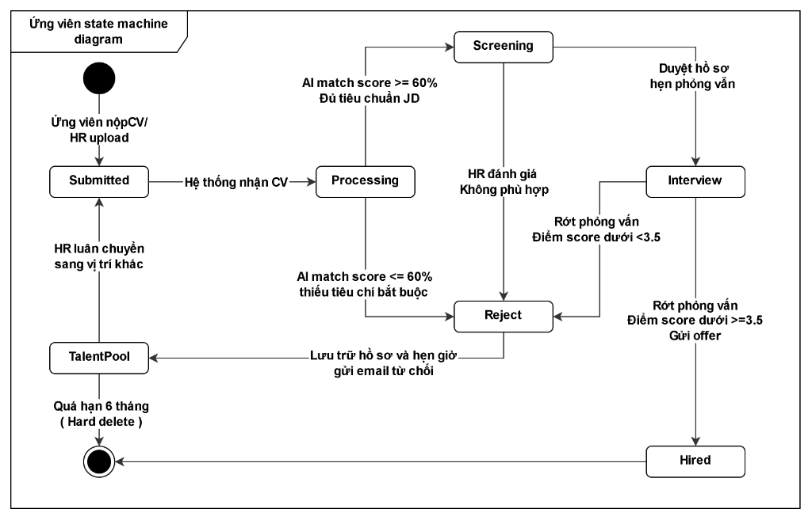
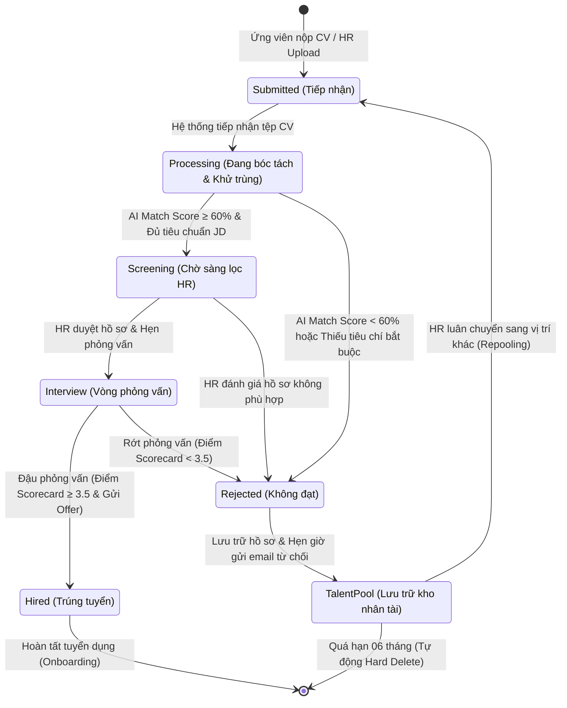
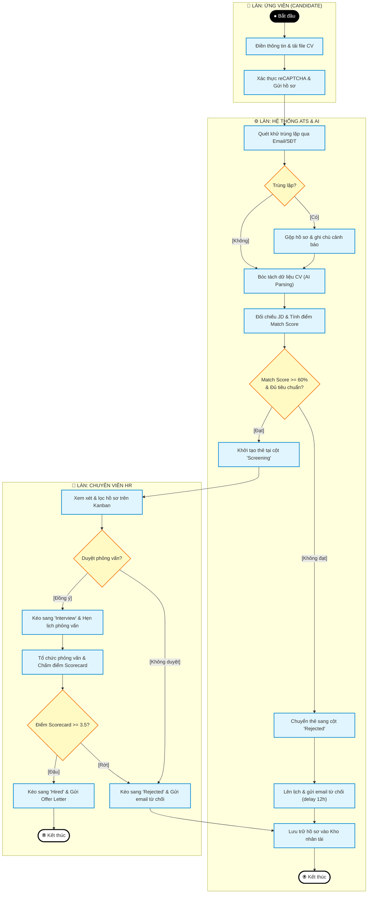
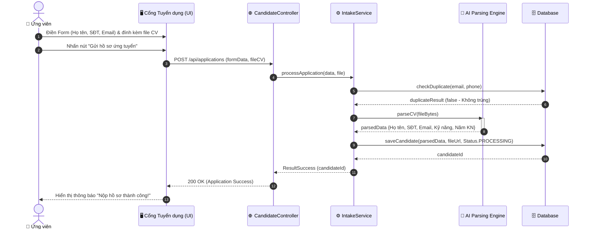
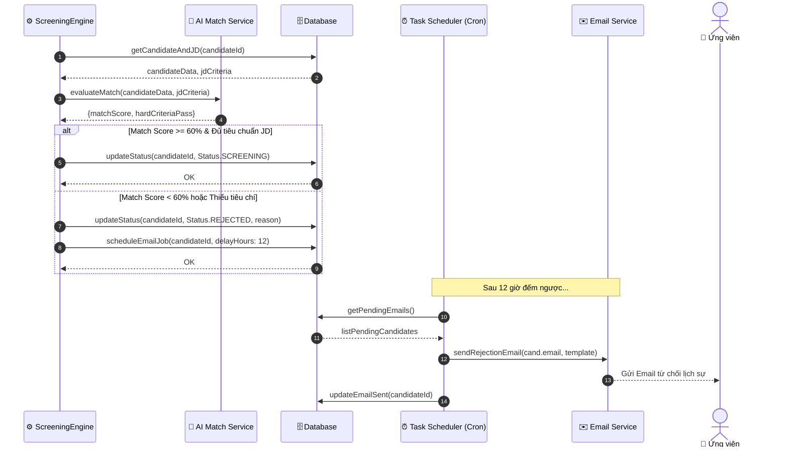
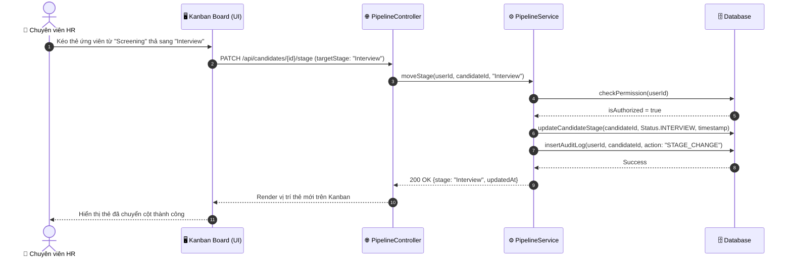
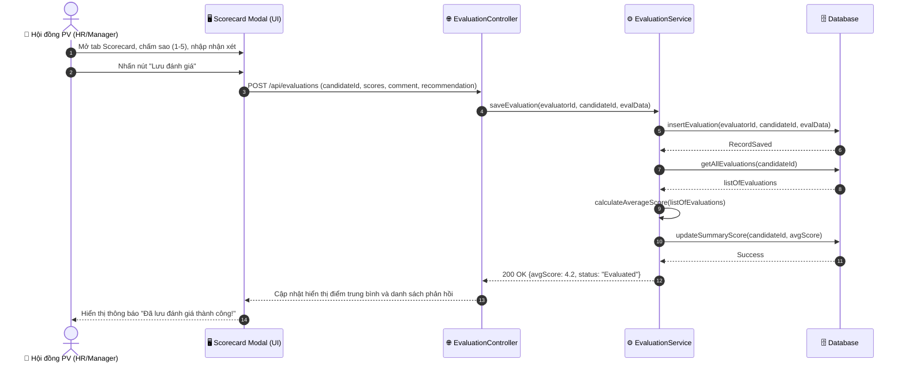
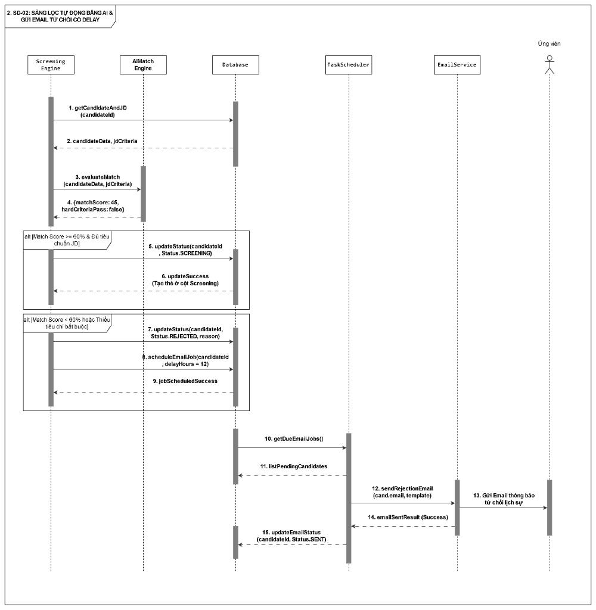

# C?C M? H?NH ??NG: STATE MACHINE, ACTIVITY & SEQUENCE DIAGRAMS

> **D? ?n:** ReCoverX Career - ATS

---

## 1. S? ?? m?y tr?ng th?i ?ng vi?n (State Machine Diagram)



### Chi ti?t c?c tr?ng th?i v? ?i?u ki?n chuy?n d?ch:

Bước phù hợp và logic nhất để làm ngay bây giờ là:  
👉 **Mục 10: SƠ ĐỒ TRẠNG THÁI (STATE MACHINE) & BẢNG CHUYỂN TRẠNG THÁI**.

### VÌ SAO NÊN LÀM BƯỚC NÀY TRƯỚC?
1. **Linh hồn của hệ thống ATS là "Vòng đời của Ứng viên":** Hồ sơ sẽ biến đổi liên tục từ *Mới nộp ➔ Bóc tách ➔ Sàng lọc ➔ Phỏng vấn ➔ Trúng tuyển / Bị loại ➔ Kho nhân tài*.
2. **Kế thừa trực tiếp Bảng Business Rules (BRL-xx) vừa viết:** Các điều kiện chuyển trạng thái (như điểm AI ≥ 60%, quá hạn 6 tháng xóa vĩnh viễn, cảnh báo SLA) sẽ trở thành **Guard Conditions (Điều kiện rẽ nhánh)** trong State Machine.
3. **Là kim chỉ nam để vẽ Sequence Diagram:** Khi vẽ Sequence Diagram ở bước tiếp theo, bạn sẽ biết chính xác hàm nào cần gọi (ví dụ: `updateStatus(INTERVIEW)`).

---

### PHẦN 1: SƠ ĐỒ TRẠNG THÁI ỨNG VIÊN (STATE MACHINE DIAGRAM)

Dưới đây là sơ đồ vòng đời trạng thái của một ứng viên trong hệ thống **ReCoverX Career (ATS)**:



---

### PHẦN 2: BẢNG CHUYỂN TRẠNG THÁI CHI TIẾT (STATE TRANSITION TABLE)

Bảng này mô tả chính xác điều kiện kỹ thuật khi hệ thống chuyển trạng thái của một hồ sơ:

| STT | Trạng thái hiện tại (Source State) | Sự kiện kích hoạt (Event / Trigger) | Điều kiện kiểm tra (Guard Condition) | Hành động thực thi của Hệ thống (Action) | Trạng thái kế tiếp (Target State) | Tác nhân thay đổi |
| :---: | :--- | :--- | :--- | :--- | :--- | :---: |
| **1** | `None` (Chưa có) | Ứng viên nộp CV (UC-01) hoặc HR tải lên (UC-02) | Tệp đúng định dạng `.pdf/.doc/.docx` và `≤ 10MB` (BRL-01) | Lưu tệp vào máy chủ, tạo bản ghi ứng viên tạm thời. | **Submitted** (Tiếp nhận) | Ứng viên / HR |
| **2** | **Submitted** | Tự động chuyển vào hàng đợi xử lý ngầm | Không có lỗi tệp | Quét trùng lặp Email/SĐT (BRL-03) và chạy AI Parsing bóc tách dữ liệu (BRL-04). | **Processing** (Đang bóc tách) | Hệ thống |
| **3** | **Processing** | Hoàn tất bóc tách dữ liệu AI | Điểm AI Match Score **≥ 60%** VÀ Đủ kinh nghiệm bắt buộc (BRL-05) | Khởi tạo thẻ ứng viên trên bảng Kanban tại cột *Screening*. | **Screening** (Chờ HR lọc) | Hệ thống (AI) |
| **4** | **Processing** | Hoàn tất bóc tách dữ liệu AI | Điểm AI Match Score **< 60%** HOẶC Thiếu tiêu chí bắt buộc (BRL-05) | Chuyển thẻ sang cột *Rejected*, gắn nhãn lý do loại và lên lịch gửi mail từ chối sau 12h (BRL-06). | **Rejected** (Bị loại vòng AI) | Hệ thống (AI) |
| **5** | **Screening** | HR kéo thẻ sang cột Interview | HR xác nhận hồ sơ đạt yêu cầu | Ghi nhận thời gian chuyển cột (Audit Log), nhắc HR hẹn lịch phỏng vấn. | **Interview** (Phỏng vấn) | Chuyên viên HR |
| **6** | **Screening** | HR kéo thẻ sang cột Rejected | HR đánh giá hồ sơ không đạt | Ghi nhận lý do loại, chuyển hồ sơ vào danh sách từ chối. | **Rejected** (Loại vòng CV) | Chuyên viên HR |
| **7** | **Interview** | HR kéo thẻ sang cột Hired | Điểm Scorecard **≥ 3.5/5.0** (BRL-08) và có quyết định tuyển dụng | Gửi Thư mời nhận việc (Offer Letter) cho ứng viên. | **Hired** (Trúng tuyển) | Chuyên viên HR |
| **8** | **Interview** | HR kéo thẻ sang cột Rejected | Điểm Scorecard **< 3.5/5.0** (BRL-08) hoặc từ chối Offer | Soạn/Gửi email thông báo kết quả phỏng vấn không trúng tuyển. | **Rejected** (Rớt phỏng vấn) | Chuyên viên HR |
| **9** | **Rejected** | Hồ sơ rơi vào trạng thái bị loại | Tất cả các nguồn bị loại (AI, vòng CV, vòng Phỏng vấn) | Đồng bộ dữ liệu vào Kho nhân tài (Talent Pool) và kích hoạt bộ đếm thời gian lưu trữ 06 tháng. | **TalentPool** (Kho nhân tài) | Hệ thống |
| **10**| **TalentPool** | HR thực hiện Repooling (UC-04) | Vị trí đích đang mở tuyển dụng | Tạo bản sao thẻ ứng viên ở trạng thái *Submitted* của vị trí mới, bảo lưu lịch sử cũ. | **Submitted** (Vị trí mới) | Chuyên viên HR |
| **11**| **TalentPool** | Tác vụ quét ngầm hàng đêm (Cron Job) | Thời gian lưu trữ trong Kho nhân tài **> 06 tháng** (BRL-10) | Thực hiện xóa vĩnh viễn (Hard Delete) hồ sơ và tệp CV khỏi CSDL để bảo mật dữ liệu. | `End` (Xóa vĩnh viễn) | Hệ thống |

---

### PHẦN 3: TEXT ĐỂ BẠN TỰ VẼ TRÊN DRAW.IO (NẾU CẦN)

Khi mở Draw.io để vẽ State Machine, bạn chọn thư viện **UML** ➔ **State**:
1. **Trạng thái bắt đầu (Initial State):** Hình tròn đen đặc `●`.
2. **Các ô trạng thái (States):** Hình chữ nhật bo tròn góc:
   * `Submitted (Tiếp nhận)`
   * `Processing (Bóc tách AI)`
   * `Screening (Chờ HR lọc)`
   * `Interview (Phỏng vấn)`
   * `Hired (Trúng tuyển)`
   * `Rejected (Bị loại)`
   * `TalentPool (Kho nhân tài)`
3. **Mũi tên chuyển trạng thái (Transitions):** Mũi tên nét liền có ghi nhãn điều kiện bên trên:
   * Ví dụ: `[AI Match Score >= 60%]`, `[HR duyệt phỏng vấn]`, `[Thời gian > 6 tháng]`.
4. **Trạng thái kết thúc (Final State):** Hình tròn đen đặc có viền tròn bao quanh `⦿`.

---

👉 **BƯỚC TIẾP THEO:**  
Sau khi đã chốt xong State Machine, chúng ta sẽ bước sang:  
👉 **Mục 9: Sequence Diagram (Sơ đồ tuần tự - yêu cầu ≥ 4 sơ đồ theo checklist)**:
1. **SD-01:** Nộp hồ sơ ứng tuyển trực tuyến & AI bóc tách (UC-01 & UC-02)
2. **SD-02:** Sàng lọc hồ sơ tự động & Gửi email từ chối có delay (UC-03)
3. **SD-03:** Kéo - thả Kanban & Cảnh báo SLA (UC-04)
4. **SD-04:** Chấm điểm phỏng vấn bằng Scorecard & Tổng hợp kết quả (UC-05)

Bạn có muốn bắt đầu triển khai **4 Sequence Diagram** này luôn không?

---

## 2. S? ?? ho?t ??ng (Activity Diagrams - Swimlane)

Rất hợp lý! Trong kỹ thuật phân tích thiết kế phần mềm, **Activity Diagram (Sơ đồ hoạt động UML)** là bước đệm tuyệt vời nhất: nó mô tả trực quan các luồng hành động tương tác giữa các bên theo thời gian thực trước khi đào sâu vào các hàm gọi chi tiết của Sequence Diagram.

Dưới đây là thiết kế chuẩn mực của **UML Activity Diagram (To-Be)** với **3 phân làn (Swimlanes / Partitions)**:

---

### PHẦN 1: SƠ ĐỒ TRỰC QUAN (ACTIVITY DIAGRAM)



---

### PHẦN 2: TEXT CHI TIẾT TỪNG PHẦN TỬ ĐỂ BẠN COPY TỰ VẼ TRÊN DRAW.IO

Khi mở Draw.io, bạn chọn thư viện **UML ➔ Activity**:

#### 1. Chia 3 Làn bơi (Swimlanes):
* **Làn 1:** `Ứng viên (Candidate)`
* **Làn 2:** `Hệ thống ATS & AI (System)`
* **Làn 3:** `Chuyên viên HR (Recruiter)`

#### 2. Danh sách các nút theo từng làn:

* **Tại Làn Ứng viên:**
  1. `Initial Node`: Hình tròn đen đặc `●` (Bắt đầu).
  2. `Action 1`: `Điền thông tin & tải file CV`.
  3. `Action 2`: `Xác thực reCAPTCHA & Gửi hồ sơ`.

* **Tại Làn Hệ thống ATS & AI:**
  4. `Action 3`: `Quét khử trùng lặp qua Email/SĐT`.
  5. `Decision Node 1`: Hình thoi `Trùng lặp?`
     * Nhánh `[Có]` ➔ `Action 4`: `Gộp hồ sơ & ghi chú cảnh báo` ➔ đi sang Action 5.
     * Nhánh `[Không]` ➔ đi thẳng sang Action 5.
  6. `Action 5`: `Bóc tách dữ liệu CV (AI Parsing)`.
  7. `Action 6`: `Đối chiếu JD & Tính điểm Match Score`.
  8. `Decision Node 2`: Hình thoi `Match Score >= 60% & Đủ tiêu chuẩn?`
     * Nhánh `[Không đạt]`:
       * `Action 7a`: `Chuyển thẻ sang cột 'Rejected'`.
       * `Action 7b`: `Lên lịch & gửi email từ chối (delay 12h)`.
       * `Action 7c`: `Lưu trữ hồ sơ vào Kho nhân tài`.
       * `Activity Final Node`: Vòng tròn đen có viền `⦿` (Kết thúc loại bởi AI).
     * Nhánh `[Đạt]`:
       * `Action 8`: `Khởi tạo thẻ tại cột 'Screening'` ➔ chuyển luồng sang Làn HR.

* **Tại Làn Chuyên viên HR:**
  9. `Action 9`: `Xem xét & lọc hồ sơ trên Kanban`.
  10. `Decision Node 3`: Hình thoi `Duyệt phỏng vấn?`
      * Nhánh `[Không duyệt]` ➔ sang `Action 10a`: `Kéo sang 'Rejected' & Gửi email từ chối` ➔ trỏ mũi tên quay về `Action 7c: Lưu trữ vào Kho nhân tài` ở Làn Hệ thống.
      * Nhánh `[Đồng ý]` ➔ `Action 10b`: `Kéo sang 'Interview' & Hẹn lịch phỏng vấn`.
  11. `Action 11`: `Tổ chức phỏng vấn & Chấm điểm Scorecard`.
  12. `Decision Node 4`: Hình thoi `Điểm Scorecard >= 3.5?`
      * Nhánh `[Đậu]` ➔ `Action 12`: `Kéo sang 'Hired' & Gửi Offer Letter` ➔ `Activity Final Node`: Vòng tròn đen có viền `⦿` (Kết thúc tuyển dụng thành công).
      * Nhánh `[Rớt]` ➔ trỏ mũi tên quay về `Action 10a: Kéo sang 'Rejected' & Gửi email từ chối`.

---

### PHẦN 3: LƯU Ý ĐỂ KHÔNG BỊ TRỪ ĐIỂM (SỰ KHÁC NHAU GIỮA ACTIVITY DIAGRAM VÀ BPMN)

Nhiều bạn vẽ Activity Diagram bị nhầm với BPMN, bạn chú ý 3 quy tắc UML này nhé:
1. **Không dùng các icon người 👤 hay bánh răng ⚙️ trong ô:** Trong UML Activity Diagram, tất cả các hành động đều dùng chung **hình chữ nhật bo tròn góc** (`Action State`).
2. **Hình thoi rẽ nhánh (Decision Node):** Chỉ là hình thoi trơn, **không có chữ "X" bên trong** (chữ X là của BPMN Exclusive Gateway).
3. **Nhãn điều kiện trên mũi tên:** Luôn được đặt trong **dấu ngoặc vuông `[Điều kiện]`** (ví dụ: `[Có]`, `[Không]`, `[Đạt]`, `[Rớt]`).

Bạn có thể mở Draw.io vẽ ngay sơ đồ này. Khi vẽ xong bạn cứ tải hình lên để mình kiểm tra đối chiếu nhé!

---

## 3. T?ng h?p 4 Sequence Diagrams (S? ?? tu?n t?)

Dưới đây là bộ **4 Sequence Diagram (Sơ đồ tuần tự)** chuẩn mực nhất, phủ kín **5 Use Case cốt lõi** và các luồng kiến trúc 3 lớp (UI ➔ Service ➔ Database / AI / Mail) của hệ thống **ReCoverX Career (ATS)** theo đúng checklist:

---

### 1. SD-01: NỘP HỒ SƠ TRỰC TUYẾN & AI BÓC TÁCH DỮ LIỆU (UC-01 & UC-02)

> **Mô tả:** Thể hiện luồng từ lúc Ứng viên nộp CV, hệ thống kiểm tra trùng lặp và dùng AI bóc tách dữ liệu lưu vào cơ sở dữ liệu.



---

### 2. SD-02: SÀNG LỌC TỰ ĐỘNG BẰNG AI & GỬI EMAIL TỪ CHỐI CÓ DELAY (UC-03)

> **Mô tả:** Thể hiện logic AI đối chiếu tiêu chí JD, rẽ nhánh: Đạt ➔ Vào Screening; Không đạt ➔ Vào Rejected và kích hoạt hàng đợi gửi email trễ sau 12h.



---

### 3. SD-03: KÉO - THẢ KANBAN CHUYỂN TRẠNG THÁI & CẢNH BÁO SLA (UC-04)

> **Mô tả:** Thể hiện thao tác HR kéo thẻ từ cột này sang cột khác, kiểm tra quyền hạn, cập nhật thời gian thực và ghi nhận Audit Log.



---

### 4. SD-04: ĐÁNH GIÁ ỨNG VIÊN BẰNG SCORECARD & TỔNG HỢP KẾT QUẢ (UC-05)

> **Mô tả:** Hội đồng phỏng vấn chấm điểm 1–5 sao, ghi nhận xét; hệ thống tự động tính điểm trung bình cộng của toàn bộ hội đồng.



---

### HƯỚNG DẪN KHI VẼ TRÊN DRAW.IO:
Khi mở Draw.io để vẽ từng sơ đồ, bạn vào thư viện **UML ➔ Sequence**:
* **Lifelines (Các cột dọc):**
  * Dùng hình Người `Actor` cho người dùng (`Ứng viên`, `Chuyên viên HR`).
  * Dùng hình Hộp chữ nhật cho các thành phần phần mềm (`UI`, `Controller`, `Service`, `Database`, `AI Engine`).
* **Messages (Mũi tên):**
  * **Mũi tên nét liền có đầu tam giác đặc (`—►`):** Lời gọi hàm đồng bộ (Synchronous Call).
  * **Mũi tên nét đứt (`- - -►`):** Phản hồi kết quả (Return Message).
* **Khung Alt (Alternate Frame):**
  * Dùng khung chữ nhật có nhãn `alt` ở góc trên bên trái để chia 2 nhánh điều kiện `[Đạt]` và `[Không đạt]`.

Bạn có thể vẽ sơ đồ đầu tiên (SD-01) hoặc bất kỳ sơ đồ nào lên Draw.io rồi tải lên để mình kiểm tra tiếp nhé!

---

### H??ng d?n v? SD-01: N?p h? s? tr?c tuy?n & AI b?c t?ch d? li?u

Dưới đây là **hướng dẫn chi tiết từng bước** để bạn mở Draw.io ra là vẽ được ngay **SD-01: NỘP HỒ SƠ TRỰC TUYẾN & AI BÓC TÁCH DỮ LIỆU** chuẩn 100% theo kiến trúc phần mềm 3 lớp (UI ➔ Logic ➔ Database & AI).

---

### BƯỚC 1: TẠO 6 CỘT ĐỐI TƯỢNG (LIFELINES - TỪ TRÁI SANG PHẢI)

Khi mở Draw.io, bạn vào thư viện bên trái: **UML ➔ Sequence**, kéo 6 đối tượng sau đặt thẳng hàng ngang từ trái qua phải:

| Vị trí | Tên đối tượng | Loại hình trong Draw.io | Đại diện cho thành phần nào? |
| :---: | :--- | :--- | :--- |
| **1** | `Ứng viên` | Hình người (**Actor**) | Người dùng thực hiện nộp hồ sơ |
| **2** | `CandidatePortal (UI)` | Hình hộp (**Lifeline**) | Giao diện trang web nộp CV |
| **3** | `CandidateController` | Hình hộp (**Lifeline**) | Tầng tiếp nhận API Backend |
| **4** | `IntakeService` | Hình hộp (**Lifeline**) | Tầng xử lý nghiệp vụ chính |
| **5** | `Database` | Hình hộp (**Lifeline**) hoặc biểu tượng Database | Cơ sở dữ liệu lưu trữ hồ sơ |
| **6** | `AIEngine (LLM API)` | Hình hộp (**Lifeline**) | Dịch vụ AI bóc tách thông tin |

*(Dưới mỗi hộp sẽ có một đường kẻ dọc nét đứt kéo dài xuống dưới gọi là đường đời - Lifeline).*

---

### BƯỚC 2: KÉO CÁC MŨI TÊN (MESSAGE) THEO ĐÚNG THỨ TỰ TỪ TRÊN XUỐNG DƯỚI

Bạn kéo lần lượt 12 mũi tên theo bảng dưới đây (đoạn nào là **gọi hàm** thì dùng **mũi tên nét liền**, đoạn nào là **trả về kết quả** thì dùng **mũi tên nét đứt**):

| STT | Đối tượng gửi (From) | Đối tượng nhận (To) | Loại mũi tên trong Draw.io | Nội dung chữ ghi trên mũi tên |
| :---: | :--- | :--- | :---: | :--- |
| **1** | `Ứng viên` | `CandidatePortal (UI)` | Nét liền (`—►`) | `1. Điền Form (Họ tên, SĐT, Email) & Đính kèm CV` |
| **2** | `Ứng viên` | `CandidatePortal (UI)` | Nét liền (`—►`) | `2. Nhấn nút "Gửi hồ sơ ứng tuyển"` |
| **3** | `CandidatePortal (UI)` | `CandidateController` | Nét liền (`—►`) | `3. POST /api/applications (formData, fileCV)` |
| **4** | `CandidateController`| `IntakeService` | Nét liền (`—►`) | `4. processApplication(data, file)` |
| **5** | `IntakeService` | `Database` | Nét liền (`—►`) | `5. checkDuplicate(email, phone)` |
| **6** | `Database` | `IntakeService` | **Nét đứt (`- - -►`)** | `6. isDuplicate = false (Không trùng)` |
| **7** | `IntakeService` | `AIEngine (LLM API)` | Nét liền (`—►`) | `7. parseCV(fileBytes)` |
| **8** | `AIEngine (LLM API)` | `IntakeService` | **Nét đứt (`- - -►`)** | `8. parsedData {Họ tên, SĐT, Email, Kỹ năng, Năm KN}` |
| **9** | `IntakeService` | `Database` | Nét liền (`—►`) | `9. saveCandidate(parsedData, fileUrl, status = 'PROCESSING')` |
| **10**| `Database` | `IntakeService` | **Nét đứt (`- - -►`)** | `10. candidateId = 101 (Success)` |
| **11**| `IntakeService` | `CandidateController`| **Nét đứt (`- - -►`)** | `11. ResultSuccess(candidateId)` |
| **12**| `CandidateController`| `CandidatePortal (UI)` | **Nét đứt (`- - -►`)** | `12. 200 OK (Application Success)` |
| **13**| `CandidatePortal (UI)` | `Ứng viên` | **Nét đứt (`- - -►`)** | `13. Hiển thị thông báo "Nộp hồ sơ thành công!"` |

---

### BƯỚC 3: MẸO VẼ THANH KÍCH HOẠT (ACTIVATION BAR) CHUẨN ĐẸP

* **Thanh kích hoạt (Activation Bar):** Là dải chữ nhật hẹp màu trắng/xám nằm đè lên đường nét đứt dọc của từng cột.
* **Cách đặt chuẩn:**
  * Cột `AIEngine`: Đặt thanh kích hoạt từ mũi tên số 7 đến mũi tên số 8 (để thể hiện AI đang bận đọc file và bóc tách dữ liệu).
  * Cột `IntakeService`: Kéo dài thanh kích hoạt từ mũi tên số 4 đến mũi tên số 11 (để thể hiện dịch vụ này quản lý toàn bộ luồng xử lý).

---

### HÌNH MẪU ĐỂ BẠN DỄ HÌNH DUNG KHI VẼ:

```text
 Ứng viên       CandidatePortal     CandidateController     IntakeService          Database          AIEngine
    |                  |                     |                   |                    |                 |
    |-- 1. Điền form ->|                     |                   |                    |                 |
    |-- 2. Gửi hồ sơ ->|                     |                   |                    |                 |
    |                  |-- 3. POST /api ---->|                   |                    |                 |
    |                  |                     |-- 4. process ---->|                    |                 |
    |                  |                     |                   |-- 5. checkDup ---->|                 |
    |                  |                     |                   |<-- 6. false -------|                 |
    |                  |                     |                   |-- 7. parseCV ----------------------->|
    |                  |                     |                   |<-- 8. parsedData --------------------|
    |                  |                     |                   |-- 9. saveCandidate>|                 |
    |                  |                     |                   |<-- 10. ID = 101 ---|                 |
    |                  |                     |<-- 11. Success ---|                    |                 |
    |                  |<-- 12. 200 OK ------|                   |                    |                 |
    |<-- 13. Báo OK ---|                     |                   |                    |                 |
```

Bạn cứ mở Draw.io, kéo 6 cột và vẽ 13 đường mũi tên này theo đúng thứ tự từ trên xuống dưới. Vẽ xong bạn tải hình lên để mình kiểm tra đối chiếu nhé!

---

### H??ng d?n v? SD-02: S?ng l?c t? ??ng b?ng AI & G?i email t? ch?i c? delay



Dưới đây là **hướng dẫn chi tiết từng bước** để bạn vẽ **SD-02: SÀNG LỌC TỰ ĐỘNG BẰNG AI & GỬI EMAIL TỪ CHỐI CÓ DELAY** trên Draw.io chuẩn chỉnh 100%:

---

### BƯỚC 1: TẠO 6 CỘT ĐỐI TƯỢNG (LIFELINES - TỪ TRÁI SANG PHẢI)

Vào thư viện **UML ➔ Sequence**, kéo 6 đối tượng đặt thẳng hàng ngang từ trái qua phải:

| Vị trí | Tên đối tượng | Loại hình trong Draw.io | Đại diện cho thành phần nào? |
| :---: | :--- | :--- | :--- |
| **1** | `ScreeningEngine` | Hình hộp (**Lifeline**) | Bộ xử lý sàng lọc hồ sơ tự động |
| **2** | `AIMatchEngine` | Hình hộp (**Lifeline**) | Dịch vụ AI so khớp tiêu chuẩn JD |
| **3** | `Database` | Hình hộp (**Lifeline**) | Cơ sở dữ liệu hệ thống |
| **4** | `TaskScheduler` | Hình hộp (**Lifeline**) | Bộ hẹn giờ tác vụ ngầm (Cron Job) |
| **5** | `EmailService` | Hình hộp (**Lifeline**) | Dịch vụ gửi email (SMTP/SendGrid) |
| **6** | `Ứng viên` | Hình người (**Actor**) | Người nhận email từ chối |

---

### BƯỚC 2: BẢNG CHI TIẾT CÁC MŨI TÊN (THEO THỨ TỰ TỪ TRÊN XUỐNG)

Quy trình này chia làm 2 giai đoạn: **Giai đoạn Sàng lọc AI (có khung rẽ nhánh `alt`)** và **Giai đoạn Hẹn giờ gửi Email sau 12h**:

#### Giai đoạn A: Sàng lọc hồ sơ bằng AI & Rẽ nhánh
| STT | Đối tượng gửi (From) | Đối tượng nhận (To) | Loại mũi tên | Nội dung chữ ghi trên mũi tên |
| :---: | :--- | :--- | :---: | :--- |
| **1** | `ScreeningEngine` | `Database` | Nét liền (`—►`) | `1. getCandidateAndJD(candidateId)` |
| **2** | `Database` | `ScreeningEngine` | **Nét đứt (`- - -►`)** | `2. candidateData, jdCriteria` |
| **3** | `ScreeningEngine` | `AIMatchEngine` | Nét liền (`—►`) | `3. evaluateMatch(candidateData, jdCriteria)` |
| **4** | `AIMatchEngine` | `ScreeningEngine` | **Nét đứt (`- - -►`)** | `4. {matchScore: 45, hardCriteriaPass: false}` |

---

#### 🟢 BƯỚC CHÈN KHUNG `alt` (RẼ NHÁNH ĐIỀU KIỆN):
*(Kéo khung chữ nhật **Frame** trong mục UML, ghi chữ **`alt`** ở góc trên bên trái, kẻ 1 đường nét đứt ngang ở giữa để chia làm 2 nửa)*:

* **Nửa trên - Điều kiện `[Match Score >= 60% & Đủ tiêu chuẩn JD]`:**
  | STT | Đối tượng gửi (From) | Đối tượng nhận (To) | Loại mũi tên | Nội dung chữ ghi trên mũi tên |
  | :---: | :--- | :--- | :---: | :--- |
  | **5** | `ScreeningEngine` | `Database` | Nét liền (`—►`) | `5. updateStatus(candidateId, Status.SCREENING)` |
  | **6** | `Database` | `ScreeningEngine` | **Nét đứt (`- - -►`)** | `6. updateSuccess (Tạo thẻ ở cột Screening)` |

* **Nửa dưới - Điều kiện `[Match Score < 60% hoặc Thiếu tiêu chí bắt buộc]`:**
  | STT | Đối tượng gửi (From) | Đối tượng nhận (To) | Loại mũi tên | Nội dung chữ ghi trên mũi tên |
  | :---: | :--- | :--- | :---: | :--- |
  | **7** | `ScreeningEngine` | `Database` | Nét liền (`—►`) | `7. updateStatus(candidateId, Status.REJECTED, reason)` |
  | **8** | `ScreeningEngine` | `Database` | Nét liền (`—►`) | `8. scheduleEmailJob(candidateId, delayHours = 12)` |
  | **9** | `Database` | `ScreeningEngine` | **Nét đứt (`- - -►`)** | `9. jobScheduledSuccess` |

---

#### Giai đoạn B: Tự động gửi Email từ chối sau 12h delay
*(Chèn 1 ô ghi chú nhỏ - Note: `Sau 12 giờ đếm ngược...`)*

| STT | Đối tượng gửi (From) | Đối tượng nhận (To) | Loại mũi tên | Nội dung chữ ghi trên mũi tên |
| :---: | :--- | :--- | :---: | :--- |
| **10**| `TaskScheduler` | `Database` | Nét liền (`—►`) | `10. getDueEmailJobs()` |
| **11**| `Database` | `TaskScheduler` | **Nét đứt (`- - -►`)** | `11. listPendingCandidates` |
| **12**| `TaskScheduler` | `EmailService` | Nét liền (`—►`) | `12. sendRejectionEmail(cand.email, template)` |
| **13**| `EmailService` | `Ứng viên` | Nét liền (`—►`) | `13. Gửi Email thông báo từ chối lịch sự` |
| **14**| `EmailService` | `TaskScheduler` | **Nét đứt (`- - -►`)** | `14. emailSentResult (Success)` |
| **15**| `TaskScheduler` | `Database` | Nét liền (`—►`) | `15. updateEmailStatus(candidateId, Status.SENT)` |

---

### BẢN MẪU DẠNG CHỮ ĐỂ BẠN DỄ HÌNH DUNG KHI VẼ:

```text
ScreeningEngine     AIMatchEngine         Database         TaskScheduler     EmailService      Ứng viên
      |                   |                  |                   |                |               |
      |-- 1. getCandidateAndJD ------------->|                   |                |               |
      |<-- 2. candidateData, jdCriteria -----|                   |                |               |
      |-- 3. evaluateMatch------>|           |                   |                |               |
      |<-- 4. {score, pass} -----|           |                   |                |               |
+==================================================================================================+
| alt [Match Score >= 60% & Đủ tiêu chuẩn]                                                         |
|     |-- 5. updateStatus(SCREENING) ------->|                   |                |               |
|     |<-- 6. updateSuccess -----------------|                   |                |               |
|--------------------------------------------------------------------------------------------------|
| else [Match Score < 60% hoặc Thiếu tiêu chuẩn]                                                   |
|     |-- 7. updateStatus(REJECTED) -------->|                   |                |               |
|     |-- 8. scheduleEmailJob(delay 12h) --->|                   |                |               |
|     |<-- 9. jobScheduledSuccess -----------|                   |                |               |
+==================================================================================================+
      |                   |                  |                   |                |               |
      |                   |      [ Note: Sau 12 giờ đếm ngược... ]                |               |
      |                   |                  |                   |                |               |
      |                   |                  |<-- 10. getDueJobs-|                |               |
      |                   |                  |-- 11. listPending>|                |               |
      |                   |                  |                   |-- 12. sendMail>|               |
      |                   |                  |                   |                |-- 13. Gửi --->|
      |                   |                  |                   |<-- 14. sent OK-|               |
      |                   |                  |<-- 15. markSent---|                |               |
```

Bạn cứ tạo 6 cột và vẽ theo các bước trên. Vẽ xong bạn gửi hình lên mình xem ngay nhé!

---

### H??ng d?n v? SD-04: ??nh gi? ?ng vi?n b?ng Scorecard & T?ng h?p k?t qu?

Dưới đây là **hướng dẫn chi tiết từng bước** để bạn vẽ **SD-04: ĐÁNH GIÁ ỨNG VIÊN BẰNG SCORECARD & TỔNG HỢP KẾT QUẢ (UC-05)** trên Draw.io chuẩn 100%:

---

### BƯỚC 1: TẠO 5 CỘT ĐỐI TƯỢNG (LIFELINES - TỪ TRÁI SANG PHẢI)

Vào thư viện **UML ➔ Sequence**, kéo 5 đối tượng đặt thẳng hàng ngang từ trái qua phải:

| Vị trí | Tên đối tượng | Loại hình trong Draw.io | Đại diện cho thành phần nào? |
| :---: | :--- | :--- | :--- |
| **1** | `Hội đồng phỏng vấn` | Hình người (**Actor**) | Người phỏng vấn (HR hoặc Hiring Manager) |
| **2** | `ScorecardModal (UI)` | Hình hộp (**Lifeline**) | Giao diện biểu mẫu chấm điểm trên web |
| **3** | `EvaluationController` | Hình hộp (**Lifeline**) | Tầng tiếp nhận API Backend |
| **4** | `EvaluationService` | Hình hộp (**Lifeline**) | Tầng xử lý nghiệp vụ & tính toán điểm |
| **5** | `Database` | Hình hộp (**Lifeline**) | Cơ sở dữ liệu lưu phiếu chấm điểm |

---

### BƯỚC 2: BẢNG CHI TIẾT CÁC MŨI TÊN (THEO THỨ TỰ TỪ TRÊN XUỐNG)

Quy trình gồm 14 bước tuần tự, đặc biệt có **bước số 9 là hàm tự tính toán (Self-call)** thể hiện logic tính điểm trung bình:

| STT | Đối tượng gửi (From) | Đối tượng nhận (To) | Loại mũi tên | Nội dung chữ ghi trên mũi tên |
| :---: | :--- | :--- | :---: | :--- |
| **1** | `Hội đồng phỏng vấn` | `ScorecardModal (UI)` | Nét liền (`—►`) | `1. Mở tab Scorecard, chấm sao (1-5), nhập nhận xét` |
| **2** | `Hội đồng phỏng vấn` | `ScorecardModal (UI)` | Nét liền (`—►`) | `2. Nhấn nút "Lưu đánh giá"` |
| **3** | `ScorecardModal (UI)` | `EvaluationController` | Nét liền (`—►`) | `3. POST /api/evaluations (candidateId, scores, comment)` |
| **4** | `EvaluationController`| `EvaluationService` | Nét liền (`—►`) | `4. saveEvaluation(evaluatorId, candidateId, evalData)` |
| **5** | `EvaluationService` | `Database` | Nét liền (`—►`) | `5. insertEvaluation(evaluatorId, candidateId, evalData)` |
| **6** | `Database` | `EvaluationService` | **Nét đứt (`- - -►`)** | `6. recordSaved (ID = 501)` |
| **7** | `EvaluationService` | `Database` | Nét liền (`—►`) | `7. getAllEvaluations(candidateId)` |
| **8** | `Database` | `EvaluationService` | **Nét đứt (`- - -►`)** | `8. listOfEvaluations [list điểm của cả hội đồng]` |
| **9** | `EvaluationService` | **Chính nó (`EvaluationService`)** | Nét liền uốn cong (`↺`) | `9. calculateAverageScore(listOfEvaluations)` |
| **10**| `EvaluationService` | `Database` | Nét liền (`—►`) | `10. updateSummaryScore(candidateId, avgScore)` |
| **11**| `Database` | `EvaluationService` | **Nét đứt (`- - -►`)** | `11. updateSuccess` |
| **12**| `EvaluationService` | `EvaluationController`| **Nét đứt (`- - -►`)** | `12. ResultSuccess {avgScore: 4.2, status: "Evaluated"}` |
| **13**| `EvaluationController`| `ScorecardModal (UI)` | **Nét đứt (`- - -►`)** | `13. 200 OK (DataSaved)` |
| **14**| `ScorecardModal (UI)` | `Hội đồng phỏng vấn` | **Nét đứt (`- - -►`)** | `14. Hiển thị điểm TB (4.2/5.0) & thông báo "Lưu thành công!"` |

---

### BƯỚC 3: MẸO VẼ MŨI TÊN SỐ 9 (SELF-CALL - TỰ GỌI CHÍNH NÓ)

* **Ở bước số 9:** Sau khi lấy được danh sách điểm của tất cả mọi người từ Database về (bước 8), `EvaluationService` tự chạy thuật toán tính điểm trung bình cộng.
* **Cách vẽ trong Draw.io:** 
  * Bạn kéo hình mũi tên **Self-Call / Loopback** (hình mũi tên cong hình chữ U nằm ngang, xuất phát từ `EvaluationService` và cắm ngược lại vào chính đường dóng của `EvaluationService`).
  * Chi tiết này rất chuẩn bài kỹ thuật phần mềm, thể hiện rõ hệ thống tự động tính điểm ngầm.

---

### BẢN MẪU DẠNG CHỮ ĐỂ BẠN DỄ HÌNH DUNG KHI VẼ:

```text
Hội đồng PV       ScorecardModal       EvaluationController    EvaluationService            Database
     |                   |                      |                      |                        |
     |-- 1. Chấm sao --->|                      |                      |                        |
     |-- 2. Nhấn Lưu --->|                      |                      |                        |
     |                   |-- 3. POST /api ----->|                      |                        |
     |                   |                      |-- 4. saveEval ------>|                        |
     |                   |                      |                      |-- 5. insertEval ------>|
     |                   |                      |                      |<-- 6. recordSaved -----|
     |                   |                      |                      |-- 7. getAllEvals ----->|
     |                   |                      |                      |<-- 8. listScores ------|
     |                   |                      |                      |--+                     |
     |                   |                      |                      |  | 9. calculateAvg()   |
     |                   |                      |                      |<-+                     |
     |                   |                      |                      |-- 10. updateAvg ------>|
     |                   |                      |                      |<-- 11. updateSuccess --|
     |                   |                      |<-- 12. ResultSuccess-|                        |
     |                   |<-- 13. 200 OK -------|                      |                        |
     |<-- 14. Báo thành công (Điểm TB 4.2) -----|                      |                        |
```

Bạn cứ mở Draw.io tạo 5 cột và vẽ 14 mũi tên này. Vẽ xong bạn tải hình lên để mình kiểm tra nhé!

