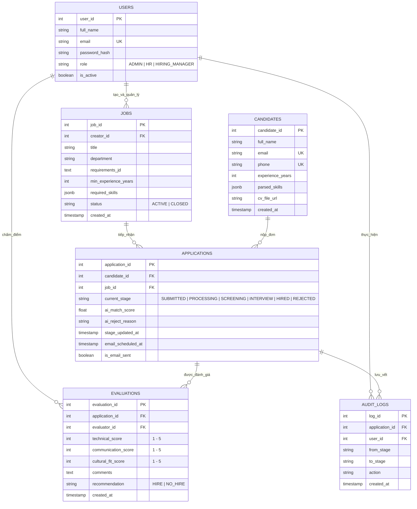
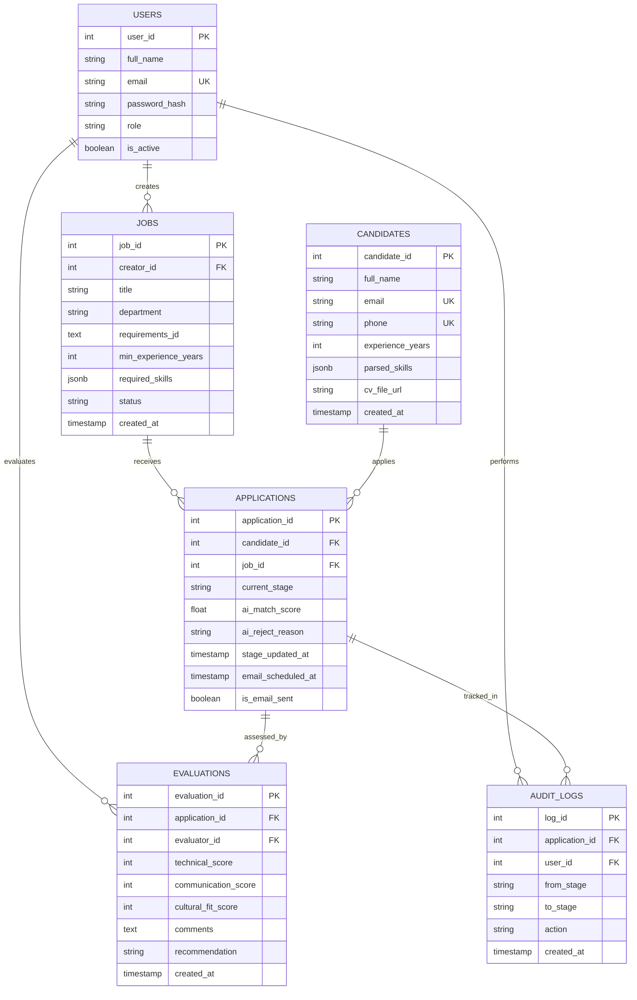

# THI?T K? C? S? D? LI?U & S? ?? TH?C TH? (ERD)

> **D? ?n:** ReCoverX Career - ATS
> **H? qu?n tr? CSDL ?? xu?t:** PostgreSQL

---

## 1. Quy?t ??nh ki?n tr?c d? li?u & Data Dictionary (T? ?i?n d? li?u)

Dưới đây là toàn bộ thiết kế cho **Mục 7: Quyết định thiết kế dữ liệu** và **Mục 8: Data Dictionary (Từ điển dữ liệu)** cho hệ thống **ReCoverX Career (ATS)**:

---

# MỤC 7: QUYẾT ĐỊNH THIẾT KẾ DỮ LIỆU (DATA DESIGN DECISIONS)

### 1. Lựa chọn Hệ quản trị Cơ sở dữ liệu (DBMS)
* **Quyết định:** Sử dụng **Hệ quản trị CSDL quan hệ PostgreSQL (RDBMS)**.
* **Lý do kỹ thuật & nghiệp vụ:**
  * **Tính toàn vẹn dữ liệu (ACID):** Đảm bảo an toàn tuyệt đối khi luân chuyển trạng thái Kanban và cập nhật lịch sử Audit Log.
  * **Hỗ trợ kiểu dữ liệu `JSONB`:** Dữ liệu kỹ năng và học vấn do AI bóc tách từ CV rất đa dạng và không cố định số lượng. PostgreSQL hỗ trợ lưu trữ và truy vấn `JSONB` cực nhanh.
  * **Full-text Search:** Tích hợp sẵn tính năng tìm kiếm văn bản toàn diện để phục vụ tính năng tìm kiếm nâng cao theo từ khóa chuyên môn (BR-04, FR-11) với thời gian phản hồi `< 3 giây`.

### 2. Kiến trúc lưu trữ Tệp tin (File Storage)
* **Quyết định:** Tách biệt hoàn toàn tệp tin CV khỏi Cơ sở dữ liệu.
  * **Tệp CV gốc (.pdf, .doc, .docx):** Lưu trữ trên dịch vụ đám mây chuyên dụng **Object Storage (AWS S3 / MinIO / Cloudflare R2)**.
  * **Cơ sở dữ liệu:** Chỉ lưu trữ đường dẫn tệp (`cv_file_url`) và các trường văn bản đã bóc tách.
* **Lý do:** Tránh phình to dung lượng CSDL (Database Bloat), tăng tốc độ sao lưu/phục hồi (Backup & Recovery).

### 3. Chiến lược Khử trùng lặp (Deduplication Strategy)
* Thiết lập chỉ mục duy nhất kết hợp (**Composite Unique Index**) trên 2 trường `email` và `phone` của bảng `candidates`.
* Tạo bảng `applications` riêng biệt liên kết với `candidates`: Một ứng viên chỉ tồn tại 1 lần trong CSDL, nhưng có thể nộp nhiều đơn ứng tuyển (`applications`) cho các vị trí khác nhau.

### 4. Chiến lược Vòng đời dữ liệu (Data Retention & Purging)
* Áp dụng **Soft Delete (Xóa mềm)** qua cờ `is_deleted` và `deleted_at` cho các thao tác hàng ngày của HR.
* Thiết lập **Tác vụ quét ngầm (Cron Job hàng đêm)**: Tự động tìm các hồ sơ ở trạng thái `REJECTED` có thời gian lưu trữ trong Kho nhân tài `> 06 tháng` để thực hiện **Hard Delete (Xóa vĩnh viễn)** cả dữ liệu CSDL lẫn tệp CV trên S3 (tuân thủ quy tắc BRL-10).

---

# SƠ ĐỒ THỰC THỂ QUAN HỆ (ERD - ENTITY RELATIONSHIP DIAGRAM)



---

# MỤC 8: DATA DICTIONARY (TỪ ĐIỂN DỮ LIỆU CHI TIẾT)

Dưới đây là từ điển chi tiết từng thuộc tính của **6 bảng cốt lõi** trong hệ thống:

### 1. Bảng `users` (Tài khoản người dùng nội bộ)
> Quản lý danh tính và phân quyền của Admin, HR và Quản lý chuyên môn.

| Tên trường (Column) | Kiểu dữ liệu | Khóa | Ràng buộc | Giá trị mặc định | Mô tả ý nghĩa nghiệp vụ |
| :--- | :--- | :---: | :--- | :--- | :--- |
| `user_id` | SERIAL | **PK** | NOT NULL | Tự tăng | Khóa chính định danh người dùng. |
| `full_name` | VARCHAR(100) | | NOT NULL | | Họ và tên người dùng. |
| `email` | VARCHAR(150) | | NOT NULL, UNIQUE | | Địa chỉ email đăng nhập hệ thống. |
| `password_hash`| VARCHAR(255) | | NOT NULL | | Mật khẩu đã được mã hóa (BCrypt/Argon2). |
| `role` | VARCHAR(20) | | NOT NULL | `'HR'` | Vai trò: `ADMIN`, `HR`, `HIRING_MANAGER`. |
| `is_active` | BOOLEAN | | NOT NULL | `TRUE` | Trạng thái tài khoản (Đang hoạt động / Khóa). |
| `created_at` | TIMESTAMP | | NOT NULL | `CURRENT_TIMESTAMP` | Thời điểm tạo tài khoản. |

---

### 2. Bảng `jobs` (Vị trí tuyển dụng & Tiêu chí JD)
> Lưu trữ thông tin công việc và các tiêu chuẩn để AI so khớp đánh giá.

| Tên trường (Column) | Kiểu dữ liệu | Khóa | Ràng buộc | Giá trị mặc định | Mô tả ý nghĩa nghiệp vụ |
| :--- | :--- | :---: | :--- | :--- | :--- |
| `job_id` | SERIAL | **PK** | NOT NULL | Tự tăng | Khóa chính định danh vị trí tuyển dụng. |
| `creator_id` | INT | **FK** | NOT NULL, FK `users(user_id)` | | Người tạo tin tuyển dụng (HR/Admin). |
| `title` | VARCHAR(150) | | NOT NULL | | Tên vị trí (VD: Backend Java Developer). |
| `department` | VARCHAR(100) | | NOT NULL | | Phòng ban tuyển dụng (VD: Khối Công nghệ). |
| `requirements_jd`| TEXT | | NOT NULL | | Toàn văn Bản mô tả công việc (JD). |
| `min_experience_years`| INT | | NOT NULL | `0` | Số năm kinh nghiệm tối thiểu bắt buộc. |
| `required_skills`| JSONB | | NOT NULL | `'[]'` | Danh sách kỹ năng bắt buộc (VD: `["Java", "Spring Boot"]`). |
| `status` | VARCHAR(20) | | NOT NULL | `'ACTIVE'` | Trạng thái: `ACTIVE` (Đang tuyển), `CLOSED` (Đóng). |
| `created_at` | TIMESTAMP | | NOT NULL | `CURRENT_TIMESTAMP` | Thời điểm đăng tin tuyển dụng. |

---

### 3. Bảng `candidates` (Thông tin Ứng viên & Dữ liệu bóc tách CV)
> Lưu thông tin cá nhân và dữ liệu do AI bóc tách từ CV.

| Tên trường (Column) | Kiểu dữ liệu | Khóa | Ràng buộc | Giá trị mặc định | Mô tả ý nghĩa nghiệp vụ |
| :--- | :--- | :---: | :--- | :--- | :--- |
| `candidate_id` | SERIAL | **PK** | NOT NULL | Tự tăng | Khóa chính định danh ứng viên. |
| `full_name` | VARCHAR(100) | | NOT NULL | | Họ và tên ứng viên (từ Form hoặc AI đọc). |
| `email` | VARCHAR(150) | | NOT NULL, UNIQUE | | Email liên hệ (Dùng để khử trùng lặp). |
| `phone` | VARCHAR(20) | | NOT NULL, UNIQUE | | Số điện thoại (Dùng để khử trùng lặp). |
| `experience_years`| INT | | NULL | `0` | Số năm kinh nghiệm do AI Parsing bóc tách. |
| `parsed_skills`| JSONB | | NULL | `'[]'` | Danh sách kỹ năng AI bóc tách được từ CV. |
| `cv_file_url` | VARCHAR(500) | | NOT NULL | | Đường dẫn tải tệp CV gốc trên S3 Storage. |
| `created_at` | TIMESTAMP | | NOT NULL | `CURRENT_TIMESTAMP` | Thời điểm tiếp nhận hồ sơ lần đầu. |

---

### 4. Bảng `applications` (Hồ sơ ứng tuyển & Quản lý Pipeline Kanban)
> Quản lý tiến trình của một ứng viên ứng tuyển vào một vị trí cụ thể.

| Tên trường (Column) | Kiểu dữ liệu | Khóa | Ràng buộc | Giá trị mặc định | Mô tả ý nghĩa nghiệp vụ |
| :--- | :--- | :---: | :--- | :--- | :--- |
| `application_id` | SERIAL | **PK** | NOT NULL | Tự tăng | Khóa chính hồ sơ ứng tuyển. |
| `candidate_id` | INT | **FK** | NOT NULL, FK `candidates` | | Tham chiếu đến ứng viên nộp đơn. |
| `job_id` | INT | **FK** | NOT NULL, FK `jobs` | | Tham chiếu đến vị trí ứng tuyển. |
| `current_stage` | VARCHAR(30) | | NOT NULL | `'SUBMITTED'` | Cột Kanban: `SUBMITTED`, `PROCESSING`, `SCREENING`, `INTERVIEW`, `HIRED`, `REJECTED`. |
| `ai_match_score`| FLOAT | | NULL | `NULL` | Điểm AI sàng lọc (thang điểm 0.0 - 100.0%). |
| `ai_reject_reason`| TEXT | | NULL | `NULL` | Lý do loại tự động nếu Match Score < 60%. |
| `stage_updated_at`| TIMESTAMP | | NOT NULL | `CURRENT_TIMESTAMP` | Thời điểm luân chuyển cột (Dùng tính SLA). |
| `email_scheduled_at`| TIMESTAMP | | NULL | `NULL` | Thời điểm hẹn giờ gửi email từ chối (+12h). |
| `is_email_sent` | BOOLEAN | | NOT NULL | `FALSE` | Trạng thái đã gửi email từ chối hay chưa. |
| `repooled_from_id`| INT | **FK** | NULL, FK `applications` | `NULL` | ID hồ sơ gốc nếu được luân chuyển (Repooling). |

---

### 5. Bảng `evaluations` (Phiếu đánh giá phỏng vấn - Scorecard)
> Lưu trữ điểm số và nhận xét của từng thành viên hội đồng phỏng vấn.

| Tên trường (Column) | Kiểu dữ liệu | Khóa | Ràng buộc | Giá trị mặc định | Mô tả ý nghĩa nghiệp vụ |
| :--- | :--- | :---: | :--- | :--- | :--- |
| `evaluation_id` | SERIAL | **PK** | NOT NULL | Tự tăng | Khóa chính phiếu đánh giá. |
| `application_id`| INT | **FK** | NOT NULL, FK `applications`| | Tham chiếu đến hồ sơ được đánh giá. |
| `evaluator_id` | INT | **FK** | NOT NULL, FK `users` | | Người chấm điểm (HR / Hiring Manager). |
| `technical_score`| INT | | NOT NULL, CHECK (1..5) | | Điểm chuyên môn kỹ thuật (thang 1 - 5 sao). |
| `communication_score`| INT | | NOT NULL, CHECK (1..5) | | Điểm giao tiếp & ứng xử (thang 1 - 5 sao). |
| `cultural_fit_score`| INT | | NOT NULL, CHECK (1..5) | | Điểm phù hợp văn hóa công ty (thang 1 - 5 sao). |
| `comments` | TEXT | | NULL | | Nhận xét chi tiết của người chấm. |
| `recommendation`| VARCHAR(20) | | NOT NULL | `'HIRE'` | Khuyến nghị tuyển dụng: `HIRE` hoặc `NO_HIRE`. |
| `created_at` | TIMESTAMP | | NOT NULL | `CURRENT_TIMESTAMP` | Thời điểm hoàn tất đánh giá. |

---

### 6. Bảng `audit_logs` (Nhật ký theo dõi thao tác hệ thống)
> Lưu vết lịch sử luân chuyển thẻ Kanban và các thao tác nhạy cảm.

| Tên trường (Column) | Kiểu dữ liệu | Khóa | Ràng buộc | Giá trị mặc định | Mô tả ý nghĩa nghiệp vụ |
| :--- | :--- | :---: | :--- | :--- | :--- |
| `log_id` | BIGSERIAL | **PK** | NOT NULL | Tự tăng | Khóa chính bản ghi nhật ký. |
| `application_id`| INT | **FK** | NOT NULL, FK `applications`| | Hồ sơ bị tác động. |
| `user_id` | INT | **FK** | NULL, FK `users` | `NULL` | Người thực hiện (NULL nếu do Hệ thống AI tự làm). |
| `from_stage` | VARCHAR(30) | | NULL | | Trạng thái ban đầu trước khi chuyển. |
| `to_stage` | VARCHAR(30) | | NOT NULL | | Trạng thái đích sau khi chuyển. |
| `action` | VARCHAR(50) | | NOT NULL | | Hành động: `STAGE_CHANGE`, `MERGE_CV`, `REPOOL`. |
| `created_at` | TIMESTAMP | | NOT NULL | `CURRENT_TIMESTAMP` | Thời điểm ghi nhận thao tác. |

---

Toàn bộ thiết kế dữ liệu trên đã bao trùm 100% tất cả các trường dữ liệu được gọi trong **BPMN To-Be**, **State Machine** và **4 Sequence Diagrams**. Bạn có thể đưa trực tiếp phần này vào tài liệu của mình!

---

## 2. M? DDL SQL v? M? import Draw.io

Trong Draw.io có 2 cách cực nhanh để nhập code tự động sinh ra sơ đồ ERD mà không cần vẽ tay. Dưới đây là code cho cả 2 cách:

---

### CÁCH 1: DÙNG MÃ SQL (KHUYÊN DÙNG - RA BẢNG CSDL ĐẸP NHẤT TRÊN DRAW.IO)

Trong Draw.io:
1. Bạn nhìn lên thanh công cụ, nhấn vào biểu tượng dấu cộng **`+`** (hoặc vào menu **Arrange** / **Chèn**).
2. Chọn **`Advanced`** ➔ Chọn **`SQL`**.
3. Dán toàn bộ đoạn code dưới đây vào khung rồi nhấn **`Insert`**:

```sql
CREATE TABLE users (
    user_id SERIAL PRIMARY KEY,
    full_name VARCHAR(100) NOT NULL,
    email VARCHAR(150) UNIQUE NOT NULL,
    password_hash VARCHAR(255) NOT NULL,
    role VARCHAR(20) NOT NULL,
    is_active BOOLEAN DEFAULT TRUE,
    created_at TIMESTAMP DEFAULT CURRENT_TIMESTAMP
);

CREATE TABLE jobs (
    job_id SERIAL PRIMARY KEY,
    creator_id INT NOT NULL REFERENCES users(user_id),
    title VARCHAR(150) NOT NULL,
    department VARCHAR(100) NOT NULL,
    requirements_jd TEXT NOT NULL,
    min_experience_years INT DEFAULT 0,
    required_skills JSONB,
    status VARCHAR(20) DEFAULT 'ACTIVE',
    created_at TIMESTAMP DEFAULT CURRENT_TIMESTAMP
);

CREATE TABLE candidates (
    candidate_id SERIAL PRIMARY KEY,
    full_name VARCHAR(100) NOT NULL,
    email VARCHAR(150) UNIQUE NOT NULL,
    phone VARCHAR(20) UNIQUE NOT NULL,
    experience_years INT DEFAULT 0,
    parsed_skills JSONB,
    cv_file_url VARCHAR(500) NOT NULL,
    created_at TIMESTAMP DEFAULT CURRENT_TIMESTAMP
);

CREATE TABLE applications (
    application_id SERIAL PRIMARY KEY,
    candidate_id INT NOT NULL REFERENCES candidates(candidate_id),
    job_id INT NOT NULL REFERENCES jobs(job_id),
    current_stage VARCHAR(30) DEFAULT 'SUBMITTED',
    ai_match_score FLOAT,
    ai_reject_reason TEXT,
    stage_updated_at TIMESTAMP DEFAULT CURRENT_TIMESTAMP,
    email_scheduled_at TIMESTAMP,
    is_email_sent BOOLEAN DEFAULT FALSE,
    repooled_from_id INT REFERENCES applications(application_id)
);

CREATE TABLE evaluations (
    evaluation_id SERIAL PRIMARY KEY,
    application_id INT NOT NULL REFERENCES applications(application_id),
    evaluator_id INT NOT NULL REFERENCES users(user_id),
    technical_score INT NOT NULL,
    communication_score INT NOT NULL,
    cultural_fit_score INT NOT NULL,
    comments TEXT,
    recommendation VARCHAR(20) DEFAULT 'HIRE',
    created_at TIMESTAMP DEFAULT CURRENT_TIMESTAMP
);

CREATE TABLE audit_logs (
    log_id BIGSERIAL PRIMARY KEY,
    application_id INT NOT NULL REFERENCES applications(application_id),
    user_id INT REFERENCES users(user_id),
    from_stage VARCHAR(30),
    to_stage VARCHAR(30) NOT NULL,
    action VARCHAR(50) NOT NULL,
    created_at TIMESTAMP DEFAULT CURRENT_TIMESTAMP
);
```

*(Draw.io sẽ tự động vẽ ra 6 bảng thực thể đầy đủ Khóa chính PK, Khóa ngoại FK và kiểu dữ liệu chuẩn chỉnh)*.

---

### CÁCH 2: DÙNG MÃ MERMAID (RA SƠ ĐỒ QUAN HỆ KÈM ĐƯỜNG NỐI)

Trong Draw.io:
1. Nhấn vào dấu cộng **`+`** trên thanh menu.
2. Chọn **`Advanced`** ➔ Chọn **`Mermaid`**.
3. Dán đoạn mã sau vào rồi nhấn **`Insert`**:



Bạn dán thử vào Draw.io sẽ thấy sơ đồ hiện ra ngay lập tức mà không cần mất công kéo từng ô nhé!

---

## 3. M? Mermaid ERD thu?n (Text Copy)

Do giao diện chat tự động chuyển code Mermaid thành hình vẽ nên bạn khó sao chép. Dưới đây là **toàn bộ mã Mermaid dạng văn bản thuần (Text)** có nút copy, bạn chỉ cần bấm nút sao chép (hoặc bôi đen):

```text
erDiagram
    USERS ||--o{ JOBS : creates
    USERS ||--o{ EVALUATIONS : evaluates
    USERS ||--o{ AUDIT_LOGS : performs
    JOBS ||--o{ APPLICATIONS : receives
    CANDIDATES ||--o{ APPLICATIONS : applies
    APPLICATIONS ||--o{ EVALUATIONS : assessed_by
    APPLICATIONS ||--o{ AUDIT_LOGS : tracked_in

    USERS {
        int user_id PK
        string full_name
        string email UK
        string password_hash
        string role
        boolean is_active
    }

    JOBS {
        int job_id PK
        int creator_id FK
        string title
        string department
        text requirements_jd
        int min_experience_years
        jsonb required_skills
        string status
        timestamp created_at
    }

    CANDIDATES {
        int candidate_id PK
        string full_name
        string email UK
        string phone UK
        int experience_years
        jsonb parsed_skills
        string cv_file_url
        timestamp created_at
    }

    APPLICATIONS {
        int application_id PK
        int candidate_id FK
        int job_id FK
        string current_stage
        float ai_match_score
        string ai_reject_reason
        timestamp stage_updated_at
        timestamp email_scheduled_at
        boolean is_email_sent
    }

    EVALUATIONS {
        int evaluation_id PK
        int application_id FK
        int evaluator_id FK
        int technical_score
        int communication_score
        int cultural_fit_score
        text comments
        string recommendation
        timestamp created_at
    }

    AUDIT_LOGS {
        int log_id PK
        int application_id FK
        int user_id FK
        string from_stage
        string to_stage
        string action
        timestamp created_at
    }
```

---

### Mẹo thêm:
Nếu muốn bảng hiện ra các cột ô ngăn nắp theo đúng kiểu Database, bạn thử tính năng **`+` (Insert) ➔ `Advanced` ➔ `SQL`** trên Draw.io và dán đoạn SQL này:

```text
CREATE TABLE users (
    user_id SERIAL PRIMARY KEY,
    full_name VARCHAR(100) NOT NULL,
    email VARCHAR(150) UNIQUE NOT NULL,
    password_hash VARCHAR(255) NOT NULL,
    role VARCHAR(20) NOT NULL,
    is_active BOOLEAN DEFAULT TRUE,
    created_at TIMESTAMP DEFAULT CURRENT_TIMESTAMP
);

CREATE TABLE jobs (
    job_id SERIAL PRIMARY KEY,
    creator_id INT NOT NULL REFERENCES users(user_id),
    title VARCHAR(150) NOT NULL,
    department VARCHAR(100) NOT NULL,
    requirements_jd TEXT NOT NULL,
    min_experience_years INT DEFAULT 0,
    required_skills JSONB,
    status VARCHAR(20) DEFAULT 'ACTIVE',
    created_at TIMESTAMP DEFAULT CURRENT_TIMESTAMP
);

CREATE TABLE candidates (
    candidate_id SERIAL PRIMARY KEY,
    full_name VARCHAR(100) NOT NULL,
    email VARCHAR(150) UNIQUE NOT NULL,
    phone VARCHAR(20) UNIQUE NOT NULL,
    experience_years INT DEFAULT 0,
    parsed_skills JSONB,
    cv_file_url VARCHAR(500) NOT NULL,
    created_at TIMESTAMP DEFAULT CURRENT_TIMESTAMP
);

CREATE TABLE applications (
    application_id SERIAL PRIMARY KEY,
    candidate_id INT NOT NULL REFERENCES candidates(candidate_id),
    job_id INT NOT NULL REFERENCES jobs(job_id),
    current_stage VARCHAR(30) DEFAULT 'SUBMITTED',
    ai_match_score FLOAT,
    ai_reject_reason TEXT,
    stage_updated_at TIMESTAMP DEFAULT CURRENT_TIMESTAMP,
    email_scheduled_at TIMESTAMP,
    is_email_sent BOOLEAN DEFAULT FALSE,
    repooled_from_id INT REFERENCES applications(application_id)
);

CREATE TABLE evaluations (
    evaluation_id SERIAL PRIMARY KEY,
    application_id INT NOT NULL REFERENCES applications(application_id),
    evaluator_id INT NOT NULL REFERENCES users(user_id),
    technical_score INT NOT NULL,
    communication_score INT NOT NULL,
    cultural_fit_score INT NOT NULL,
    comments TEXT,
    recommendation VARCHAR(20) DEFAULT 'HIRE',
    created_at TIMESTAMP DEFAULT CURRENT_TIMESTAMP
);

CREATE TABLE audit_logs (
    log_id BIGSERIAL PRIMARY KEY,
    application_id INT NOT NULL REFERENCES applications(application_id),
    user_id INT REFERENCES users(user_id),
    from_stage VARCHAR(30),
    to_stage VARCHAR(30) NOT NULL,
    action VARCHAR(50) NOT NULL,
    created_at TIMESTAMP DEFAULT CURRENT_TIMESTAMP
);
```

