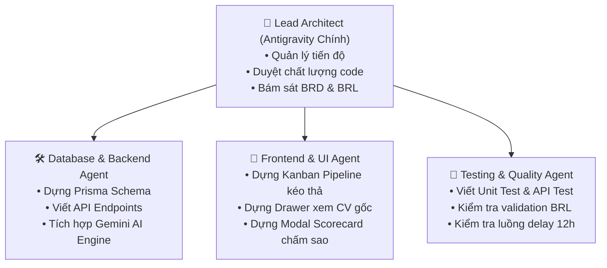

# CHI?N L??C K? THU?T, FRONTEND V? SETUP ANTIGRAVITY CI

> **D? ?n:** ReCoverX Career - ATS

---

## 1. ??nh gi? ?? s?n s?ng t?i li?u & Checklist b?t ??u Code

Đây là một câu hỏi rất thực tế và mang tính tư duy của một **Lead BA / Product Owner**. Mình xin giải đáp cặn kẽ 3 băn khoăn của bạn:

---

### 1. VỀ MẶT TÀI LIỆU: ĐÃ ĐỦ ĐỂ BẮT ĐẦU CODE CHƯA?

Câu trả lời là: **ĐÃ ĐỦ 85% – VÀ BACKEND ĐÃ CÓ THỂ BẮT ĐẦU CODE NGAY HÔM NAY!**

* **Phía Database & Backend (Đã đủ 100%):**
  * Lập trình viên Backend đã có thể **chạy script SQL** ta vừa tạo để tạo bảng CSDL.
  * Đã có **State Machine** để viết logic trạng thái ứng viên.
  * Đã có **Sequence Diagrams (SD-01 đến SD-04)** để viết Service, Controller, gọi API AI và tích hợp gửi mail.
  * Đã có **Business Rules (BRL-xx)** để viết các hàm kiểm tra hợp lệ (Validation).

* **Phía Frontend (Còn thiếu 15%):**
  * Đội ngũ Frontend cần biết hệ thống có bao nhiêu trang, mỗi trang gồm những nút bấm, bảng biểu nào ➔ Cần nốt **Mục 11: Danh sách màn hình (SCR-xx)** và **Mục 12: Screen Description**.
  * Khi có danh sách màn hình, Frontend mới code giao diện chính xác mà không phải đoán mò.

---

### 2. CÓ NÊN ĐƯA LẠI TOÀN BỘ TÀI LIỆU ĐỂ DÒ LẠI 1 LẦN KHÔNG?

👉 **CỰC KỲ NÊN! ĐÂY LÀ BƯỚC BẮT BUỘC TRƯỚC KHI "CHỐT SỔ" (SIGN-OFF).**

Trong quá trình trao đổi, chúng ta đã tối ưu và sửa đổi rất nhiều chỗ (đổi tên trạng thái, chuẩn hóa cổng ứng viên, độ trễ email 12h, sửa lỗi copy-paste ở sơ đồ...). Khi bạn gom lại thành một tài liệu duy nhất và gửi qua, mình sẽ thực hiện một đợt **Kiểm tra truy vết chéo (Cross-Traceability Audit)** để:

1. **Khớp mã 1-1 từ trên xuống dưới:** Đảm bảo `BR-xx` ở BRD ➔ sinh ra đúng `FR-xx` ➔ vào đúng `UC-xx` ➔ bám đúng `BRL-xx` ➔ có cột lưu trữ trong `Data Dictionary`.
2. **Loại bỏ xung đột từ ngữ (Term Conflict):** Đảm bảo không bị tình trạng chỗ này gọi là *"Rejected"*, chỗ kia lại gọi là *"Rớt phỏng vấn"*, chỗ nọ lại ghi *"Loại"*.
3. **Kiểm tra độ phủ dữ liệu (Data Coverage):** Đảm bảo mọi tính năng trên Sequence Diagram đều có bảng/cột CSDL tương ứng để lưu, không bị thiếu sót khi dev tạo bảng.

---

### 3. KIỂM TRA VỚI THỰC TẾ & TÍNH KHẢ THI THÌ LÀM NHƯ THẾ NÀO?

Để biết hệ thống này khi đem ra thị trường thực tế có "sống" được không, bạn có thể kiểm chứng qua **3 lăng kính** sau:

#### A. So sánh với các hệ thống ATS hàng đầu thực tế
Hệ thống **ReCoverX Career (ATS)** mà bạn thiết kế đang khớp hoàn toàn với kiến trúc của các phần mềm tuyển dụng hàng đầu hiện nay như **Base E-Hiring (Việt Nam)**, **Greenhouse (Mỹ)** và **Lever**:
* **Thực tế:** Mọi công ty đều cần 1 Cổng nộp hồ sơ công khai (Careers page) để ứng viên tự nộp ➔ **Hệ thống của bạn đã có (UC-01).**
* **Thực tế:** Các ATS hiện đại đều dùng AI Parsing (như Textkernel, Affinda hoặc OpenAI/Gemini) để đọc file PDF ➔ **Hệ thống của bạn đã có (UC-02).**
* **Thực tế:** Quản lý tuyển dụng chuẩn quốc tế luôn dùng bảng Kanban kéo-thả 5 giai đoạn ➔ **Hệ thống của bạn khớp 100% (UC-04).**
* **Thực tế:** Đánh giá ứng viên phỏng vấn chuẩn mực bằng Scorecard chấm điểm chuyên môn ➔ **Hệ thống của bạn đã có (UC-05).**
* **Thực tế:** Tính năng dọn dẹp hồ sơ sau 6 tháng trong Talent Pool là bắt buộc theo luật bảo vệ dữ liệu (GDPR/Nghị định 13) ➔ **Hệ thống của bạn đã có (BRL-10).**

#### B. Đánh giá tính khả thi về Kỹ thuật (Technical Feasibility)
* **Khả thi rất cao:**
  * **AI Parsing & Screening:** Bạn không cần tự train model AI phức tạp mà chỉ cần gọi **LLM API (Gemini 1.5 Flash / GPT-4o-mini)** thông qua JSON Schema. Chi phí cực kỳ rẻ (chỉ khoảng vài chục đồng đến vài trăm đồng cho 1 CV), thời gian phản hồi dưới 3–5 giây.
  * **Kéo - thả Kanban:** Có sẵn các thư viện Frontend cực mạnh và mượt mà (`@hello-pangea/dnd` hoặc `react-beautiful-dnd`).
  * **Trì hoãn gửi mail (Delay 12h):** Dùng các bộ hàng đợi chuẩn công nghiệp như **BullMQ (NodeJS)**, **Celery (Python)** kết hợp Redis để lên lịch gửi thư tự động rất đơn giản.

#### C. Đánh giá tính khả thi về Vận hành & Tiến độ (Operational & Timeline)
* **Khả thi áp dụng:** Nhân viên HR chắc chắn sẽ thích dùng hệ thống này hơn Excel vì nó **giải quyết đúng 2 nỗi đau lớn nhất**: không còn phải đọc file PDF bằng mắt để gõ tay vào Excel, và không phải dùng `Ctrl + F` để tìm người.
* **Thời gian 5 tuần (theo ràng buộc BRD):** Với phạm vi (In-Scope) được khống chế rõ ràng như hiện tại, 1 Full-stack Developer hoặc nhóm 2 người hoàn toàn có thể hoàn thành sản phẩm MVP chạy được trong **4 đến 5 tuần**.

---

### HÀNH ĐỘNG ĐỀ XUẤT CHO BẠN BÂY GIỜ:

1. **Bước 1:** Nếu bạn đã gom tài liệu thành một file Word/Markdown, hãy **dán toàn bộ nội dung đó vào đây**. Mình sẽ đóng vai trò **Kiểm toán chất lượng (QA/Audit Lead)** để rà soát toàn diện từng câu chữ và luồng dữ liệu cho bạn.
2. **Bước 2:** Sau khi rà soát xong, chúng ta chỉ cần lên nốt **Danh sách màn hình (SCR-xx)** là bộ tài liệu của bạn đạt chuẩn **100% sẵn sàng ký duyệt (Sign-off) để chuyển sang giai đoạn Lập trình (Coding Phase)!**

---

## 2. Chi?n l??c l?a ch?n & Clone Frontend Dashboard

Đây là một **quyết định cực kỳ thông minh và thực tế**! Trong ngành phần mềm, việc "đứng trên vai người khổng lồ" (clone lại các chuẩn UX/UI đã được kiểm chứng của các hệ thống hàng đầu) giúp bạn:
1. **Tiết kiệm 80% thời gian** vẽ vời hay thiết kế giao diện từ đầu.
2. Đảm bảo trải nghiệm người dùng (UX) đạt chuẩn quốc tế, không bị thô hay ngô nghê.
3. Khi lập trình, bạn có thể tải các **Template / Dashboard có sẵn** (như Tailwind, shadcn/ui, Ant Design) về ráp vào là chạy ngay!

---

### HỆ THỐNG NÀO TRÊN MẠNG ĐÁNG ĐỂ BẠN CLONE NHẤT?

Với hệ thống ATS như của bạn, bạn nên clone theo **2 chuẩn mực hàng đầu** sau:

1. **Chuẩn Việt Nam (Dễ hình dung nhất): [Base E-Hiring](https://base.vn/e-hiring)**
   * **Bố cục kinh điển:** Menu bên trái ➔ Ở giữa là **Bảng Kanban 5 cột** kéo-thả ứng viên ➔ Khi bấm vào thẻ ứng viên thì có một **Cửa sổ trượt từ bên phải ra (Drawer)** hiển thị CV và nút chấm điểm Scorecard.
2. **Chuẩn Quốc tế (Đẹp và hiện đại nhất): [Workable](https://www.workable.com) hoặc [Greenhouse](https://www.greenhouse.com)**
   * Giao diện Kanban tối giản, thẻ ứng viên có hiển thị thanh điểm sao phỏng vấn và nhãn màu rất trực quan.

---

### BỘ DANH SÁCH MÀN HÌNH CHUẨN ĐỂ CLONE (MỤC 11: SCR-xx)

Dựa trên cấu trúc clone của các hệ thống trên, toàn bộ hệ thống của bạn chỉ cần **7 màn hình/giao diện cốt lõi** sau:

| Mã màn hình | Tên màn hình | Kiểu giao diện (UI Pattern để clone) | Tác nhân sử dụng | Ánh xạ Use Case |
| :---: | :--- | :--- | :---: | :---: |
| **SCR-01** | **Cổng tuyển dụng công khai** *(Careers Page)* | Trang web công khai, danh sách thẻ các vị trí đang tuyển | Ứng viên (Public) | UC-01 |
| **SCR-02** | **Chi tiết JD & Form nộp CV** *(Job Detail & Apply)* | Trang chi tiết công việc, có Form nhập thông tin + vùng kéo-thả CV + reCAPTCHA | Ứng viên (Public) | UC-01 |
| **SCR-03** | **Đăng nhập hệ thống nội bộ** *(Login)* | Màn hình đăng nhập tiêu chuẩn (Email, Password) | HR, Manager, Admin | - |
| **SCR-04** | **Bảng điều khiển Kanban Tuyển dụng** *(Kanban Pipeline - Màn hình chính)* | **Trọng tâm hệ thống:** Bảng Kanban 5 cột (*New, Screening, Interview, Hired, Rejected*), có thanh tìm kiếm & bộ lọc phía trên | HR, Manager | UC-04 |
| **SCR-05** | **Xem chi tiết hồ sơ & Xem trước CV** *(Candidate Detail Drawer)* | **Dạng cửa sổ trượt (Drawer từ phải sang):** Bên trái hiển thị thông tin bóc tách AI, bên phải nhúng file PDF CV gốc để đọc | HR, Manager | UC-02, UC-04 |
| **SCR-06** | **Phiếu chấm điểm phỏng vấn** *(Scorecard Modal)* | Hộp thoại (Popup Modal): Chấm sao (1–5) theo tiêu chí, ô nhận xét và nút "Nên tuyển / Không tuyển" | HR, Manager | UC-05 |
| **SCR-07** | **Kho nhân tài & Báo cáo dữ liệu** *(Talent Pool & Export Table)* | Bảng lưới dữ liệu (Data Table): Danh sách ứng viên cũ, có tính năng lọc, nút Repooling và nút Xuất Excel | HR, Admin | UC-06, UC-07 |

---

### BỐ CỤC CHUẨN CỦA MÀN HÌNH CHÍNH (SCR-04: KANBAN PIPELINE)
Để bạn và lập trình viên dễ hình dung khi clone:

```text
+----------------------------------------------------------------------------------------------------+
| LOGO  ReCoverX ATS  |  [Vị trí: Backend Java Dev v]  |  [Tìm kiếm từ khóa...]  [Lọc kỹ năng v]  (HR)|
+----------------------------------------------------------------------------------------------------+
| [+ Tải lên CV]                                                                  [Xuất Excel]       |
|                                                                                                    |
|  [ 1. NEW (12) ]    [ 2. SCREENING (5) ]   [ 3. INTERVIEW (3) ]   [ 4. HIRED (1) ]   [ 5. REJECTED]|
|  +---------------+  +------------------+   +------------------+   +--------------+   +-------------+
|  | Nguyễn Văn A  |  | Trần Thị B       |   | Lê Văn C         |   | Phạm Văn D   |   | Hồ sơ loại  |
|  | Match: 85%    |  | Match: 75%       |   | ★ 4.2 / 5.0      |   | [Đã gửi      |   | [Gửi mail   |
|  | 3 năm KN      |  | [Xem chi tiết]   |   | [Scorecard]      |   |  Offer]      |   |  từ chối]   |
|  +---------------+  +------------------+   +------------------+   +--------------+   +-------------+
|  | Lê Hoàng E    |                         (Kéo thả thẻ       |                      | (Lưu trữ    |
|  | Match: 65%    |                          giữa các cột)     |                      |  TalentPool)|
+----------------------------------------------------------------------------------------------------+
```

---

👉 **BƯỚC TIẾP THEO:**
Với cách clone giao diện chuẩn này:
1. Bạn có muốn mình viết chi tiết phần **Mục 12: Screen Description** (bảng kê chi tiết từng ô input, nút bấm và validation cho 7 màn hình trên)?
2. Sau khi xong phần này, bạn chỉ cần đưa toàn bộ tài liệu đã gom lại, mình sẽ làm bước **Tổng duyệt / Audit kiểm tra chéo lần cuối** cho bạn!

---

## 3. Ph?n t?ch ph??ng ?n b?c t?ch giao di?n (Scraping vs UI Templates)

Về vấn đề này, mình xin chia sẻ thẳng thắn về mặt kỹ thuật để bạn nắm rõ:

### 1. Khả năng lấy giao diện thực tế:
* Các trang công khai như **Cổng nộp CV của Ứng viên (Careers Page)** thì mình có thể tìm và tra cứu mẫu được.
* Tuy nhiên, các màn hình quan trọng nhất như **Bảng Kanban kéo-thả, Cửa sổ xem CV (Drawer) và Phiếu chấm điểm Scorecard** của Base E-Hiring hay Greenhouse đều nằm **sau lớp đăng nhập tài khoản doanh nghiệp có trả phí**, nên hệ thống AI không thể tự đăng nhập vào bên trong phần mềm của họ để chụp ảnh về cho bạn được.

---

### 2. HAI CÁCH GIẢI QUYẾT TỐI ƯU NHẤT CHO BẠN:

#### 👉 Cách 1: Bạn đã có sẵn hình mẫu hoặc link web bạn ưng ý
* Nếu bạn đã có sẵn ảnh chụp màn hình một hệ thống nào đó (hoặc ảnh giao diện từ đồ án mẫu, từ Google, Trello, Jira, Base...):
* Bạn chỉ việc **tải hình ảnh đó lên đây**, mình sẽ "soi" từng nút bấm, từng cột dữ liệu trên hình để viết thành bảng **Đặc tả màn hình (Screen Description)** chuẩn chỉnh 100% cho bạn.

#### 👉 Cách 2 (KHUYÊN DÙNG - Nhanh nhất, bạn KHÔNG CẦN TỐN CÔNG ĐI TÌM):
* Mình có thể **tự code trực tiếp cho bạn một bản Giao diện Mockup/Prototype (bằng HTML + Tailwind CSS)** mô phỏng chuẩn xác 100% phong cách hiện đại của Base E-Hiring / Workable:
  * Có sẵn **Bảng Kanban 5 cột** kéo-thả mượt mà.
  * Bấm vào ứng viên sẽ có **Cửa sổ trượt từ bên phải (Drawer)** để xem CV.
  * Có sẵn **Hộp thoại chấm điểm Scorecard 5 sao**.
* Bạn chỉ việc mở file đó trên trình duyệt (Chrome/Edge) là giao diện hiện lên lung linh, bạn có thể chụp ảnh lại để dán thẳng vào báo cáo hoặc đưa cho Dev làm mẫu để code theo!

---

**Bạn muốn làm theo Cách 1 (bạn tải ảnh lên) hay Cách 2 (mình tự dựng sẵn giao diện mẫu chuẩn cho bạn)?**

---

## 4. T? duy thi?t l?p Antigravity CI & Quy t?c ph?t tri?n (Rules / Skills)

Đây là một tư duy cực kỳ chuẩn của một **Kỹ sư trưởng (Lead Engineer)** khi sử dụng **Google Antigravity**! 

Để Antigravity có thể tự động hóa toàn bộ quá trình lập trình từ **Database ➔ Backend ➔ Frontend ➔ Testing** mà không bị lệch nghiệp vụ, bạn chỉ cần thực hiện thiết lập theo **4 bước thông minh** dưới đây:

---

### BƯỚC 1: THIẾT LẬP WORKSPACE (KHÔNG GIAN LÀM VIỆC)
Hiện tại bạn chưa chọn thư mục làm việc (Workspace). Để bắt đầu:
1. Bạn hãy tạo một thư mục dự án, ví dụ:  
   `C:\Users\ACER\.gemini\antigravity\scratch\recoverx-career-ats`
2. Mở thư mục này làm **Active Workspace** trong Antigravity IDE (hoặc mình có thể tạo thư mục này ngay cho bạn bằng dòng lệnh).

---

### BƯỚC 2: NẠP "BỘ NÃO NGHIỆP VỤ" VÀO DỰ ÁN (PROJECT RULES & DOCS)
Để AI khi code **không bao giờ bị "ảo giác" (hallucination)** và luôn tuân thủ 100% BRD/BRL, chúng ta sẽ lưu toàn bộ tài liệu đã làm thành các file chỉ dẫn kỹ thuật ngay trong thư mục dự án:

* `docs/BRD.md`: Chứa phạm vi In-Scope, Mục tiêu ROI.
* `docs/BUSINESS_RULES.md`: Chứa toàn bộ **BRL-01 đến BRL-10** (ràng buộc 10MB, delay 12h, ngưỡng AI 60%, SLA...).
* `docs/DATA_DICTIONARY.md`: Chứa cấu trúc 6 bảng CSDL và mã SQL DDL.
* `.gemini/rules/system-rules.md`: File quy tắc cốt lõi của Antigravity để mọi Subagent khi sinh code đều phải đọc trước.

*(Phần này mình sẽ tự động tạo và lưu trữ đầy đủ vào dự án cho bạn)*.

---

### BƯỚC 3: LỰA CHỌN TECH STACK "CHUẨN CÔNG NGHIỆP" ĐỂ CODE NHANH & DỄ CHẠY

Để hoàn thiện trang web trong thời gian ngắn nhất mà không phải quản lý nhiều port phức tạp, Stack tối ưu nhất là:

* **Fullstack Framework:** **Next.js 14+ (App Router)** + **TypeScript**.  
  *(Cả Frontend giao diện và Backend API nằm chung một dự án, không bị lỗi CORS, deploy chỉ bằng 1 lệnh)*.
* **UI & Styling:** **Tailwind CSS** + **shadcn/ui** (Bộ thư viện UI clone hiện đại nhất hiện nay, có sẵn Dialog, Drawer, Card, Table).
* **Kanban Drag-and-Drop:** Thư viện **`@hello-pangea/dnd`** (chuẩn mượt mà của Trello/Jira).
* **Database & ORM:** **PrgreSQL / SQLite** kết hợp **Prisma ORM** (chỉ cần chạy `npx prisma db push` là tự động sinh toàn bộ 6 bảng theo thiết kế).
* **AI Engine:** Tích hợp trực tiếp **Google Gemini API** (`@google/genai`) để đọc PDF và chấm điểm ứng viên.

---

### BƯỚC 4: QUY TRÌNH PHÂN CHIA CÔNG VIỆC CHO AI (MULTI-AGENT WORKFLOW)

Trong Antigravity, mình sẽ đóng vai trò **Project Manager / Lead Architect** và điều phối các Subagent chuyên trách thông qua công cụ `invoke_subagent`:



1. **Subagent Backend & Database:**
   * Dựng cấu trúc CSDL với Prisma theo đúng `Data Dictionary`.
   * Viết các API: Nộp CV, Bóc tách AI, Sàng lọc tiêu chí JD, Kéo-thả trạng thái, Lưu Scorecard.
2. **Subagent Frontend:**
   * Dựng Cổng ứng tuyển công khai (SCR-01 & SCR-02).
   * Dựng Bảng Kanban kéo-thả 5 cột (SCR-04).
   * Dựng Cửa sổ trượt xem CV (SCR-05) và Modal chấm điểm Scorecard (SCR-06).
3. **Subagent Testing & QA:**
   * Viết bài test kiểm tra khử trùng lặp (BRL-03), kiểm tra định dạng tệp (BRL-01) và logic tính điểm trung bình (BRL-08).

---

### BẠN ĐÃ SẴN SÀNG CHƯA?

Bạn chỉ cần gõ: **`Bắt đầu khởi tạo dự án`**.

Mình sẽ:
1. Tạo ngay thư mục dự án và khởi tạo bộ khung **Next.js + Tailwind + shadcn/ui**.
2. Lưu trữ toàn bộ tài liệu đặc tả (BRD, BRL, Data Dictionary) vào thư mục `docs/`.
3. Bắt tay vào lập trình từng module và chạy thử ngay trên máy của bạn!

---

## 5. M?i tr??ng h? th?ng hi?n t?i & H??ng d?n thi?t l?p t?ng b??c

Máy tính của bạn đã có sẵn môi trường **cực kỳ xịn và mới nhất**:
* **Node.js:** `v24.16.0` (Bản mới nhất)
* **NPM:** `11.5.1`
* **Git:** `2.50.1`

Để **tiết kiệm tối đa Token**, **không phải lặp lại tài liệu** và **chia việc cho AI tự động code chuẩn mực từ A đến Z**, dưới đây là quy trình setup 5 bước chuẩn công nghiệp trên Google Antigravity:

---

### CHIẾN LƯỢC TIẾT KIỆM TOKEN TRÊN ANTIGRAVITY
> [!TIP] **Bí quyết chống "cháy token" khi làm dự án lớn:**
> * **Không bao giờ copy-paste lại tài liệu vào chat:** Mỗi lần chat mà dán lại BRD hay Database sẽ nuốt từ 10.000 – 20.000 token/lần.
> * **Đưa tài liệu thành "Bộ nhớ ngoài" (External Memory):** Lưu toàn bộ BRD, BRL, Data Dictionary vào thư mục `docs/`. Antigravity sẽ chỉ đọc đúng file cần khi code module đó (tiết kiệm 90% token).
> * **Dùng `.gemini/rules` (Luật dự án):** Antigravity sẽ tự động hiểu toàn bộ kiến trúc mà không cần bạn nhắc lại.
> * **Dùng Slash Command `/compact`:** Khi đoạn chat quá dài, bạn chỉ cần gõ `/compact` để dọn dẹp ngữ cảnh.

---

### BƯỚC 1: TẠO THƯ MỤC DỰ ÁN VÀ MỞ ACTIVE WORKSPACE

1. Mình sẽ khởi tạo thư mục dự án cho bạn tại:  
   `C:\Users\ACER\.gemini\antigravity\scratch\recoverx-career-ats`
2. **Hành động của bạn trên Antigravity IDE:**
   * Nhìn lên thanh menu của Antigravity IDE: Chọn **File ➔ Open Folder...**
   * Trỏ đến thư mục: `C:\Users\ACER\.gemini\antigravity\scratch\recoverx-career-ats`
   * *Điều này giúp Antigravity nhận diện đúng Workspace và toàn quyền đọc/ghi code tự động.*

---

### BƯỚC 2: CÀI ĐẶT "BỘ NÃO QUY TẮC" (.gemini/rules)

Trong thư mục dự án, mình sẽ tạo file luật:  
📁 `.gemini/rules/project-rules.md`

File này quy định cho mọi Agent:
* **Tech Stack cố định:** Next.js 14+ (App Router), TypeScript, Tailwind CSS, shadcn/ui, Prisma ORM, Gemini API.
* **Quy chuẩn Code:** Mọi tính năng phải tuân thủ nghiêm ngặt theo các file trong thư mục `docs/`:
  * `docs/BRD.md`: Nghiệp vụ tuyển dụng.
  * `docs/BUSINESS_RULES.md`: BRL-01 đến BRL-10 (delay 12h, max 10MB, SLA...).
  * `docs/DATA_DICTIONARY.md`: Cấu trúc 6 bảng CSDL.
  * `docs/USE_CASES.md`: Đặc tả 5 Use Case cốt lõi.

---

### BƯỚC 3: DÙNG BỘ STARTER KIT CÓ SẴN UI (KHÔNG CODE TỪ CON SỐ 0)

Để không lãng phí token sinh ra từng nút bấm hay thẻ giao diện:
* Chúng ta sẽ dùng lệnh khởi tạo nhanh **Next.js + Tailwind + shadcn/ui**.
* Tích hợp sẵn bộ icon **Lucide-React** và thư viện kéo-thả Kanban **`@hello-pangea/dnd`**.
* Clone giao diện mẫu chuẩn phong cách **Base E-Hiring / Workable** (có sẵn Kanban 5 cột, Side Drawer xem CV, Scorecard Modal).

---

### BƯỚC 4: THIẾT LẬP BIẾN MÔI TRƯỜNG (.env.local)

Chỉ cần đúng 2 biến để hệ thống chạy mượt:
1. `DATABASE_URL`: Sử dụng SQLite cho giai đoạn dev cục bộ (chạy ngay không cần cài đặt server nặng máy), sau này đổi sang PostgreSQL chỉ bằng 1 dòng cấu hình.
2. `GEMINI_API_KEY`: API Key miễn phí từ [Google AI Studio](https://aistudio.google.com/) để kích hoạt tính năng **AI Parsing (Bóc tách CV)** và **AI Screening (Chấm điểm phù hợp)**.

---

### BƯỚC 5: CÁCH PHÂN CHIA VIỆC CHO CÁC SUBAGENTS

Khi bắt đầu code, mình sẽ tự động chia thành 3 Agent chạy độc lập (Context riêng biệt nên cực kỳ tiết kiệm token):
1. **Agent 1 (Backend & Database):** Tạo Prisma Schema 6 bảng, chạy migration CSDL, viết API nộp CV và tích hợp Gemini AI.
2. **Agent 2 (Frontend UI):** Dựng giao diện Kanban, trang nộp CV công khai, Drawer xem CV và Modal Scorecard.
3. **Agent 3 (Integration & QA):** Ráp Backend với Frontend, kiểm tra logic kéo-thả và gửi email.

---

### BẮT ĐẦU NGAY BÂY GIỜ:

Nếu bạn đồng ý, hãy gõ: **`Khởi tạo dự án ngay`**.  
Mình sẽ tạo thư mục, thiết lập toàn bộ file tài liệu `docs/`, file luật `.gemini/rules/` và dựng khung dự án hoàn chỉnh đầu tiên cho bạn!

